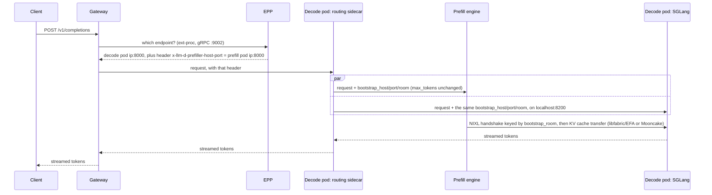

# SGLang prefill/decode disaggregation routed by llm-d

**Status: run on real hardware, working end to end.** This chart ports [`../../vllm/disagg-pd-llmd/`](../../vllm/disagg-pd-llmd/)'s own llm-d routing onto SGLang's engines, following the RFC's revised Decision 2 ([#37](https://github.com/littlemex/distai-platform/issues/37): both vLLM and SGLang route through llm-d by default; `../disagg-pd`'s own `sgl-model-gateway` router stays as a named, optional alternative, not the default).

On `us-east-1` (light tier, 2x `g7.8xlarge` + 1x `c7i.2xlarge`, 2026-11-24, commit `410f3cb`), a clean install of this chart with `decode.memFractionStatic=0.75` set reached `Running`/`Ready` on all three roles in 464s with zero restarts: decode's own KV cache allocated at startup (K/V 11.12GB each) with no OOM, no duplicate-port-name event anywhere among the namespace's own objects or Events, prefill and decode landed on different nodes, and the `HTTPRoute` reached `Accepted=True`/`ResolvedRefs=True`.

10 real requests through the Gateway all returned HTTP 200. The EPP's own `llm_d_epp_disagg_decision_total{decision_type="prefill-decode"}` counter read 10 afterward; its own per-request debug log counted `"Running scheduler profile"` prefill=10/decode=10 and `"Request handled"`=10. The decode pod's own routing sidecar's `llm_d_disagg_sidecar_disagg_requests_total{disagg_type="prefill-decode"}` reached 10, with `llm_d_disagg_sidecar_decode_duration_seconds_count` and `llm_d_disagg_sidecar_prefill_duration_seconds_count` both moving 0 -> 10. Both engines' own `sglang:num_requests_total` moved from 1 (its value before any of these 10 requests) to 11, and prefill's own `kv_transfer_latency_ms` and decode's own `kv_transfer_bootstrap_ms` histograms populated with nonzero values.

A 40-request open-loop load-replay against the same shared harness ([`../../_shared/`](../../_shared/)) the sibling charts use returned `successful_requests=40`, `failed_requests=0`, `joint_attainment_share=1.0`, `goodput_per_gpu=1.9951` at both this engine's own `TTFT<=2000ms`/`TPOT<=100ms` threshold and the `TTFT<=5000ms`/`TPOT<=500ms` threshold the same scorer also reports (identical at both: real p99 TTFT was 134ms, mean TPOT 2.16ms, far under either bound).

A `helm upgrade` changing the decode Pod template (`decode.extraArgs=["--disaggregation-decode-enable-radix-cache"]`) was watched for up to 6 minutes (polling every 10s): the old decode pod and a `Pending` new decode pod were never observed to coexist; the old pod was deleted and the new one reached `Running`/`Ready` at +93s elapsed, well inside that window, and one further real request after the upgrade returned HTTP 200 from the new pod.

After that upgrade, the EFA hardware counters on each role's own node (`/sys/class/infiniband/*/ports/1/hw_counters`) were read before and after 5 further requests sent to the new decode pod (now running with `--disaggregation-decode-enable-radix-cache`): prefill's `tx_bytes`/`rdma_write_bytes` and decode's `rx_bytes`/`rdma_write_recv_bytes` moved by the same 32,576-byte delta on both sides -- byte-for-byte symmetric, with `rdma_read_bytes` staying 0 on both nodes throughout, confirming EFA traffic between the two engines is carried by an RDMA write from prefill to decode, not a read. See "Known issues" for the three previously found defects this round confirms fixed.

This chart serves the same prefill and decode engines as [`../disagg-pd/`](../disagg-pd/) (SGLang's own NIXL/Mooncake transfer backend, the same placement and transport values), but routes requests with the [llm-d](https://github.com/llm-d/llm-d) router instead of that chart's own `sgl-model-gateway`: a Gateway API `HTTPRoute` sends each request to an `InferencePool`, the Gateway asks llm-d's Endpoint Picker (EPP) which pod to use, and a routing sidecar in each decode pod injects SGLang's own bootstrap fields into the calls it makes to both the prefill pod the EPP chose and its own decode engine.

The aggregated baseline to compare against is [`../agg-baseline/`](../agg-baseline/); the load generator, the scorer and the dashboard are in [`../../_shared/`](../../_shared/).

## What changes compared with `sgl-model-gateway`

The routing layer differs, as the table below details; the engine pods and their placement are rendered the same way by both charts, but the KV transfer is **not** quite identical -- this chart always sets SGLang's own staging-buffer environment variables (`SGLANG_DISAGG_STAGING_BUFFER*`), which `../disagg-pd` does not set at all (see Known issues). Measuring this chart against `../disagg-pd` therefore measures that difference together with the routing layer, not the routing layer alone.

| | [`../disagg-pd/`](../disagg-pd/) | This chart |
| --- | --- | --- |
| Entry point | A `ClusterIP` Service in front of the `sgl-model-gateway` router | An `HTTPRoute` on a Gateway the cluster administrator provides |
| Who picks the prefill and the decode pod | `sgl-model-gateway`, by `router.prefillPolicy`/`decodePolicy` (`round_robin` by default) over the engines it finds through the Kubernetes API | The EPP, per request: the prefill profile picks the prefill pod with the least queued prompt tokens (`token-load-scorer`), the decode profile the decode pod with the fewest in-flight requests (`active-request-scorer`) |
| Who tells decode where to bootstrap from | `sgl-model-gateway` reads the prefill pod's own `sglang.ai/bootstrap-port` annotation and sets `bootstrap_host`/`bootstrap_port`/`bootstrap_room` on the request itself | The routing sidecar in the decode pod the EPP picked, reading `routingSidecar.bootstrapPort` (an explicit value, not a pod-annotation lookup) |
| How prefill and decode are called | `sgl-model-gateway` calls both concurrently | The routing sidecar calls both concurrently (llm-d-router v1.0.0's `connector_sglang.go`) -- same concurrency, different caller |
| If routing cannot be decided | `sgl-model-gateway` returns an error (`router.disableRetries: true`, that chart's own default) | `failureMode: FailClose`: the Gateway rejects the request instead of sending it to an arbitrary pool member |
| Single point of failure | One router pod | One EPP pod (see [Known issues](#known-issues)) |

## How a request flows



Unlike [`../../vllm/disagg-pd-llmd/`](../../vllm/disagg-pd-llmd/)'s own sidecar (which calls prefill, waits for the `kv_transfer_params` it returns, and only then calls decode), SGLang's engines run their own handshake once both calls land, keyed by one `bootstrap_room` id the sidecar generates per request -- the sidecar calls both roles concurrently and does not sit in the data path between them. With `routingSidecar.ssrfProtection=true` (default) the sidecar refuses a prefill address that is not a pod of this release's own `InferencePool`.

## Upstream components

Every routing object is rendered by llm-d's own router chart, used as a dependency of this chart rather than rewritten; the CRDs come from their own projects' release manifests. See [`../../vllm/disagg-pd-llmd/README.md`](../../vllm/disagg-pd-llmd/README.md#upstream-components) for the full version table (identical here: same router chart, same EPP image, same Gateway API and Inference Extension CRD versions -- `llm-d-router v1.0.0` ships one EPP image and one router chart for every `modelServers.type` it supports).

What differs for SGLang specifically:

| Component | This chart | Source |
| --- | --- | --- |
| `modelServers.type` | `sglang` | [llm-d-router `v1.0.0`, `config/charts/routerlib/values.yaml`](https://github.com/llm-d/llm-d-router/blob/v1.0.0/config/charts/routerlib/values.yaml) lists `vllm, sglang, triton-tensorrt-llm, trtllm-serve, triton` as the supported values |
| Routing sidecar connector | `routingSidecar.kvConnector: sglang` (`constants.KVConnectorSGLang`), a distinct implementation from vLLM's `nixlv2` | [`pkg/sidecar/proxy/connector_sglang.go`](https://github.com/llm-d/llm-d-router/blob/v1.0.0/pkg/sidecar/proxy/connector_sglang.go) |
| Bootstrap port | `routingSidecar.bootstrapPort` / `SGLANG_BOOTSTRAP_PORT` env (default `8998` if unset upstream; this chart always sets it, and `disagg.validateRouting` fails the render if it disagrees with `transport.bootstrapPort`) | Same file, `sglangBootstrapPort` |
| EPP scheduling | Same plugin list as `../../vllm/disagg-pd-llmd` (`always-disagg-pd-decider`, `prefill-filter`/`decode-filter`, `token-load-scorer`, `active-request-scorer`, `max-score-picker`) | "Must use `always-disagg-pd-decider`: a decode worker has no local-prefill path" -- [llm-d `v1.0.0`'s own pd-disaggregation guide](https://github.com/llm-d/llm-d/tree/v1.0.0/guides/pd-disaggregation/modelserver/gpu/sglang) |
| Engine launch flags | `--disaggregation-mode`, `--disaggregation-transfer-backend`, `--disaggregation-bootstrap-port` (prefill only) | Same guide, `modelserver/gpu/sglang/base/disaggregatedset.yaml` |
| AWS/EFA env | `SGLANG_DISAGGREGATION_NIXL_BACKEND=LIBFABRIC` is rendered; llm-d's own AWS patch also adds an `IPC_LOCK` capability, which this chart does **not** add (same gap `../disagg-pd` already documents in its own Known issues -- see this chart's own Known issues) | Same guide, `modelserver/gpu/sglang/aws/patch-{prefill,decode}.yaml` |
| Staging buffer env (`SGLANG_DISAGG_STAGING_BUFFER*`) | Always set (see `templates/engines.yaml`'s own comment for why "only when TP differs" was rejected); `../disagg-pd` does not set these at all -- see "What changes" above and Known issues | Same guide's base manifest: "required for heterogeneous TP for non-MLA models" |

llm-d's own guide deploys the engines as a `DisaggregatedSet` (a LeaderWorkerSet-based CRD). This chart keeps two ordinary Deployments instead, for the same reason `../../vllm/disagg-pd-llmd` does: so the placement rules of [`../disagg-pd/`](../disagg-pd/) (RFC Decision 3) apply unchanged and no `DisaggregatedSet` controller is needed. This chart also uses the Gateway variant of the router chart, not the standalone variant (an Envoy proxy inside the EPP pod, no Gateway object) that [awsome-distributed-ai#1350](https://github.com/awslabs/awsome-distributed-ai/pull/1350) uses for SGLang -- see [#37](https://github.com/littlemex/distai-platform/issues/37)'s own comparison for why standalone mode was not adopted here.

## Switching routing behavior

`llmdRouter.router.epp.pluginsCustomConfig['pd-config.yaml']` is a plain Helm value (a YAML document given as a string); Helm never templates `values.yaml`, so it cannot be driven by a boolean toggle the way a `templates/*.yaml` file could be. It is switched the same way any Helm value is switched: override it wholesale with `-f` or `--set-file`. Two ready-made alternates:

- **Add prefix-cache affinity.** Append a `prefix-cache-affinity-filter` entry to `plugins` and to the `prefill` scheduling profile's own `plugins` list, with `parameters: {peakPrefillThroughput: <measured tokens/sec>, maxTTFTPenaltyMs: 500}`. `peakPrefillThroughput` is a throughput measured for one model on one GPU type ([`../../vllm/disagg-pd-llmd/README.md`](../../vllm/disagg-pd-llmd/README.md) explains why this chart's sibling drops it for the same reason); calibrate it for this release's own model and hardware with llm-d `v1.0.0`'s own [`guides/recipes/router/calibration/calibrate.sh`](https://github.com/llm-d/llm-d/tree/v1.0.0/guides/recipes/router/calibration) before using an unmeasured number.
- **Drop load-aware scoring (a load-blind baseline).** Remove `token-load-scorer` and `active-request-scorer` from `plugins` and from both scheduling profiles. With no scorer, `max-score-picker` has nothing to rank the filtered candidates by and picks one roughly arbitrarily -- useful only as a baseline to compare the scorers' own effect against, not a recommended setting.

## Prerequisites

Same as [`../../vllm/disagg-pd-llmd/#prerequisites`](../../vllm/disagg-pd-llmd/#prerequisites): the Gateway API and Gateway API Inference Extension CRDs (`v1.6.2`), a Gateway implementation and a `Gateway` object the cluster administrator provides (follow that README's own `NginxProxy`/`GatewayClass`/`Gateway` ordering to avoid ever creating a `LoadBalancer`-type Service), plus everything [`../disagg-pd/#prerequisites`](../disagg-pd/#prerequisites) needs for the engines themselves (NVIDIA GPU nodes, the NVIDIA and EFA device plugins, nodes labeled for each role).

## Deploy

```bash
git clone https://github.com/littlemex/distai-platform.git
cd distai-platform
export NAMESPACE=sglang-pd-demo
export RELEASE=sglang-pd
export MODEL_ID="${MODEL_ID:?set MODEL_ID to a Hugging Face model repository id}"
export PREFILL_NODE="${PREFILL_NODE:?set PREFILL_NODE to a GPU node name}"
export DECODE_NODE="${DECODE_NODE:?set DECODE_NODE to another GPU node name}"
export GATEWAY_NAME=llm-d-inference-gateway
export GATEWAY_NAMESPACE="${GATEWAY_NAMESPACE:?set GATEWAY_NAMESPACE to the namespace of the Gateway}"

kubectl label node "$PREFILL_NODE" distai.dev/pd-role=prefill --overwrite
kubectl label node "$DECODE_NODE" distai.dev/pd-role=decode --overwrite

helm dependency build examples/inference/sglang/disagg-pd-llmd
helm install "$RELEASE" examples/inference/sglang/disagg-pd-llmd \
  --namespace "$NAMESPACE" --create-namespace \
  --set model.name="$MODEL_ID" \
  --set llmdRouter.httpRoute.inferenceGatewayName="$GATEWAY_NAME" \
  --set llmdRouter.httpRoute.inferenceGatewayNamespace="$GATEWAY_NAMESPACE"
kubectl rollout status deployment -n "$NAMESPACE" -l app.kubernetes.io/instance="$RELEASE" --timeout=40m
kubectl rollout status deployment "$RELEASE-epp" -n "$NAMESPACE" --timeout=10m
```

## Verify

Same two checks as [`../../vllm/disagg-pd-llmd/#verify`](../../vllm/disagg-pd-llmd/#verify): pod placement and the `HTTPRoute`'s own `Accepted`/`ResolvedRefs` status.

```bash
kubectl get pods -n "$NAMESPACE" -l app.kubernetes.io/instance="$RELEASE" -o wide
kubectl get httproute "$RELEASE" -n "$NAMESPACE" \
  -o jsonpath='{range .status.parents[*].conditions[*]}{.type}={.status} {end}{"\n"}'
```

Send one request through the Gateway from inside the cluster:

```bash
export GATEWAY_ADDRESS="$(kubectl get gateway "$GATEWAY_NAME" -n "$GATEWAY_NAMESPACE" -o jsonpath='{.status.addresses[0].value}')"
kubectl run curl-pd --rm -i --restart=Never -n "$NAMESPACE" \
  --image=curlimages/curl:8.23.0 -- \
  curl -sS "http://$GATEWAY_ADDRESS/v1/completions" \
  -H 'Content-Type: application/json' \
  -d "{\"model\": \"$MODEL_ID\", \"prompt\": \"The capital of France is\", \"max_tokens\": 32}"
```

## Confirm the EPP split each request

Same three independent records as [`../../vllm/disagg-pd-llmd/#confirm-the-epp-split-each-request`](../../vllm/disagg-pd-llmd/#confirm-the-epp-split-each-request): the EPP's own `llm_d_epp_disagg_decision_total{decision_type="prefill-decode"}` counter, the EPP's own per-request log (`"Running scheduler profile"` with `"profile":"prefill"` then `"profile":"decode"`, one `"Request handled"` line naming the decode pod's `ip:8000`), and the decode pod's own routing sidecar metrics/log -- read the same way, against this release's own namespace and release name. At `routingSidecar.logLevel=4` the sidecar additionally logs the `bootstrap_host`/`bootstrap_port`/`bootstrap_room` it injected for every request (`connector_sglang.go`), where `../../vllm/disagg-pd-llmd`'s own sidecar logs `"sending prefill request"` with the prefill pod's `ip:port` instead. This shows what the sidecar sent, not that either engine received or acted on it; the engine-side checks below are what confirm arrival.

**Confirmed on real hardware** (2026-11-24, see Status): each role's own per-request completion counter (`sglang:num_requests_total`, not a token counter) moved from 1 to 11 across 10 requests on both prefill and decode -- unlike vLLM's own prefill (which this chart's diagram notes runs with `max_tokens` unchanged, not vLLM's `max_tokens=1` pattern, so a token count is not the right signal for either role here) -- and a further 5 requests, sent after the `helm upgrade` above (so against the post-upgrade decode pod, now running with `--disaggregation-decode-enable-radix-cache`), produced a byte-for-byte symmetric 32,576-byte delta on the EFA write/write-receive counters between prefill and decode, with `rdma_read_bytes` staying at 0 on both nodes -- confirming the path and direction of the EFA traffic (prefill writes to decode), not the volume of any one request's KV cache (same check as [`../disagg-pd`, "Check which path the KV cache took"](../disagg-pd/#check-which-path-the-kv-cache-took)).

## Measure

Use the in-cluster load replay and the scorer in [`../../_shared/`](../../_shared/) with `TARGET_URL=http://$GATEWAY_ADDRESS`, then run the same trace against [`disagg-pd`](../disagg-pd/) (the `sgl-model-gateway` baseline) and the [aggregated baseline](../agg-baseline/) on the same hardware, the same way `../../vllm/disagg-pd-llmd`'s own README recommends. Record `llm_d_epp_disagg_decision_total` before and after every run. **This comparison does not isolate the routing layer alone** (see "What changes" above): this chart's staging-buffer env differs from `../disagg-pd`'s, so a difference between the two also reflects that, not only the router.

## Values

Every key from `image` through `engine` has the same meaning and default as [`../disagg-pd`'s own values table](../disagg-pd/#values). `llmdRouter.*` has the same meaning and default as [`../../vllm/disagg-pd-llmd`'s own values table](../../vllm/disagg-pd-llmd/#values), with `modelServers.type: sglang` and `modelServers.matchLabels: {distai.dev/llm-d-pool: sglang-disagg-pd-llmd}`. The routing-specific values that differ from the vLLM chart:

| Value | Default | Meaning |
| --- | --- | --- |
| `routingSidecar.kvConnector` | `sglang` | `constants.KVConnectorSGLang`; runs `connector_sglang.go`'s concurrent-call, bootstrap-injecting flow |
| `routingSidecar.bootstrapPort` | `8998` | Rendered as the sidecar's `SGLANG_BOOTSTRAP_PORT` env; must equal `transport.bootstrapPort` (the chart fails to render otherwise) |
| `transport.backend` | `NIXL` | `NIXL` or `MOONCAKE` -- same meaning as `../disagg-pd`'s own `transport.backend` |
| `transport.sglangNixlBackend` | `LIBFABRIC` | `LIBFABRIC` (EFA) or `UCX`, used with `backend: NIXL` |
| `transport.mooncakeProtocol` | `efa` | `efa` or `tcp`, used with `backend: MOONCAKE` |
| `transport.bootstrapPort` | `8998` | Prefill's `--disaggregation-bootstrap-port`; must equal `routingSidecar.bootstrapPort` |
| `prefill.memFractionStatic` / `decode.memFractionStatic` | `""` | `--mem-fraction-static`; empty omits the flag (SGLang's own automatic sizing). See Known issues: decode may need this set explicitly on a small GPU |
| `engine.stagingBufferSizeMb` / `engine.stagingPoolSizeMb` | `64` / `4096` | `SGLANG_DISAGG_STAGING_BUFFER_SIZE_MB` / `SGLANG_DISAGG_STAGING_POOL_SIZE_MB`, rendered on both roles; llm-d's own guide defaults |

## Known issues

- **Decode OOMs at startup against the fixed-size NIXL staging pool unless `decode.memFractionStatic` is set; fixed and confirmed on real hardware.** SGLang's own automatic `--mem-fraction-static` sizing does not know about `engine.stagingPoolSizeMb` (the NIXL staging pool this chart always reserves for the connector). On the 2026-11-23 round, on a `g7.8xlarge` (31.4GiB GPU) with the value unset, this left only about 2.2GiB free and decode crash-looped: `torch.OutOfMemoryError: CUDA out of memory. Tried to allocate 4.00 GiB. GPU 0 has a total capacity of 31.38 GiB of which 2.21 GiB is free. Including non-PyTorch memory, this process has 29.14 GiB memory in use.`, raised from `scheduler.py init_disaggregation -> decode.py _init_kv_manager -> nixl/conn.py _init_staging_decode_ctx -> common/staging_buffer.py`'s `torch.empty(size_bytes...)`; the preceding log line on that round showed the KV cache alone already taking `K size: 13.18 GB, V size: 13.18 GB`. Prefill does not allocate this pool and is unaffected. `decode.memFractionStatic=0.75` (this chart's own value for the same flag) is confirmed working on the same hardware and model (2026-11-24, see Status): a clean install using it reached decode `Running`/`Ready` with zero restarts, its own KV cache allocated at startup (K/V 11.12GB each) with no OOM. Left unset by default (see that value's own comment for why); set it whenever the default collides on a given GPU/model shape.
- **The decode pod's sidecar and SGLang container must not both name their own port "http"; fixed and confirmed on real hardware.** A duplicate port name produces this warning: `spec.template.spec.containers[0].ports[0]: duplicate port name "http" with spec.template.spec.initContainers[0].ports[0], services and probes that select ports by name will use spec.template.spec.initContainers[0].ports[0]` -- any probe or Service on either container that selects a port by name, rather than by number, becomes ambiguous between the two. Fixed by naming the SGLang container's port `engine` on the decode role specifically (matching `../../vllm/disagg-pd-llmd`'s own `$vllmPortName` ternary), so the two containers' port names no longer collide (`sglang: engine=8200 nixl=5600`). Confirmed on real hardware (2026-11-24, see Status): a check across every object and Event in the namespace after a clean install found no duplicate-port-name warning, and the decode pod reached `Running`/`Ready` with zero restarts.
- **Any `helm upgrade` that changes the decode Pod template deadlocks when decode's own pool is sized to fit exactly one node, unless the Deployment uses `Recreate`; fixed and confirmed on real hardware.** The default `RollingUpdate` strategy tries to schedule a surge pod before deleting the old one; this chart's own `pool.limits` (the shape this chart's own Deploy section and PR #51's own Test Plan use) has no room for a second pod on decode's own node. On the 2026-11-23 round, before this fix, that left a surge pod `Pending` for 35 minutes (`0/5 nodes are available: 1 Insufficient nvidia.com/gpu, 1 Insufficient vpc.amazonaws.com/efa, ...`) while the old pod kept the node's only GPU and EFA device. Fixed by rendering `strategy: Recreate` unconditionally (previously only under `placement.sameNodeMeasurement`). Confirmed on real hardware (2026-11-24, see Status): a `helm upgrade` changing `decode.extraArgs` was watched for up to 6 minutes (polling every 10s) without the old pod and a `Pending` new pod ever coexisting; the old pod was deleted and the new one reached `Running`/`Ready` at +93s elapsed, and one further real request after the upgrade returned HTTP 200 from the new pod. Decode's own availability cost that 93s in this run -- an improvement over the deadlock it replaces, not a guarantee of this exact duration on every upgrade.
- **`networkPolicy.enabled=true` (default off) does not admit the Gateway implementation's own data-plane Pod, the EPP's own `ext_proc` caller, or a Prometheus scrape.** The chart can only state the one rule it has enough information to get right (the peer-role KV/bootstrap/engine-port traffic covered above); turning this on without also adding the administrator's own matching allow rules for the Gateway's data plane and any scraper blocks real traffic, the same gap `../../vllm/disagg-pd-llmd`'s own README already documents for itself.
- Everything `../disagg-pd` lists under its own Known issues about the engines (SGLang's own `/health` cost, the `emptyDir` model cache, no `IPC_LOCK` capability -- llm-d's own AWS reference patch adds it, this chart does not, see "Upstream components" above) applies here unchanged; everything `../../vllm/disagg-pd-llmd` lists about the routing layer (one EPP pod, `failureMode: FailClose`, the EPP seeing only GPU-resident KV blocks) applies here unchanged too.
- **This chart's KV transfer is not identical to `../disagg-pd`'s own**, unlike the vLLM pair (`disagg-pd` vs `disagg-pd-llmd`), where only routing differs: this chart always sets `SGLANG_DISAGG_STAGING_BUFFER*` (llm-d's own guide default, "required for heterogeneous TP for non-MLA models"), and `../disagg-pd` sets none of these. A measured difference between the two charts reflects both the staging buffer and the router, not the router alone; disclosed in "What changes" and "Measure" above, not fixed here (fixing it means deciding whether `../disagg-pd` should also set these, which needs its own real-hardware check, out of this chart's own scope).
- The staging-buffer sizes (`engine.stagingBufferSizeMb`/`engine.stagingPoolSizeMb`, `64`/`4096` by default) are llm-d's own guide defaults; raising `stagingPoolSizeMb` without lowering `decode.memFractionStatic` to match reproduces the OOM above.
- `tests/1.e2e.sh` does not cover this chart (same gap `../../vllm/disagg-pd-llmd`'s own Known issues names for itself); `tests/0.static.sh` does cover it (helm lint/template, the ssrfProtection=false dangling-volumeMount check, kubeconform) as of this round, but the SGLang-specific placement/transport values-contract depth that already covers the vLLM charts does not.

## Clean up

```bash
helm uninstall "$RELEASE" -n "$NAMESPACE"
kubectl label node "$PREFILL_NODE" distai.dev/pd-role-
kubectl label node "$DECODE_NODE" distai.dev/pd-role-
kubectl delete namespace "$NAMESPACE"
```

The Gateway API and Gateway API Inference Extension CRDs are cluster-wide and shared with any other user of them; remove them only if nothing else uses them.
