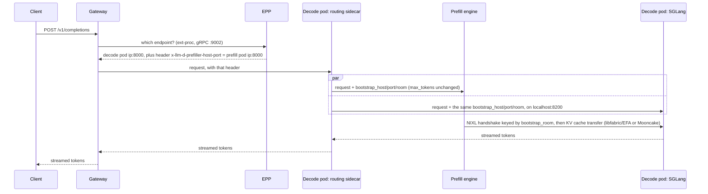

# SGLang prefill/decode disaggregation routed by llm-d

**Status: chart and README only, static checks pending; not yet run on real hardware.** This chart ports [`../../vllm/disagg-pd-llmd/`](../../vllm/disagg-pd-llmd/)'s own llm-d routing onto SGLang's engines, following the RFC's revised Decision 2 ([#37](https://github.com/littlemex/distai-platform/issues/37): both vLLM and SGLang route through llm-d by default; `../disagg-pd`'s own `sgl-model-gateway` router stays as a named, optional alternative, not the default). Real-machine verification (a request through the Gateway, the EPP's own decision counter and log, and the EFA counters on both roles) is tracked in [#37](https://github.com/littlemex/distai-platform/issues/37) the same way `../../vllm/disagg-pd-llmd`'s own first round was.

This chart serves the same prefill and decode engines as [`../disagg-pd/`](../disagg-pd/) (SGLang's own NIXL/Mooncake transfer backend, the same placement and transport values), but routes requests with the [llm-d](https://github.com/llm-d/llm-d) router instead of that chart's own `sgl-model-gateway`: a Gateway API `HTTPRoute` sends each request to an `InferencePool`, the Gateway asks llm-d's Endpoint Picker (EPP) which pod to use, and a routing sidecar in each decode pod injects SGLang's own bootstrap fields into the prefill call the EPP chose.

The aggregated baseline to compare against is [`../agg-baseline/`](../agg-baseline/); the load generator, the scorer and the dashboard are in [`../../_shared/`](../../_shared/).

## What changes compared with `sgl-model-gateway`

Only the routing layer differs; the engine pods, their placement and the KV transfer are rendered the same way by both charts.

| | [`../disagg-pd/`](../disagg-pd/) | This chart |
| --- | --- | --- |
| Entry point | A `ClusterIP` Service in front of the `sgl-model-gateway` router | An `HTTPRoute` on a Gateway the cluster administrator provides |
| Who picks the prefill and the decode pod | `sgl-model-gateway`, by `router.prefillPolicy`/`decodePolicy` (`round_robin` by default) over the engines it finds through the Kubernetes API | The EPP, per request: the prefill profile picks the prefill pod with the least queued prompt tokens (`token-load-scorer`), the decode profile the decode pod with the fewest in-flight requests (`active-request-scorer`) |
| Who tells decode where to bootstrap from | `sgl-model-gateway` reads the prefill pod's own `sglang.ai/bootstrap-port` annotation and sets `bootstrap_host`/`bootstrap_port`/`bootstrap_room` on the request itself | The routing sidecar in the decode pod the EPP picked, reading `routingSidecar.bootstrapPort` (an explicit value, not a pod-annotation lookup) |
| How prefill and decode are called | `sgl-model-gateway` calls both concurrently | The routing sidecar calls both concurrently (llm-d-router v1.0.0's `connector_sglang.go`) -- same concurrency, different caller |
| If routing cannot be decided | `sgl-model-gateway` returns an error (`router.disableRetries: true`, this chart's own default) | `failureMode: FailClose`: the Gateway rejects the request instead of sending it to an arbitrary pool member |
| Single point of failure | One router pod | One EPP pod (see [Known issues](#known-issues)) |

## How a request flows



Unlike [`../../vllm/disagg-pd-llmd/`](../../vllm/disagg-pd-llmd/)'s own sidecar (which calls prefill, waits for the `kv_transfer_params` it returns, and only then calls decode), SGLang's engines run their own handshake once both calls land, keyed by one `bootstrap_room` id the sidecar generates per request -- the sidecar calls both roles concurrently and does not sit in the data path between them. With `routingSidecar.ssrfProtection=true` (default) the sidecar refuses a prefill address that is not a pod of this release's own `InferencePool`.

## Upstream components

Every routing object is rendered by llm-d's own router chart, used as a dependency of this chart rather than rewritten; the CRDs come from their own projects' release manifests. See [`../../vllm/disagg-pd-llmd/README.md`](../../vllm/disagg-pd-llmd/README.md#upstream-components) for the full version table (identical here: same router chart, same EPP image, same Gateway API and Inference Extension CRD versions -- `llm-d-router v1.0.0` ships one EPP image and one router chart for every `modelServers.type` it supports).

What differs for SGLang specifically:

| Component | This chart | Source |
| --- | --- | --- |
| `modelServers.type` | `sglang` | [llm-d-router `v1.0.0`, `config/charts/routerlib/values.yaml`](https://github.com/llm-d/llm-d-router/blob/v1.0.0/config/charts/routerlib/values.yaml) lists `vllm, sglang, triton-tensorrt-llm, trtllm-serve, triton` as the supported values |
| Routing sidecar connector | `routingSidecar.kvConnector: sglang` (`constants.KVConnectorSGLang`), a distinct implementation from vLLM's `nixlv2` | [`pkg/sidecar/proxy/connector_sglang.go`](https://github.com/llm-d/llm-d-router/blob/v1.0.0/pkg/sidecar/proxy/connector_sglang.go) |
| Bootstrap port | `routingSidecar.bootstrapPort` / `SGLANG_BOOTSTRAP_PORT` env (default `8998` if unset upstream; this chart always sets it, and `disagg.validateRouting` fails the render if it disagrees with `transport.bootstrapPort`) | Same file, `sglangBootstrapPort` |
| EPP scheduling | Same plugin list as `../../vllm/disagg-pd-llmd` (`always-disagg-pd-decider`, `prefill-filter`/`decode-filter`, `token-load-scorer`, `active-request-scorer`, `max-score-picker`) | "Must use `always-disagg-pd-decider`: a decode worker has no local-prefill path" -- [llm-d `v1.0.0`'s own pd-disaggregation guide](https://github.com/llm-d/llm-d/tree/v1.0.0/guides/pd-disaggregation/modelserver/gpu/sglang) |
| Engine launch flags | `--disaggregation-mode`, `--disaggregation-transfer-backend`, `--disaggregation-bootstrap-port` (prefill only) | Same guide, `modelserver/gpu/sglang/base/disaggregatedset.yaml` |
| AWS/EFA env | `SGLANG_DISAGGREGATION_NIXL_BACKEND=LIBFABRIC`, `IPC_LOCK` capability | Same guide, `modelserver/gpu/sglang/aws/patch-{prefill,decode}.yaml` |
| Staging buffer env (`SGLANG_DISAGG_STAGING_BUFFER*`) | Always set (see `templates/engines.yaml`'s own comment for why "only when TP differs" was rejected) | Same guide's base manifest: "required for heterogeneous TP for non-MLA models" |

llm-d's own guide deploys the engines as a `DisaggregatedSet` (a LeaderWorkerSet-based CRD). This chart keeps two ordinary Deployments instead, for the same reason `../../vllm/disagg-pd-llmd` does: so the placement rules of [`../disagg-pd/`](../disagg-pd/) (RFC Decision 3) apply unchanged and no `DisaggregatedSet` controller is needed. This chart also uses the Gateway variant of the router chart, not the standalone variant (an Envoy proxy inside the EPP pod, no Gateway object) that [awsome-distributed-ai#1350](https://github.com/awslabs/awsome-distributed-ai/pull/1350) uses for SGLang -- see [#37](https://github.com/littlemex/distai-platform/issues/37)'s own comparison for why standalone mode was not adopted here.

## Switching routing behavior

`llmdRouter.router.epp.pluginsCustomConfig['pd-config.yaml']` is a plain Helm value (a YAML document given as a string); Helm never templates `values.yaml`, so it cannot be driven by a boolean toggle the way a `templates/*.yaml` file could be. It is switched the same way any Helm value is switched: override it wholesale with `-f` or `--set-file`. Two ready-made alternates:

- **Add prefix-cache affinity.** Append a `prefix-cache-affinity-filter` entry to `plugins` and to the `prefill` scheduling profile's own `plugins` list, with `parameters: {peakPrefillThroughput: <measured tokens/sec>, maxTTFTPenaltyMs: 500}`. `peakPrefillThroughput` is a throughput measured for one model on one GPU type ([`../../vllm/disagg-pd-llmd/README.md`](../../vllm/disagg-pd-llmd/README.md) explains why this chart's sibling drops it for the same reason); calibrate it for this release's own model and hardware with llm-d `v1.0.0`'s own [`guides/recipes/router/calibration/calibrate.sh`](https://github.com/llm-d/llm-d/tree/v1.0.0/guides/recipes/router/calibration) before using an unmeasured number.
- **Drop load-aware scoring (a load-blind baseline).** Remove `token-load-scorer` and `active-request-scorer` from `plugins` and from both scheduling profiles. With no scorer, `max-score-picker` has nothing to rank the filtered candidates by and picks one roughly arbitrarily -- useful only as a baseline to compare the scorers' own effect against, not a recommended setting.

## Prerequisites

Same as [`../../vllm/disagg-pd-llmd/#prerequisites`](../../vllm/disagg-pd-llmd/#prerequisites): the Gateway API and Gateway API Inference Extension CRDs (`v1.6.2`), a Gateway implementation and a `Gateway` object the cluster administrator provides (follow that README's own `NginxProxy`/`GatewayClass`/`Gateway` ordering to avoid ever creating a `LoadBalancer`-type Service), plus everything [`../disagg-pd/#prerequisites`](../disagg-pd/#prerequisites) needs for the engines themselves (NVIDIA GPU nodes, the NVIDIA and EFA device plugins, nodes labeled for each role).

## Deploy

```bash
git clone https://github.com/littlemex/distai-platform.git
cd distai-platform
export NAMESPACE=sglang-pd-demo
export RELEASE=sglang-pd
export MODEL_ID="${MODEL_ID:?set MODEL_ID to a Hugging Face model repository id}"
export PREFILL_NODE="${PREFILL_NODE:?set PREFILL_NODE to a GPU node name}"
export DECODE_NODE="${DECODE_NODE:?set DECODE_NODE to another GPU node name}"
export GATEWAY_NAME=llm-d-inference-gateway
export GATEWAY_NAMESPACE="${GATEWAY_NAMESPACE:?set GATEWAY_NAMESPACE to the namespace of the Gateway}"

kubectl label node "$PREFILL_NODE" distai.dev/pd-role=prefill --overwrite
kubectl label node "$DECODE_NODE" distai.dev/pd-role=decode --overwrite

helm dependency build examples/inference/sglang/disagg-pd-llmd
helm install "$RELEASE" examples/inference/sglang/disagg-pd-llmd \
  --namespace "$NAMESPACE" --create-namespace \
  --set model.name="$MODEL_ID" \
  --set llmdRouter.httpRoute.inferenceGatewayName="$GATEWAY_NAME" \
  --set llmdRouter.httpRoute.inferenceGatewayNamespace="$GATEWAY_NAMESPACE"
kubectl rollout status deployment -n "$NAMESPACE" -l app.kubernetes.io/instance="$RELEASE" --timeout=40m
kubectl rollout status deployment "$RELEASE-epp" -n "$NAMESPACE" --timeout=10m
```

## Verify

Same two checks as [`../../vllm/disagg-pd-llmd/#verify`](../../vllm/disagg-pd-llmd/#verify): pod placement and the `HTTPRoute`'s own `Accepted`/`ResolvedRefs` status.

```bash
kubectl get pods -n "$NAMESPACE" -l app.kubernetes.io/instance="$RELEASE" -o wide
kubectl get httproute "$RELEASE" -n "$NAMESPACE" \
  -o jsonpath='{range .status.parents[*].conditions[*]}{.type}={.status} {end}{"\n"}'
```

Send one request through the Gateway from inside the cluster:

```bash
export GATEWAY_ADDRESS="$(kubectl get gateway "$GATEWAY_NAME" -n "$GATEWAY_NAMESPACE" -o jsonpath='{.status.addresses[0].value}')"
kubectl run curl-pd --rm -i --restart=Never -n "$NAMESPACE" \
  --image=curlimages/curl:8.23.0 -- \
  curl -sS "http://$GATEWAY_ADDRESS/v1/completions" \
  -H 'Content-Type: application/json' \
  -d "{\"model\": \"$MODEL_ID\", \"prompt\": \"The capital of France is\", \"max_tokens\": 32}"
```

## Confirm the EPP split each request

Same three independent records as [`../../vllm/disagg-pd-llmd/#confirm-the-epp-split-each-request`](../../vllm/disagg-pd-llmd/#confirm-the-epp-split-each-request): the EPP's own `llm_d_epp_disagg_decision_total{decision_type="prefill-decode"}` counter, the EPP's own per-request log (`"Running scheduler profile"` with `"profile":"prefill"` then `"profile":"decode"`, one `"Request handled"` line naming the decode pod's `ip:8000`), and the decode pod's own routing sidecar metrics/log -- read the same way, against this release's own namespace and release name. At `routingSidecar.logLevel=4` the sidecar additionally logs the `bootstrap_host`/`bootstrap_port`/`bootstrap_room` it injected for every request (`connector_sglang.go`), where `../../vllm/disagg-pd-llmd`'s own sidecar logs `"sending prefill request"` with the prefill pod's `ip:port` instead -- the SGLang-specific evidence that the handshake fields reached both engines.

The engines confirm the same split from their own side: the prefill pod's own token-generation counter grows by one per request, the decode pod's by one per request, and the KV cache bytes show up on the EFA counters (same check as [`../disagg-pd`, "Check which path the KV cache took"](../disagg-pd/#check-which-path-the-kv-cache-took)).

## Measure

Use the in-cluster load replay and the scorer in [`../../_shared/`](../../_shared/) with `TARGET_URL=http://$GATEWAY_ADDRESS`, then run the same trace against [`disagg-pd`](../disagg-pd/) (the `sgl-model-gateway` baseline) and the [aggregated baseline](../agg-baseline/) on the same hardware, the same way `../../vllm/disagg-pd-llmd`'s own README recommends. Record `llm_d_epp_disagg_decision_total` before and after every run.

## Values

Every key from `image` through `engine` has the same meaning and default as [`../disagg-pd`'s own values table](../disagg-pd/#values). `llmdRouter.*` has the same meaning and default as [`../../vllm/disagg-pd-llmd`'s own values table](../../vllm/disagg-pd-llmd/#values), with `modelServers.type: sglang` and `modelServers.matchLabels: {distai.dev/llm-d-pool: sglang-disagg-pd-llmd}`. The routing-specific values that differ from the vLLM chart:

| Value | Default | Meaning |
| --- | --- | --- |
| `routingSidecar.kvConnector` | `sglang` | `constants.KVConnectorSGLang`; runs `connector_sglang.go`'s concurrent-call, bootstrap-injecting flow |
| `routingSidecar.bootstrapPort` | `8998` | Rendered as the sidecar's `SGLANG_BOOTSTRAP_PORT` env; must equal `transport.bootstrapPort` (the chart fails to render otherwise) |
| `transport.backend` | `NIXL` | `NIXL` or `MOONCAKE` -- same meaning as `../disagg-pd`'s own `transport.backend` |
| `transport.sglangNixlBackend` | `LIBFABRIC` | `LIBFABRIC` (EFA) or `UCX`, used with `backend: NIXL` |
| `transport.mooncakeProtocol` | `efa` | `efa` or `tcp`, used with `backend: MOONCAKE` |
| `transport.bootstrapPort` | `8998` | Prefill's `--disaggregation-bootstrap-port`; must equal `routingSidecar.bootstrapPort` |

## Known issues

- **Not yet run on real hardware.** Static checks (`helm lint`/`helm template`/kubeconform) are pending on the EC2 runner; a real Gateway, a real request, the EPP's own decision counter and log, and the EFA counters on both roles have not yet been read against this chart. Tracked in [#37](https://github.com/littlemex/distai-platform/issues/37).
- Everything `../disagg-pd` lists under its own Known issues about the engines (SGLang's own `/health` cost, the `emptyDir` model cache, `IPC_LOCK`) applies here unchanged; everything `../../vllm/disagg-pd-llmd` lists about the routing layer (one EPP pod, `failureMode: FailClose`, the EPP seeing only GPU-resident KV blocks) applies here unchanged too.
- The staging-buffer sizes (`SGLANG_DISAGG_STAGING_BUFFER_SIZE_MB=64`, `SGLANG_DISAGG_STAGING_POOL_SIZE_MB=4096`) are llm-d's own guide defaults, not re-measured against this chart's own default model/GPU shape; they are not yet exposed as separate values (hardcoded in `templates/engines.yaml`), since no measurement has shown a reason to change them.
- `tests/0.static.sh`/`tests/1.e2e.sh` do not cover this chart yet (same gap `../../vllm/disagg-pd-llmd`'s own Known issues names for itself).

## Clean up

```bash
helm uninstall "$RELEASE" -n "$NAMESPACE"
kubectl label node "$PREFILL_NODE" distai.dev/pd-role-
kubectl label node "$DECODE_NODE" distai.dev/pd-role-
kubectl delete namespace "$NAMESPACE"
```

The Gateway API and Gateway API Inference Extension CRDs are cluster-wide and shared with any other user of them; remove them only if nothing else uses them.
