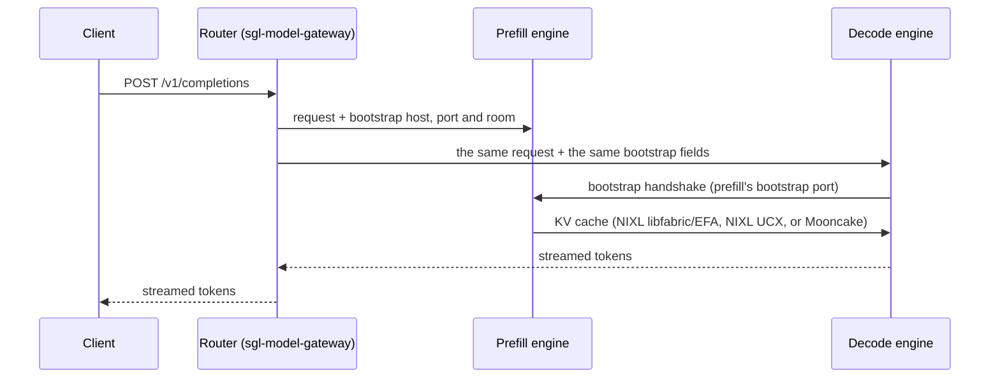

# SGLang prefill/decode disaggregation

This Helm chart serves one model with prefill and decode disaggregated, using SGLang's own disaggregation mechanism: prefill engines compute the KV cache of each prompt and send it to decode engines over SGLang's transfer backend, and SGLang's own router sends each request to one engine of each role. The two roles run as two Deployments with their own replica count and GPUs per engine, so the prefill:decode ratio is a value, not a fixed 1:1. By default prefill and decode never share a node, and the KV cache moves over NIXL's libfabric backend on EFA.

The chart has the same shape and value names as the [vLLM disaggregated chart](../../vllm/disagg-pd/) wherever the two engines share a concept: the same `placement.*` values and rendering, the same `prefill.*`/`decode.*`/`engine.*` values, the same `kvCacheTier.mode` names, the same metrics switch, and the same shared load replay, scorer and dashboards in [`../../_shared/`](../../_shared/). What differs is what SGLang itself does differently: the transfer backends (`transport.*`) and the router in front of the engines (`router.*` instead of `proxy.*`). The design behind both charts is RFC [#37](https://github.com/littlemex/distai-platform/issues/37).

The aggregated baseline to compare against is [`../agg-baseline/`](../agg-baseline/).

## Status

**Run on real hardware** (`g7.8xlarge` x2, light tier, RFC [#37](https://github.com/littlemex/distai-platform/issues/37) follow-up issue C): prefill, decode and the router all reached `Running`/`Ready` on two separate Karpenter-launched nodes; a real OpenAI-compatible completion was served end to end (confirmed by a 40-request open-loop load-replay against `_shared/load-replay`/`score.py`, `successful_requests=40`/`failed_requests=0`, `joint_attainment_share=1.0`). The prefill node's own EFA hardware counter (`rdma_write_bytes`) moved from `0` to `63,040` across 5 real requests — EFA RDMA traffic observed on the prefill node, confirming at least one side of the transfer crossed real EFA hardware; decode's own receive-side counter was not read in this round, so the transfer is not confirmed symmetric the way `vllm/disagg-pd`'s own cross-node proof is (see that chart's own README for its own, different connector's counter pair — SGLang's own transfer direction is not stated there and should not be inferred from it). The load-replay ran at a fixed, low, non-saturating rate (2 req/s, 128 input / 64 output tokens); `goodput_per_gpu≈1.01` reflects that rate divided by 2 GPUs comfortably under every SLO limit, not a saturation or efficiency measurement — it is a smoke result, not yet a disaggregated-vs-aggregated performance comparison. [`../../tests/0.static.sh`](../../tests/0.static.sh) still does not render-check this chart (follow-up). Not yet measured in this round: the `MOONCAKE` transfer backend, any ratio other than 1:1, `placement.sameNodeMeasurement`/`transport.forceEfaSameNode`, NIXL over UCX, a non-default router policy, and the `kvCacheTier` skeleton.

## How a request flows



The router is `sgl-model-gateway`, the router binary of SGLang's `sglang_router` package, which the pinned image ships (`/opt/sglang/bin/sgl-model-gateway`), so router and engines come from one SGLang commit. It runs in prefill/decode mode with Kubernetes discovery: it lists and watches the pods of this release in this namespace through the API server, registers ready prefill and decode pods by their `app.kubernetes.io/component` label, and reads each prefill pod's bootstrap port from its `sglang.ai/bootstrap-port` annotation (`sgl-model-gateway/src/service_discovery.rs`). For that it gets a ServiceAccount bound to a namespaced Role that can only `get`, `list` and `watch` pods. Its readiness endpoint answers 200 only while at least one prefill and one decode engine are healthy. Retries are off by default (`router.disableRetries`), so a request that fails, including a failed KV transfer, is counted as a failure rather than silently re-sent to another engine. Both roles use `round_robin` by default, matching the vLLM chart's proxy, so an engine comparison does not also change the routing policy; `cache_aware` is SGLang's prefix-aware alternative.

### Why this router and not OME

RFC #37, Decision 2, names [OME](https://github.com/ome-projects/ome) as the primary SGLang candidate, contingent on a check that needs a real cluster: whether OME's own resources leave room for the placement mechanism of Decision 3 (`nodeSelector` on the role label, decode-only anti-affinity), or replace it with OME's own placement. The same decision names SGLang's bundled router as the fallback if that check fails, and as the option that works with Decision 3's mechanism directly, since the engines stay ordinary Deployments. Until that check has run, this chart ships the fallback: it is the only one of the two that keeps the placement contract this chart shares with the vLLM chart, and it needs no cluster-scoped operator. An OME variant, if the check passes, is a separate change.

## Placement and transport

Placement is identical to the vLLM chart: the same three mechanisms (node label, `nodeSelector` per role, a required pod anti-affinity or affinity rendered on decode only), the same `placement.sameNodeMeasurement` and `placement.enforceAntiAffinity` values with the same four combinations, the same same-zone requirement whenever EFA devices are requested, and the same `Recreate` strategy in same-node mode. See [Placement and transport](../../vllm/disagg-pd/README.md#placement-and-transport) in the vLLM chart's README for the full explanation; nothing in it is engine-specific.

Transport is explicit, and each backend is rendered from values, never left to the image's or the library's defaults:

| `transport.backend` | What the chart renders on both roles | Needs EFA devices |
| --- | --- | --- |
| `NIXL` (default), `transport.sglangNixlBackend=LIBFABRIC` (default) | `--disaggregation-transfer-backend nixl`, `SGLANG_DISAGGREGATION_NIXL_BACKEND=LIBFABRIC`, `FI_PROVIDER=efa`, `FI_EFA_USE_DEVICE_RDMA=1`, `FI_EFA_ENABLE_SHM_TRANSFER=1` (or `0` with `transport.forceEfaSameNode=true`) | Yes |
| `NIXL`, `transport.sglangNixlBackend=UCX` | `--disaggregation-transfer-backend nixl`, `SGLANG_DISAGGREGATION_NIXL_BACKEND=UCX` | No |
| `MOONCAKE`, `transport.mooncakeProtocol=efa` (default) | `--disaggregation-transfer-backend mooncake`, `MOONCAKE_PROTOCOL=efa` | Yes |
| `MOONCAKE`, `transport.mooncakeProtocol=tcp` | `--disaggregation-transfer-backend mooncake`, `MOONCAKE_PROTOCOL=tcp` | No |

The NIXL flag and the NIXL backend variable are always rendered together, never one without the other; SGLang's own default NIXL backend is `UCX` (`python/sglang/srt/environ.py`), which would silently not use EFA. Mooncake's transport protocol is selected by the `MOONCAKE_PROTOCOL` environment variable, which SGLang reads when it initializes the Mooncake transfer engine (`python/sglang/srt/distributed/device_communicators/mooncake_transfer_engine.py`; SGLang's own default is `rdma`, for InfiniBand); `efa` against `tcp` is the positive and negative control pair for a Mooncake cell, read from the same EFA counters as every other cell. The EFA build of Mooncake in this image is amd64 only. The chart fails to render on combinations that would not do what they say: `forceEfaSameNode=true` without `placement.sameNodeMeasurement=true`, with `sglangNixlBackend=UCX`, or with `MOONCAKE` (whether Mooncake's EFA transport honors that libfabric variable is unconfirmed); and an EFA transport with `efaDevices` below 1 on either role.

Each engine advertises its pod IP for the KV transfer handshake through `SGLANG_HOST_IP`, which SGLang reads before guessing from the network interfaces. Which path a transfer really took is read from the EFA hardware counters, not inferred from these values; see [Check which path the KV cache took](../../vllm/disagg-pd/README.md#check-which-path-the-kv-cache-took) in the vLLM chart's README. The same-node limitation found there on real hardware applies here unchanged: with two Pods on one node, each holds its own physical EFA interface, so `forceEfaSameNode=true` and `false` cannot be expected to show a shm-versus-EFA contrast.

## Prerequisites

| Requirement | Why |
| --- | --- |
| An EKS cluster with NVIDIA GPU nodes and the NVIDIA device plugin (`nvidia.com/gpu`) | Engines request GPUs as an extended resource |
| The EFA device plugin (`vpc.amazonaws.com/efa`) on those nodes, for the default EFA transports | Engines request EFA devices |
| amd64 GPU nodes for `transport.backend=MOONCAKE` with `mooncakeProtocol=efa` | The image's EFA build of Mooncake is amd64 only |
| At least one node labeled for each role | The node selectors |
| Nodes that can pull `lmsysorg/sglang` from Docker Hub and model weights from Hugging Face | The image and the weights are downloaded at start |
| Permission to create a Role and a RoleBinding in the target namespace | The router's pod discovery |
| `kubectl` and Helm 3.8 or later on your workstation | Installing the chart |

GPU only: SGLang's disaggregation path has no Neuron variant, so this chart has none either.

## Image

`lmsysorg/sglang:v0.5.23-efa`, pinned by digest `sha256:644f315d1d48ade2f95d76c2a8a802541a027e7e56af289b17bd5d1fdf4c8fe7` (the multi-arch index), used for the engines and the router. v0.5.23 is the latest stable SGLang release as of 2026-11-22 ([GitHub releases](https://github.com/sgl-project/sglang/releases/tag/v0.5.23)); the digest is the `Docker-Content-Digest` that Docker Hub's registry returns for that tag (`registry-1.docker.io/v2/lmsysorg/sglang/manifests/v0.5.23-efa`, checked 2026-11-22), and matches the digest on the tag's [Docker Hub page](https://hub.docker.com/r/lmsysorg/sglang/tags?name=v0.5.23-efa). The image records the SGLang commit it was built from (`SGLANG_BUILD_COMMIT=297e54fd105e974cdf401e5b4d20253a22c16f90`, the `v0.5.23` tag); source paths cited in this README are at that commit. The `-efa` variant (`docker/efa.Dockerfile`) adds the AWS EFA userspace (EFA installer 1.50.0), checks at build time that NIXL's `LIBFABRIC` plugin links against that libfabric, swaps in the EFA build of the Mooncake transfer engine on amd64, and sets `MOONCAKE_PROTOCOL=efa` and `SGLANG_DISAGGREGATION_NIXL_BACKEND=LIBFABRIC` as image defaults, which the chart overrides explicitly from its own values.

## Deploy

Clone the repository and set the values for your cluster. `MODEL_ID` is a Hugging Face model repository id that fits on `gpusPerEngine` GPUs of your nodes; `PREFILL_NODE` and `DECODE_NODE` are the names of two GPU nodes.

```bash
git clone https://github.com/littlemex/distai-platform.git
cd distai-platform
export NAMESPACE=pd-demo
export RELEASE=pd
export MODEL_ID="${MODEL_ID:?set MODEL_ID to a Hugging Face model repository id}"
export PREFILL_NODE="${PREFILL_NODE:?set PREFILL_NODE to a GPU node name}"
export DECODE_NODE="${DECODE_NODE:?set DECODE_NODE to another GPU node name}"
```

Label the nodes. On a cluster whose GPU nodes come from Karpenter, put the same label in the template of the NodePool that provisions each role instead, so that new nodes carry it from the start.

```bash
kubectl label node "$PREFILL_NODE" distai.dev/pd-role=prefill --overwrite
kubectl label node "$DECODE_NODE" distai.dev/pd-role=decode --overwrite
```

Install the chart. For a gated model, first create the namespace with `kubectl create namespace "$NAMESPACE"`, store your Hugging Face token in a Secret with `kubectl create secret generic hf-token -n "$NAMESPACE" --from-literal=token="$HF_TOKEN"` and add `--set model.hfTokenSecret.name=hf-token`.

```bash
helm install "$RELEASE" examples/inference/sglang/disagg-pd \
  --namespace "$NAMESPACE" --create-namespace \
  --set model.name="$MODEL_ID"
kubectl rollout status deployment -n "$NAMESPACE" -l app.kubernetes.io/instance="$RELEASE" --timeout=40m
```

The installation notes print the in-cluster endpoint, the transport actually rendered, and the number of GPUs the release requests, which is the `--gpu-count` the scorer needs.

## Verify

Check that prefill and decode landed on different nodes:

```bash
kubectl get pods -n "$NAMESPACE" -l app.kubernetes.io/instance="$RELEASE" -o wide
```

Check that the router found one engine of each role. Its readiness requires both, so a ready router pod means discovery worked:

```bash
kubectl get pods -n "$NAMESPACE" -l app.kubernetes.io/instance="$RELEASE",app.kubernetes.io/component=router
```

Send one request through the router from inside the cluster. The Service is `ClusterIP`, so it is not reachable from outside the cluster.

```bash
kubectl run curl-pd --rm -i --restart=Never -n "$NAMESPACE" \
  --image=curlimages/curl:8.23.0 -- \
  curl -sS "http://$RELEASE-sglang-disagg-pd:8000/v1/completions" \
  -H 'Content-Type: application/json' \
  -d "{\"model\": \"$MODEL_ID\", \"prompt\": \"The capital of France is\", \"max_tokens\": 32}"
```

The response is an ordinary OpenAI-style completion generated by a decode engine from a KV cache that a prefill engine computed. SGLang counts each KV transfer in `sglang:kv_transfer_latency_ms` and each failed one in `sglang:num_transfer_failed_reqs_total` on the engines' `/metrics`.

To switch to Mooncake over EFA, then to its TCP negative control:

```bash
helm upgrade "$RELEASE" examples/inference/sglang/disagg-pd -n "$NAMESPACE" \
  --set model.name="$MODEL_ID" \
  --set transport.backend=MOONCAKE
helm upgrade "$RELEASE" examples/inference/sglang/disagg-pd -n "$NAMESPACE" \
  --set model.name="$MODEL_ID" \
  --set transport.backend=MOONCAKE \
  --set transport.mooncakeProtocol=tcp
```

## KV cache tiers (skeleton, not built or measured on real hardware yet)

`kvCacheTier.mode` uses the same three names as the vLLM charts (RFC #37, Decision 11), mapped onto SGLang's own hierarchical cache (HiCache):

| `kvCacheTier.mode` | What the chart renders |
| --- | --- |
| `gpu-only` (default) | Nothing: SGLang's own GPU-resident radix cache only |
| `local` | `--enable-hierarchical-cache --hicache-size <kvCacheTier.hicache.sizeGb>` on the **prefill** engines: a second tier in each prefill engine's own host memory ([HiCache design](https://docs.sglang.io/advanced_features/hicache_design.html)) |
| `remote` | Fails to render: SGLang's HiCache documents no Redis/ElastiCache third-tier backend, so this tier stays vLLM-only until that is confirmed |

Prefill is where a reused prefix saves work in this layout, so the tier is on prefill only. A cache on the decode side is a different, decode-only feature: `--disaggregation-decode-enable-radix-cache` keeps KV prefixes on decode so they are not transferred again (RFC #37, Decision 10, asks for prefix-heavy traffic to be measured with and without it); pass it with `decode.extraArgs`. `kvCacheTier.hicache.sizeGb` is required with `local`, because SGLang's own default sizes the host pool at twice the GPU pool, which can silently exceed the pod's memory request; raise `prefill.resources.requests.memory` by at least the same amount. With `prefill.replicas` above 1, each prefill engine has its own host tier, and the router's `round_robin` policy does not send a repeated prefix back to the engine that holds it; `router.prefillPolicy=cache_aware` does try to. Record the policy with every tier comparison.

## Measure

Use the in-cluster load replay and the scorer in [`../../_shared/`](../../_shared/) against `http://$RELEASE-sglang-disagg-pd:8000`, then run the same trace against the [aggregated baseline](../agg-baseline/) on the same hardware. A comparison is only meaningful when the model revision, precision, hardware, total GPU count, SGLang version, the replayed trace and the router policy are the same on both sides; pin `model.revision` for any measurement. The load replay drives SGLang with the same pinned `vllm bench serve` client the vLLM examples use, through SGLang's OpenAI-compatible `/v1/completions` endpoint, rather than SGLang's own `sglang.benchmark.serving`; the reason is in [`../../_shared/README.md`](../../_shared/README.md#load-replay). Engine-side panels, including the KV transfer latency and SGLang's per-role disaggregation queues, are in [`../../_shared/dashboards/sglang-pd.json`](../../_shared/dashboards/sglang-pd.json).

## Values

| Value | Default | Meaning |
| --- | --- | --- |
| `model.name` | `""` | Hugging Face model repository id. Required; the engines exit with a message until it is set |
| `model.revision` | `""` | Model repository commit or tag; empty is the default branch |
| `model.servedModelName` | `""` | Name clients send as `model`; empty is `model.name` |
| `model.hfTokenSecret.name` / `.key` | `""` / `token` | Secret with a Hugging Face token, for gated models |
| `image.repository` / `.tag` / `.digest` | `lmsysorg/sglang` / `v0.5.23-efa` / pinned | Engine and router image |
| `accelerator.resourceName` | `nvidia.com/gpu` | Extended resource the GPU device plugin advertises |
| `placement.nodeSelectorKey` | `distai.dev/pd-role` | Node label key that tells the roles apart |
| `placement.sameNodeMeasurement` | `false` | `true` targets both roles' `nodeSelector` at `placement.sharedPoolValue` instead of their own `nodeSelectorValue` |
| `placement.sharedPoolValue` | `shared` | The pool value both roles target when `sameNodeMeasurement=true` |
| `placement.enforceAntiAffinity` | `true` | `false` swaps decode's required anti-affinity (against prefill) for a required affinity (toward prefill); only meaningful with `sameNodeMeasurement=true` |
| `placement.tolerations` | `[]` | Tolerations for both roles, for example for GPU node taints |
| `transport.backend` | `NIXL` | `--disaggregation-transfer-backend`: `NIXL` or `MOONCAKE` |
| `transport.sglangNixlBackend` | `LIBFABRIC` | `SGLANG_DISAGGREGATION_NIXL_BACKEND` with `NIXL`: `LIBFABRIC` or `UCX` |
| `transport.mooncakeProtocol` | `efa` | `MOONCAKE_PROTOCOL` with `MOONCAKE`: `efa` or `tcp` |
| `transport.forceEfaSameNode` | `false` | `true` sets `FI_EFA_ENABLE_SHM_TRANSFER=0` on both roles (else explicitly `1`); requires `NIXL` with `LIBFABRIC` and `placement.sameNodeMeasurement=true` |
| `transport.efaResourceName` | `vpc.amazonaws.com/efa` | Extended resource the EFA device plugin advertises |
| `transport.bootstrapPort` | `8998` | Prefill's bootstrap server port (`--disaggregation-bootstrap-port`), also published as the `sglang.ai/bootstrap-port` annotation |
| `prefill.replicas`, `decode.replicas` | `1`, `1` | Engines per role |
| `prefill.gpusPerEngine`, `decode.gpusPerEngine` | `1`, `1` | GPUs per engine (`--tp-size`) |
| `prefill.efaDevices`, `decode.efaDevices` | `1`, `1` | EFA devices per engine pod; at least 1 with an EFA transport |
| `prefill.nodeSelectorValue`, `decode.nodeSelectorValue` | `prefill`, `decode` | Label value each role selects |
| `prefill.extraNodeSelector`, `decode.extraNodeSelector` | `{}` | Additional node selector terms per role |
| `prefill.extraArgs`, `decode.extraArgs` | `[]` | Extra `sglang.launch_server` arguments per role |
| `prefill.extraEnv`, `decode.extraEnv` | `[]` | Extra environment variables per role |
| `prefill.resources`, `decode.resources` | 4 CPU, 32Gi requested | CPU and memory; GPU and EFA limits are added from the values above |
| `engine.port` | `8000` | Engine HTTP port, also serving `/metrics` |
| `engine.shmSizeLimit` | `16Gi` | Size of the memory-backed `/dev/shm` |
| `engine.cacheVolume` | `emptyDir: {}` | Volume for the model download cache, `HOME` and the compile caches |
| `engine.podSecurityContext`, `engine.containerSecurityContext` | non-root UID 1000, all capabilities dropped | Security context of the engine pods |
| `engine.startupTimeoutSeconds` | `1800` | Time allowed for download and load before a restart |
| `router.replicas` | `1` | Router pods |
| `router.port` | `8000` | Router HTTP port |
| `router.prefillPolicy`, `router.decodePolicy` | `round_robin`, `round_robin` | Engine selection per role: `random`, `round_robin`, `cache_aware`, `power_of_two` (needs at least 2 engines of that role) or `prefix_hash` |
| `router.disableRetries` | `true` | A failed request stays a failure instead of being retried on another engine |
| `router.metricsPort` | `29000` | The router's own Prometheus endpoint; not scraped by the shared jobs |
| `router.extraArgs` | `[]` | Extra `sgl-model-gateway` arguments |
| `router.resources`, `router.nodeSelector`, `router.tolerations` | 2 CPU, 2Gi | Router pod scheduling and size |
| `router.podSecurityContext`, `router.containerSecurityContext` | non-root UID 1000, read-only root file system | Security context of the router pods |
| `service.type` / `.port` | `ClusterIP` / `8000` | Client-facing Service in front of the router |
| `metrics.enabled` | `true` | `--enable-metrics`, plus the pod labels and annotations for the `sglang` scrape job |
| `kvCacheTier.mode` | `gpu-only` | `local` adds HiCache with a host tier on prefill; `remote` fails to render. Skeleton only |
| `kvCacheTier.hicache.sizeGb` | `0` | Host KV pool per prefill engine (`--hicache-size`); required with `local` |
| `kvCacheTier.hicache.extraArgs` | `[]` | Extra HiCache flags for the prefill engines, passed unchanged |

## Known issues

- Not yet run on real hardware; see [Status](#status).
- The SGLang image runs as root by default and has no non-root user of its own. The chart runs engines and router as UID 1000 with all capabilities dropped and `HOME` on a writable volume. **Confirmed on real hardware**: both engines and the router reached `Running`/`Ready` under this security context, served a real completion and moved real KV bytes over EFA — this UID/capability combination does not block either a normal library write or EFA memory registration at this chart's default locked-memory limit. Not independently checked: a workload that writes outside `HOME`/`/tmp`, or a memory-registration size large enough to hit the node's locked-memory limit.
- SGLang's `/health` generates one token when the engine is idle and takes at least one second, so the engine probes use a 25-second timeout. The router health-checks the same endpoint with its own 5-second default.
- SGLang's OpenAI-compatible server and the router have no authentication in this configuration. The Services are `ClusterIP`; any pod in the cluster that can reach them can send requests. Restrict access with a NetworkPolicy if the cluster is shared.
- The router can read every pod in the release's namespace (not only this release's), because a Role cannot be narrowed to pods with a given label. Install the chart in a namespace of its own if that matters.
- One router pod is a single point of failure for the endpoint. Raise `router.replicas` for anything beyond measurement; each replica keeps its own routing state.
- With the default `emptyDir` cache, every engine pod downloads the weights at start. Point `engine.cacheVolume` at a persistent volume to avoid that.
- `transport.forceEfaSameNode` is not expected to show a shm-versus-EFA contrast under `placement.sameNodeMeasurement=true`; see [Placement and transport](#placement-and-transport).
- `placement.sameNodeMeasurement=true` sets the roles' `strategy.type` to `Recreate` (brief downtime on every `helm upgrade` in that mode), for the same reason as the vLLM chart.
- `sglang:kv_transfer_latency_ms` has fixed buckets ending at 5000 ms, so its quantiles saturate for any transfer slower than that (RFC #37, Decision 7).

## Clean up

```bash
helm uninstall "$RELEASE" -n "$NAMESPACE"
kubectl label node "$PREFILL_NODE" distai.dev/pd-role-
kubectl label node "$DECODE_NODE" distai.dev/pd-role-
kubectl delete namespace "$NAMESPACE"
```
