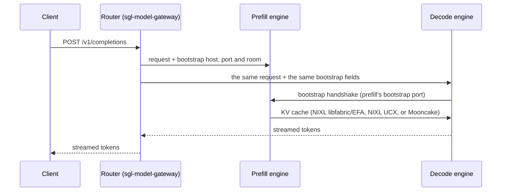

# SGLang prefill/decode disaggregation

This Helm chart serves one model with prefill and decode disaggregated, using SGLang's own disaggregation mechanism: prefill engines compute the KV cache of each prompt and send it to decode engines over SGLang's transfer backend, and SGLang's own router sends each request to one engine of each role. The two roles run as two Deployments with their own replica count and GPUs per engine, so the prefill:decode ratio is a value, not a fixed 1:1. By default prefill and decode never share a node, and the KV cache moves over NIXL's libfabric backend on EFA.

The chart has the same shape and value names as the [vLLM disaggregated chart](../../vllm/disagg-pd/) wherever the two engines share a concept: the same `placement.*` values and rendering, the same `prefill.*`/`decode.*`/`engine.*` values, the same `kvCacheTier.mode` names, the same metrics switch, and the same shared load replay, scorer and dashboards in [`../../_shared/`](../../_shared/). What differs is what SGLang itself does differently: the transfer backends (`transport.*`) and the router in front of the engines (`router.*` instead of `proxy.*`). The design behind both charts is RFC [#37](https://github.com/littlemex/distai-platform/issues/37).

The aggregated baseline to compare against is [`../agg-baseline/`](../agg-baseline/).

## Status

**Run on real hardware** (`g7.8xlarge` x2, light tier, RFC [#37](https://github.com/littlemex/distai-platform/issues/37) follow-up issue C): prefill, decode and the router all reached `Running`/`Ready` on two separate Karpenter-launched nodes; a real OpenAI-compatible completion was served end to end (confirmed by a 40-request open-loop load-replay against `_shared/load-replay`/`score.py`, `successful_requests=40`/`failed_requests=0`, `joint_attainment_share=1.0`). **Confirmed symmetric on both nodes in a follow-up round** (`g7.8xlarge` x2, 10 real requests): the prefill node's own `tx_bytes` and `rdma_write_bytes` moved from `0` to `1,011,646` and `1,011,328`; the decode node's own `rx_bytes` and `rdma_write_recv_bytes` moved from `0` to the identical `1,011,646` and `1,011,328` — a byte-for-byte match on both sides of the transfer, read directly from each node's `hw_counters`. This is a push-shaped transfer (prefill writes to decode), the opposite direction from `vllm/disagg-pd`'s own default connector (`NixlPullConnector`, decode pulls from prefill, see that chart's own README for its own counter pair) — confirming SGLang's own transfer direction is genuinely different from vLLM's default, not merely unconfirmed in one direction as an earlier round of this same check found. The engine's own log corroborates this: `NIXL INFO: Backend LIBFABRIC was instantiated`, `disaggregation_transfer_backend: nixl`. The load-replay ran at a fixed, low, non-saturating rate (2 req/s, 128 input / 64 output tokens); `goodput_per_gpu≈1.01` reflects that rate divided by 2 GPUs comfortably under every SLO limit, not a saturation or efficiency measurement — it is a smoke result, not yet a disaggregated-vs-aggregated performance comparison. [`../../tests/0.static.sh`](../../tests/0.static.sh) now covers this chart's own `helm lint`/`helm template`/kubeconform (it did not before this round; the placement/transport values-contract checks that already cover the vLLM charts do not cover this one yet, a separate, deeper follow-up). Not yet measured in this round: the `MOONCAKE` transfer backend, any ratio other than 1:1, `placement.sameNodeMeasurement`/`transport.forceEfaSameNode`, NIXL over UCX, a non-default router policy, and the `kvCacheTier` skeleton.

**A later round measured `placement.sameNodeMeasurement` and NIXL over UCX, on real hardware (`p5en.48xlarge`, single node): prefill, decode and router all reach `Running`/`Ready`, but no real client request against the router had succeeded on this single-node placement, with either backend.** **Two candidate mechanisms, each independently confirmed as real on separate hardware, with one of them now fixed in this chart -- neither is confirmed as the attribution for that specific historical run, whose own `kubectl get networkpolicy --all-namespaces` returning none still contradicts both (see [Known issues](#known-issues)).** First, documented but not changed: the router's own rendered `NetworkPolicy` admits only a Pod labeled `app.kubernetes.io/name: load-replay`; none of that round's own ad hoc clients, including its health probes, carried that label, so a client in that shape would time out against the router if the policy object existed and was enforced for that release. Second, and the actual fix in this PR: this chart's own `NetworkPolicy` never let prefill and decode talk to each other on the port their own disaggregation protocol actually needs, on any placement, with any client label, independent of the first mechanism -- SGLang's own control-plane channel between prefill and decode (every backend this chart renders) binds an OS-assigned ephemeral TCP port with no flag to pin it in this SGLang version, and `transport.backend=MOONCAKE` opens a second ephemeral port of its own, so a `NetworkPolicy` that lists only `transport.bootstrapPort` and, for `UCX`, `transport.ucx.tcpPortRange` can never name a port that does not exist until the engine process has already started -- if that rule was in effect for that release, it too would have blocked it. The fix: the peer-to-peer ingress rule now admits every port from the peer role's own Pods, scoped by `podSelector` rather than by a port list. A clean-room reproduction (a freshly built cell, CPU-only stand-in Pods, NetworkPolicy enforcement checked directly) confirms the fix does what it says -- prefill and decode now reach each other on a port the old policy would have blocked, the same pair the original round's own table recorded timing out, while an unlabeled client is still blocked from the router and from both engines directly. This reproduction used stand-ins, not the real SGLang engine and not the original cluster: it does not confirm the policy object was present and enforced for that exact `p5en` release. A separate real-GPU round (`g5.12xlarge`/`g6e.12xlarge` spot, NIXL over UCX, no EFA, this chart's own fix already in place, same-node placement) confirms the real engine itself does complete a real request end to end on that placement, for both an unlabeled and a labeled client -- but that cluster's own `aws-eks-nodeagent` carries `--enable-network-policy=false`, so this round does not retest the label gate or the peer-port fix under enforcement with the real engine, and it used neither the `p5en`/H200 instance family nor the `LIBFABRIC`/EFA backend the original failure was on. Whether the real engine completes end to end on a cluster that actually enforces `NetworkPolicy`, and on `LIBFABRIC`/EFA specifically, is still open, tracked in RFC #37. See [Known issues](#known-issues) below for the full evidence. This does not revise the two-node, `LIBFABRIC`-only numbers directly above, which stand as measured.

## How a request flows



The router is `sgl-model-gateway`, the router binary of SGLang's `sglang_router` package, which the pinned image ships (`/opt/sglang/bin/sgl-model-gateway`), so router and engines come from one SGLang commit. It runs in prefill/decode mode with Kubernetes discovery: it lists and watches the pods of this release in this namespace through the API server, registers ready prefill and decode pods by their `app.kubernetes.io/component` label, and reads each prefill pod's bootstrap port from its `sglang.ai/bootstrap-port` annotation (`sgl-model-gateway/src/service_discovery.rs`). For that it gets a ServiceAccount bound to a namespaced Role that can only `get`, `list` and `watch` pods. Its readiness endpoint answers 200 only while at least one prefill and one decode engine are healthy. Retries are off by default (`router.disableRetries`), so a request that fails, including a failed KV transfer, is counted as a failure rather than silently re-sent to another engine. Both roles use `round_robin` by default, matching the vLLM chart's proxy, so an engine comparison does not also change the routing policy; `cache_aware` is SGLang's prefix-aware alternative.

### Why this router and not OME

RFC #37, Decision 2, names [OME](https://github.com/ome-projects/ome) as the primary SGLang candidate, contingent on a check that needs a real cluster: whether OME's own resources leave room for the placement mechanism of Decision 3 (`nodeSelector` on the role label, decode-only anti-affinity), or replace it with OME's own placement. The same decision names SGLang's bundled router as the fallback if that check fails, and as the option that works with Decision 3's mechanism directly, since the engines stay ordinary Deployments. Until that check has run, this chart ships the fallback: it is the only one of the two that keeps the placement contract this chart shares with the vLLM chart, and it needs no cluster-scoped operator. An OME variant, if the check passes, is a separate change.

## Placement and transport

Placement is identical to the vLLM chart: the same three mechanisms (node label, `nodeSelector` per role, a required pod anti-affinity or affinity rendered on decode only), the same `placement.sameNodeMeasurement` and `placement.enforceAntiAffinity` values with the same four combinations, the same same-zone requirement whenever EFA devices are requested, and the same `Recreate` strategy in same-node mode. See [Placement and transport](../../vllm/disagg-pd/README.md#placement-and-transport) in the vLLM chart's README for the full explanation; nothing in it is engine-specific.

Transport is explicit, and each backend is rendered from values, never left to the image's or the library's defaults:

| `transport.backend` | What the chart renders on both roles | Needs EFA devices |
| --- | --- | --- |
| `NIXL` (default), `transport.sglangNixlBackend=LIBFABRIC` (default) | `--disaggregation-transfer-backend nixl`, `SGLANG_DISAGGREGATION_NIXL_BACKEND=LIBFABRIC`, `FI_PROVIDER=efa`, `FI_EFA_USE_DEVICE_RDMA=1`, `FI_EFA_ENABLE_SHM_TRANSFER=1` (or `0` with `transport.forceEfaSameNode=true`) | Yes |
| `NIXL`, `transport.sglangNixlBackend=UCX` | `--disaggregation-transfer-backend nixl`, `SGLANG_DISAGGREGATION_NIXL_BACKEND=UCX` | No |
| `MOONCAKE`, `transport.mooncakeProtocol=efa` (default) | `--disaggregation-transfer-backend mooncake`, `MOONCAKE_PROTOCOL=efa` | Yes |
| `MOONCAKE`, `transport.mooncakeProtocol=tcp` | `--disaggregation-transfer-backend mooncake`, `MOONCAKE_PROTOCOL=tcp` | No |

The NIXL flag and the NIXL backend variable are always rendered together, never one without the other; SGLang's own default NIXL backend is `UCX` (`python/sglang/srt/environ.py`), which would silently not use EFA. Mooncake's transport protocol is selected by the `MOONCAKE_PROTOCOL` environment variable, which SGLang reads when it initializes the Mooncake transfer engine (`python/sglang/srt/distributed/device_communicators/mooncake_transfer_engine.py`; SGLang's own default is `rdma`, for InfiniBand); `efa` against `tcp` is the positive and negative control pair for a Mooncake cell, read from the same EFA counters as every other cell. The EFA build of Mooncake in this image is amd64 only. The chart fails to render on combinations that would not do what they say: `forceEfaSameNode=true` without `placement.sameNodeMeasurement=true`, with `sglangNixlBackend=UCX`, or with `MOONCAKE` (whether Mooncake's EFA transport honors that libfabric variable is unconfirmed); and an EFA transport with `efaDevices` below 1 on either role.

Each engine advertises its pod IP for the KV transfer handshake through `SGLANG_HOST_IP`, which SGLang reads before guessing from the network interfaces. Which path a transfer really took is read from the EFA hardware counters, not inferred from these values; see [Check which path the KV cache took](../../vllm/disagg-pd/README.md#check-which-path-the-kv-cache-took) in the vLLM chart's README. The same-node limitation found there on real hardware applies here unchanged: with two Pods on one node, each holds its own physical EFA interface, so `forceEfaSameNode=true` and `false` cannot be expected to show a shm-versus-EFA contrast.

## Prerequisites

| Requirement | Why |
| --- | --- |
| An EKS cluster with NVIDIA GPU nodes and the NVIDIA device plugin (`nvidia.com/gpu`) | Engines request GPUs as an extended resource |
| The EFA device plugin (`vpc.amazonaws.com/efa`) on those nodes, for the default EFA transports | Engines request EFA devices |
| amd64 GPU nodes for `transport.backend=MOONCAKE` with `mooncakeProtocol=efa` | The image's EFA build of Mooncake is amd64 only |
| At least one node labeled for each role | The node selectors |
| Nodes that can pull `lmsysorg/sglang` from Docker Hub and model weights from Hugging Face | The image and the weights are downloaded at start |
| Permission to create a Role and a RoleBinding in the target namespace | The router's pod discovery |
| `kubectl` and Helm 3.8 or later on your workstation | Installing the chart |

GPU only: SGLang's disaggregation path has no Neuron variant, so this chart has none either.

## Image

`lmsysorg/sglang:v0.5.23-efa`, pinned by digest `sha256:644f315d1d48ade2f95d76c2a8a802541a027e7e56af289b17bd5d1fdf4c8fe7` (the multi-arch index), used for the engines and the router. v0.5.23 is the latest stable SGLang release as of 2026-11-22 ([GitHub releases](https://github.com/sgl-project/sglang/releases/tag/v0.5.23)); the digest is the `Docker-Content-Digest` that Docker Hub's registry returns for that tag (`registry-1.docker.io/v2/lmsysorg/sglang/manifests/v0.5.23-efa`, checked 2026-11-22), and matches the digest on the tag's [Docker Hub page](https://hub.docker.com/r/lmsysorg/sglang/tags?name=v0.5.23-efa). The image records the SGLang commit it was built from (`SGLANG_BUILD_COMMIT=297e54fd105e974cdf401e5b4d20253a22c16f90`, the `v0.5.23` tag); source paths cited in this README are at that commit. The `-efa` variant (`docker/efa.Dockerfile`) adds the AWS EFA userspace (EFA installer 1.50.0), checks at build time that NIXL's `LIBFABRIC` plugin links against that libfabric, swaps in the EFA build of the Mooncake transfer engine on amd64, and sets `MOONCAKE_PROTOCOL=efa` and `SGLANG_DISAGGREGATION_NIXL_BACKEND=LIBFABRIC` as image defaults, which the chart overrides explicitly from its own values.

## Deploy

Clone the repository and set the values for your cluster. `MODEL_ID` is a Hugging Face model repository id that fits on `gpusPerEngine` GPUs of your nodes; `PREFILL_NODE` and `DECODE_NODE` are the names of two GPU nodes.

```bash
git clone https://github.com/littlemex/distai-platform.git
cd distai-platform
export NAMESPACE=pd-demo
export RELEASE=pd
export MODEL_ID="${MODEL_ID:?set MODEL_ID to a Hugging Face model repository id}"
export PREFILL_NODE="${PREFILL_NODE:?set PREFILL_NODE to a GPU node name}"
export DECODE_NODE="${DECODE_NODE:?set DECODE_NODE to another GPU node name}"
```

Label the nodes. On a cluster whose GPU nodes come from Karpenter, put the same label in the template of the NodePool that provisions each role instead, so that new nodes carry it from the start.

```bash
kubectl label node "$PREFILL_NODE" distai.dev/pd-role=prefill --overwrite
kubectl label node "$DECODE_NODE" distai.dev/pd-role=decode --overwrite
```

Install the chart. For a gated model, first create the namespace with `kubectl create namespace "$NAMESPACE"`, store your Hugging Face token in a Secret with `kubectl create secret generic hf-token -n "$NAMESPACE" --from-literal=token="$HF_TOKEN"` and add `--set model.hfTokenSecret.name=hf-token`.

```bash
helm install "$RELEASE" examples/inference/sglang/disagg-pd \
  --namespace "$NAMESPACE" --create-namespace \
  --set model.name="$MODEL_ID"
kubectl rollout status deployment -n "$NAMESPACE" -l app.kubernetes.io/instance="$RELEASE" --timeout=40m
```

The installation notes print the in-cluster endpoint, the transport actually rendered, and the number of GPUs the release requests, which is the `--gpu-count` the scorer needs.

## Verify

Check that prefill and decode landed on different nodes:

```bash
kubectl get pods -n "$NAMESPACE" -l app.kubernetes.io/instance="$RELEASE" -o wide
```

Check that the router found one engine of each role. Its readiness requires both, so a ready router pod means discovery worked:

```bash
kubectl get pods -n "$NAMESPACE" -l app.kubernetes.io/instance="$RELEASE",app.kubernetes.io/component=router
```

Send one request through the router from inside the cluster. The Service is `ClusterIP`, so it is not reachable from outside the cluster. Under this chart's own default (`networkPolicy.enabled: true`), the template admits only a Pod labeled `app.kubernetes.io/name: load-replay` into the router's port (see [Known issues](#known-issues)); the command below carries that label for that reason -- confirmed on real hardware against stand-in Pods carrying this chart's own rendered `NetworkPolicy` (an unlabeled client times out, a labeled one does not); a separate real-GPU round confirms the real SGLang engine itself completes this same request end to end on a same-node placement with this chart's own fix in place, **but that cluster's own CNI does not enforce `NetworkPolicy`, so the label gate itself is still only confirmed against stand-ins, not the real engine**. Whether an unlabeled client is actually blocked in your cluster also depends on whether your CNI enforces `NetworkPolicy`; check with `kubectl get networkpolicy -n "$NAMESPACE"` if a request behaves unexpectedly.

```bash
kubectl run curl-pd --rm -i --restart=Never -n "$NAMESPACE" \
  --labels="app.kubernetes.io/name=load-replay" \
  --image=curlimages/curl:8.23.0 -- \
  curl -sS "http://$RELEASE-sglang-disagg-pd:8000/v1/completions" \
  -H 'Content-Type: application/json' \
  -d "{\"model\": \"$MODEL_ID\", \"prompt\": \"The capital of France is\", \"max_tokens\": 32}"
```

The response is an ordinary OpenAI-style completion generated by a decode engine from a KV cache that a prefill engine computed. SGLang counts each KV transfer in `sglang:kv_transfer_latency_ms` and each failed one in `sglang:num_transfer_failed_reqs_total` on the engines' `/metrics`.

To switch to Mooncake over EFA, then to its TCP negative control:

```bash
helm upgrade "$RELEASE" examples/inference/sglang/disagg-pd -n "$NAMESPACE" \
  --set model.name="$MODEL_ID" \
  --set transport.backend=MOONCAKE
helm upgrade "$RELEASE" examples/inference/sglang/disagg-pd -n "$NAMESPACE" \
  --set model.name="$MODEL_ID" \
  --set transport.backend=MOONCAKE \
  --set transport.mooncakeProtocol=tcp
```

## KV cache tiers (skeleton, not built or measured on real hardware yet)

`kvCacheTier.mode` uses the same three names as the vLLM charts (RFC #37, Decision 11), mapped onto SGLang's own hierarchical cache (HiCache):

| `kvCacheTier.mode` | What the chart renders |
| --- | --- |
| `gpu-only` (default) | Nothing: SGLang's own GPU-resident radix cache only |
| `local` | `--enable-hierarchical-cache --hicache-size <kvCacheTier.hicache.sizeGb>` on the **prefill** engines: a second tier in each prefill engine's own host memory ([HiCache design](https://docs.sglang.io/advanced_features/hicache_design.html)) |
| `remote` | Fails to render: SGLang's HiCache documents no Redis/ElastiCache third-tier backend, so this tier stays vLLM-only until that is confirmed |

Prefill is where a reused prefix saves work in this layout, so the tier is on prefill only. A cache on the decode side is a different, decode-only feature: `--disaggregation-decode-enable-radix-cache` keeps KV prefixes on decode so they are not transferred again (RFC #37, Decision 10, asks for prefix-heavy traffic to be measured with and without it); pass it with `decode.extraArgs`. `kvCacheTier.hicache.sizeGb` is required with `local`, because SGLang's own default sizes the host pool at twice the GPU pool, which can silently exceed the pod's memory request; raise `prefill.resources.requests.memory` by at least the same amount. With `prefill.replicas` above 1, each prefill engine has its own host tier, and the router's `round_robin` policy does not send a repeated prefix back to the engine that holds it; `router.prefillPolicy=cache_aware` does try to. Record the policy with every tier comparison.

## Measure

Use the in-cluster load replay and the scorer in [`../../_shared/`](../../_shared/) against `http://$RELEASE-sglang-disagg-pd:8000`, then run the same trace against the [aggregated baseline](../agg-baseline/) on the same hardware. A comparison is only meaningful when the model revision, precision, hardware, total GPU count, SGLang version, the replayed trace and the router policy are the same on both sides; pin `model.revision` for any measurement. The load replay drives SGLang with the same pinned `vllm bench serve` client the vLLM examples use, through SGLang's OpenAI-compatible `/v1/completions` endpoint, rather than SGLang's own `sglang.benchmark.serving`; the reason is in [`../../_shared/README.md`](../../_shared/README.md#load-replay). Engine-side panels, including the KV transfer latency and SGLang's per-role disaggregation queues, are in [`../../_shared/dashboards/sglang-pd.json`](../../_shared/dashboards/sglang-pd.json).

## Values

| Value | Default | Meaning |
| --- | --- | --- |
| `model.name` | `""` | Hugging Face model repository id. Required; the engines exit with a message until it is set |
| `model.revision` | `""` | Model repository commit or tag; empty is the default branch |
| `model.servedModelName` | `""` | Name clients send as `model`; empty is `model.name` |
| `model.hfTokenSecret.name` / `.key` | `""` / `token` | Secret with a Hugging Face token, for gated models |
| `image.repository` / `.tag` / `.digest` | `lmsysorg/sglang` / `v0.5.23-efa` / pinned | Engine and router image |
| `accelerator.resourceName` | `nvidia.com/gpu` | Extended resource the GPU device plugin advertises |
| `placement.nodeSelectorKey` | `distai.dev/pd-role` | Node label key that tells the roles apart |
| `placement.sameNodeMeasurement` | `false` | `true` targets both roles' `nodeSelector` at `placement.sharedPoolValue` instead of their own `nodeSelectorValue` |
| `placement.sharedPoolValue` | `shared` | The pool value both roles target when `sameNodeMeasurement=true` |
| `placement.enforceAntiAffinity` | `true` | `false` swaps decode's required anti-affinity (against prefill) for a required affinity (toward prefill); only meaningful with `sameNodeMeasurement=true` |
| `placement.tolerations` | `[]` | Tolerations for both roles, for example for GPU node taints |
| `transport.backend` | `NIXL` | `--disaggregation-transfer-backend`: `NIXL` or `MOONCAKE`. **Same value name as the [vLLM disagg-pd chart's own `transport.backend`](../../vllm/disagg-pd/#values), different enum** (`LIBFABRIC`/`UCX` there, selecting a NIXL backend directly, versus `NIXL`/`MOONCAKE` here, selecting between two different transfer mechanisms): `--set transport.backend=LIBFABRIC` copied from that chart does not render here — `helm template`/`helm install` fails outright with `transport.backend must be NIXL or MOONCAKE, got "LIBFABRIC"` (this chart's own `_helpers.tpl` calls Helm's `fail`) |
| `transport.sglangNixlBackend` | `LIBFABRIC` | `SGLANG_DISAGGREGATION_NIXL_BACKEND` with `NIXL`: `LIBFABRIC` or `UCX` |
| `transport.mooncakeProtocol` | `efa` | `MOONCAKE_PROTOCOL` with `MOONCAKE`: `efa` or `tcp` |
| `transport.forceEfaSameNode` | `false` | `true` sets `FI_EFA_ENABLE_SHM_TRANSFER=0` on both roles (else explicitly `1`); requires `NIXL` with `LIBFABRIC` and `placement.sameNodeMeasurement=true` |
| `transport.efaResourceName` | `vpc.amazonaws.com/efa` | Extended resource the EFA device plugin advertises |
| `transport.bootstrapPort` | `8998` | Prefill's bootstrap server port (`--disaggregation-bootstrap-port`), also published as the `sglang.ai/bootstrap-port` annotation |
| `transport.ucx.tcpPortRange` | `"20000-20063"` | `UCX_TCP_PORT_RANGE`, only read with `backend=NIXL`, `sglangNixlBackend=UCX`: fixes the TCP port NIXL's UCX backend listens on for the actual KV connection. The chart's own `NetworkPolicy` no longer tries to open exactly this range -- see "Known issues" for why a fixed port list cannot work for the prefill<->decode rule at all |
| `prefill.replicas`, `decode.replicas` | `1`, `1` | Engines per role |
| `prefill.gpusPerEngine`, `decode.gpusPerEngine` | `1`, `1` | GPUs per engine (`--tp-size`) |
| `prefill.efaDevices`, `decode.efaDevices` | `1`, `1` | EFA devices per engine pod; at least 1 with an EFA transport |
| `prefill.nodeSelectorValue`, `decode.nodeSelectorValue` | `prefill`, `decode` | Label value each role selects |
| `prefill.extraNodeSelector`, `decode.extraNodeSelector` | `{}` | Additional node selector terms per role |
| `prefill.extraArgs`, `decode.extraArgs` | `[]` | Extra `sglang.launch_server` arguments per role |
| `prefill.extraEnv`, `decode.extraEnv` | `[]` | Extra environment variables per role |
| `prefill.resources`, `decode.resources` | 4 CPU, 32Gi requested | CPU and memory; GPU and EFA limits are added from the values above |
| `engine.port` | `8000` | Engine HTTP port, also serving `/metrics` |
| `engine.shmSizeLimit` | `16Gi` | Size of the memory-backed `/dev/shm` |
| `engine.cacheVolume` | `emptyDir: {}` | Volume for the model download cache, `HOME` and the compile caches |
| `engine.podSecurityContext`, `engine.containerSecurityContext` | non-root UID 1000, all capabilities dropped | Security context of the engine pods |
| `engine.startupTimeoutSeconds` | `1800` | Time allowed for download and load before a restart |
| `router.replicas` | `1` | Router pods |
| `router.port` | `8000` | Router HTTP port |
| `router.prefillPolicy`, `router.decodePolicy` | `round_robin`, `round_robin` | Engine selection per role: `random`, `round_robin`, `cache_aware`, `power_of_two` (needs at least 2 engines of that role) or `prefix_hash` |
| `router.disableRetries` | `true` | A failed request stays a failure instead of being retried on another engine |
| `router.metricsPort` | `29000` | The router's own Prometheus endpoint; not scraped by the shared jobs |
| `router.extraArgs` | `[]` | Extra `sgl-model-gateway` arguments |
| `router.resources`, `router.nodeSelector`, `router.tolerations` | 2 CPU, 2Gi | Router pod scheduling and size |
| `router.podSecurityContext`, `router.containerSecurityContext` | non-root UID 1000, read-only root file system | Security context of the router pods |
| `service.type` / `.port` | `ClusterIP` / `8000` | Client-facing Service in front of the router |
| `metrics.enabled` | `true` | `--enable-metrics`, plus the pod labels and annotations for the `sglang` scrape job |
| `kvCacheTier.mode` | `gpu-only` | `local` adds HiCache with a host tier on prefill; `remote` fails to render. Skeleton only |
| `kvCacheTier.hicache.sizeGb` | `0` | Host KV pool per prefill engine (`--hicache-size`); required with `local` |
| `kvCacheTier.hicache.extraArgs` | `[]` | Extra HiCache flags for the prefill engines, passed unchanged |

## Known issues

- The SGLang image runs as root by default and has no non-root user of its own. The chart runs engines and router as UID 1000 with all capabilities dropped and `HOME` on a writable volume. **Confirmed on real hardware**: both engines and the router reached `Running`/`Ready` under this security context and served a real completion — this UID/capability combination does not block a normal library write, nor whatever EFA memory registration this run's own transfer needed at this chart's default locked-memory limit (see the Status section above for what the transfer itself confirmed and did not). Not independently checked: a workload that writes outside `HOME`/`/tmp`, or a memory-registration size large enough to hit the node's locked-memory limit.
- SGLang's `/health` generates one token when the engine is idle and takes at least one second, so the engine probes use a 25-second timeout. The router health-checks the same endpoint with its own 5-second default.
- SGLang's OpenAI-compatible server and the router have no authentication in this configuration. The Services are `ClusterIP`; any pod in the cluster that can reach them can send requests. Restrict access with a NetworkPolicy if the cluster is shared.
- The router can read every pod in the release's namespace (not only this release's), because a Role cannot be narrowed to pods with a given label. Install the chart in a namespace of its own if that matters.
- One router pod is a single point of failure for the endpoint. Raise `router.replicas` for anything beyond measurement; each replica keeps its own routing state.
- With the default `emptyDir` cache, every engine pod downloads the weights at start. Point `engine.cacheVolume` at a persistent volume to avoid that.
- `transport.forceEfaSameNode` is not expected to show a shm-versus-EFA contrast under `placement.sameNodeMeasurement=true`; see [Placement and transport](#placement-and-transport).
- `placement.sameNodeMeasurement=true` sets the roles' `strategy.type` to `Recreate` (brief downtime on every `helm upgrade` in that mode), for the same reason as the vLLM chart.
- `sglang:kv_transfer_latency_ms` has fixed buckets ending at 5000 ms, so its quantiles saturate for any transfer slower than that (RFC #37, Decision 7).
- **Same-node (`placement.sameNodeMeasurement=true`): no real request has succeeded on real hardware so far, for either NIXL backend.** Real hardware (`p5en.48xlarge`, single node, light-tier Capacity Block), four independent install/request cycles (two for `transport.sglangNixlBackend=LIBFABRIC`, two for `=UCX`, this chart's own current `transport.ucx.tcpPortRange` default in place for every `UCX` cycle): prefill, decode and router all reach `Running`/`Ready` with zero restarts, but a client request against the router (`curl -m 30 .../v1/completions`, sent from a separate pod, as a real client would) timed out every time -- `curl: (28) Connection timed out after 30001 milliseconds`, `HTTP_CODE=000`. That error is curl's own connect-phase message: the TCP connection to the router's Service IP itself did not complete within 30s, before any HTTP request, NIXL call or bootstrap handshake would even begin. In the same time window, with the same node and the same same-node placement, `examples/inference/vllm/disagg-pd` (also requesting EFA, also NIXL/LIBFABRIC) served 1000 and then 1200 real requests with `successful_requests` equal to the planned count and `joint_attainment_share=1.0` both times -- so this is not a general EFA/placement defect on this node, though vLLM's own chart renders a different Service and NetworkPolicy, so this comparison does not by itself clear this chart's own Service/Endpoints wiring. A direct, non-NIXL check (`kubectl exec`'d `curl .../health`, plain HTTP, port 8000, no disaggregation call at all) isolated which hop fails, run twice on the same node -- once while the node's VPC CNI had attached a second regular ENI and prefill/decode's pod IPs happened to land on different ENIs, once after that second ENI was gone and all three roles' pod IPs were on the same one ([comment 7210491509](https://github.com/littlemex/distai-platform/issues/37#issuecomment-7210491509)): `router -> prefill` and `router -> decode` both returned `200` in the round that tried them; `prefill -> decode` and `decode -> prefill` returned the same `curl: (28)` connection timeout in both rounds, regardless of ENI layout -- a clean split between the router-to-engine hop (open) and the engine-to-engine hop (blocked), not an unexplained mix. Three more candidates were each individually ruled out on the same node and session ([comment 7211635334](https://github.com/littlemex/distai-platform/issues/37#issuecomment-7211635334)): the Service's own `EndpointSlice` stayed `ready: true` throughout a failing call, with DNS resolving correctly and the client's own `curl -v` trace showing the timeout at the TCP connect step itself, after DNS and before any request reached the engine; 24 fresh calls against a plain `python3 -m http.server` target (by Service DNS and by bare ClusterIP) all returned `200` in under 10ms, ruling out a general node- or session-level networking defect; and a plain pod given the identical `securityContext` these engines use (non-root UID 1000, `seccompProfile: RuntimeDefault`, all capabilities dropped) was reachable cross-pod instantly. A direct read of the engine's own listen socket from inside the running container, at the moment a client call was made, showed it correctly listening on `0.0.0.0:8000` ([comment 7211809579](https://github.com/littlemex/distai-platform/issues/37#issuecomment-7211809579)). None of these ad hoc clients, including the health probes, carried the `app.kubernetes.io/name: load-replay` label the router's rendered `NetworkPolicy` requires; the real `_shared/load-replay` driver always does.

  Two same-host shm/CUDA-IPC hypotheses from real `awslabs/awsome-distributed-ai` examples (the same pinned commit `examples/tools/gpu-healthcheck` already vendors from) were also tried directly on real hardware and neither fixed it ([comment 7212244078](https://github.com/littlemex/distai-platform/issues/37#issuecomment-7212244078)): `transport.forceEfaSameNode=true` (confirmed `FI_EFA_ENABLE_SHM_TRANSFER=0` actually rendered on both roles) produced the identical timeout, as did additionally excluding UCX's own shm/CUDA-IPC transports (`UCX_TLS=^cuda_ipc,shm`). The clearest negative result for both hypotheses is a control from the same session ([comment 7211455993](https://github.com/littlemex/distai-platform/issues/37#issuecomment-7211455993), extended by [comment 7212244078](https://github.com/littlemex/distai-platform/issues/37#issuecomment-7212244078)): `sglang/agg-baseline` -- one Pod, no disaggregation, no NIXL agent, no cross-Pod KV transfer or CUDA IPC of any kind -- showed the identical external-client timeout against its own `/v1/completions` endpoint, while that same Pod's own outbound call to the in-cluster Kubernetes API Service succeeded. Neither shm/CUDA-IPC hypothesis has a mechanism to explain a non-disaggregated, single-Pod chart failing the same way. That control's own chart carries the same client-label gate on its Service as the router rule described in Candidate mechanism 1 below (`sglang/agg-baseline`'s own `templates/networkpolicy.yaml#L18-L27`, a different file from this chart's own), so the result is consistent with that mechanism rather than a third, unexplained failure -- but `agg-baseline`'s own Service/Endpoints under that policy was not itself re-checked, so this is cited here as ruling out the two shm/CUDA-IPC hypotheses, not as independent confirmation of mechanism 1. Issue #37's own [comment 7215113698](https://github.com/littlemex/distai-platform/issues/37#issuecomment-7215113698) first read this chart's own template source (`templates/networkpolicy.yaml`) against this reachability pattern and found it consistent with the two mechanisms below, while flagging the `--all-namespaces` result below as a direct, unreconciled counter-observation; this PR's own clean-room reproduction confirms each mechanism directly rather than only by template reading.
  - **Candidate mechanism 1, documented, not changed by this chart: the router's own client-label gate.** This chart's own rendered router `NetworkPolicy` admits only a Pod labeled `app.kubernetes.io/name: load-replay`; none of the original round's own ad hoc clients, including its health probes, carried that label, so a client in that shape would time out against the router if this rule was in effect and enforced for that release. Confirmed as a real mechanism by a clean-room reproduction (a freshly built cell, NetworkPolicy enforcement checked and on -- the VPC CNI's own `aws-eks-nodeagent` DaemonSet carries `--enable-network-policy=true` and the `amazon-vpc-cni` ConfigMap has `enable-network-policy-controller: "true"`, both read directly): an unlabeled stand-in client's request to the router timed out (`wget: download timed out`); the identical request from a client labeled `app.kubernetes.io/name: load-replay` succeeded; the unlabeled client was blocked again, the same way, on an immediate repeat. Unrelated to placement -- a router that gates on this label would do so cross-node too.
  - **Candidate mechanism 2, confirmed as a real structural gap and fixed in this PR, independent of whether it explains the historical run: the chart's own peer-to-peer rule did not name the port SGLang's disaggregation protocol actually uses, on any placement.** Read against `sgl-project/sglang` at the pinned commit (`SGLANG_BUILD_COMMIT=297e54fd105e974cdf401e5b4d20253a22c16f90`, independently confirmed as the `v0.5.23` tag's own commit via the GitHub API): every backend this chart renders (NIXL over UCX, NIXL over LIBFABRIC, and MOONCAKE) routes prefill/decode registration, abort notices and chunk-ready signals through one shared control-plane channel, `CommonKVManager` (`python/sglang/srt/disaggregation/common/conn.py`), and `CommonKVManager.__init__` binds its TCP socket with `get_zmq_socket_on_host` -> `bind_to_random_port` (`python/sglang/srt/utils/network.py#L254-L287`, called with no `min_port`/`max_port` argument) -- an OS-assigned ephemeral port, different every process start, with no CLI flag or environment variable in this SGLang version to pin it to a fixed value. Both `disaggregation/nixl/conn.py`'s `NixlKVManager` and `disaggregation/mooncake/conn.py`'s `MooncakeKVManager` subclass `CommonKVManager` and call `super().__init__(...)` unconditionally before any backend-specific setup, and both `prefill.py` and `decode.py` construct whichever subclass `transport.backend` selects through the same `_init_kv_manager()` path -- so this bind happens for every role and every backend, not only the one read directly. `transport.backend=MOONCAKE` opens a second, independent ephemeral port the same way: `kvcache-ai/Mooncake` @`d936855`'s own [`transfer_engine_py.cpp#L450-L458`](https://github.com/kvcache-ai/Mooncake/blob/d936855e3ae087cd013bf75855fb85c38b87875f/mooncake-integration/transfer_engine/transfer_engine_py.cpp#L450-L458) calls `TransferEngine::init` with `rpc_port=0` -- "the last two params are unused", in that file's own comment -- unless the legacy environment variable `MC_LEGACY_RPC_PORT_BINDING` is set, which this chart does not set; that legacy path shows a fixed port is possible inside Mooncake itself, but this chart's own SGLang version exposes no equivalent flag for the default channel read directly above, which is the one that matters here (this repository is not independently version-pinned to whatever Mooncake build this chart's own SGLang image vendors, so treat the `d936855` citation as "this mechanism exists in this codebase," not as a claim about the exact vendored version). The chart's old peer-to-peer ingress rule listed only `transport.bootstrapPort` and, for `sglangNixlBackend=UCX`, `transport.ucx.tcpPortRange`; neither names this ephemeral port. This is independent of the router's client-label gate above: if this rule was in effect and binding for a given run, even a perfectly labeled client reaching the router would still sit behind a prefill/decode pair that this specific gap could keep from completing their own handshake. **The fix**: the peer-to-peer ingress rule (`templates/networkpolicy.yaml`) now admits every port from the peer role's own Pods, with no port list at all -- the `podSelector` already does the scoping (only this release's own peer role); a port list can only narrow which ports that role may reach, never who counts as that role, so removing it widens which ports the peer role may use (including `engine.port`, previously router-only) without widening who the peer role is. Confirmed by the same clean-room reproduction, same cell, continuous run: with the old rule, the prefill stand-in and the decode stand-in both timed out reaching each other on a port the rule did not list, and so did both directions on an arbitrary unlisted high port no rule named at all -- the former the same pair, the same kind of timeout, the original round's own table recorded; with the fixed rule, both directions succeed on both ports, while an unlabeled client (neither the router nor the peer role) stays blocked from the router and from both engines directly, and a decode stand-in carrying the same `app.kubernetes.io/component` label but a **different** `app.kubernetes.io/instance` (a different release) stays blocked from this release's prefill stand-in on the now-open port -- a different release or a different team's own same-named component still cannot reach in. `awslabs/awsome-distributed-ai`'s own SGLang PD reference manifests, read directly at the pinned commit `examples/tools/gpu-healthcheck` already vendors from (`94853e2`) -- [`kimi2.6-h200-1p1d/manifests/kimi-pd-deploy.yaml`](https://github.com/awslabs/awsome-distributed-ai/blob/94853e2d55cc541aa44088c5b1a80913762cb4e0/examples/inference/sglang/kimi2.6-h200-1p1d/manifests/kimi-pd-deploy.yaml) and [`dsv41flash-pd-autodiscovery/manifests-pd-rdma/{prefill,decode,router}.yaml`](https://github.com/awslabs/awsome-distributed-ai/tree/94853e2d55cc541aa44088c5b1a80913762cb4e0/examples/inference/sglang/dsv41flash-pd-autodiscovery/manifests-pd-rdma) -- contain no `kind: NetworkPolicy` object at all, so they never had to solve this.
  - **Unreconciled, the same way the `--all-namespaces` observation below is: at least one earlier real round on this chart succeeded under the old, narrower rule.** The two-node round reported in this chart's own README Status section above (`g7.8xlarge` x2, NIXL/LIBFABRIC) served 40/40 real requests with byte-matched RDMA counters, and `../disagg-pd-llmd`'s own earlier text (now revised) called a comparable round "reported working end to end" -- both presumably under the same `networkPolicy.enabled: true` default, which has not changed since this chart was added. Whether NetworkPolicy enforcement was actually verified on either of those rounds' own clusters was not recorded there (the three-point check this PR's own reproduction runs -- the VPC CNI node agent's flag, its ConfigMap, and a `PolicyEndpoint` object actually existing -- was not run historically). If enforcement was off on either round, the gap this PR fixes would not have mattered there either way, consistent with the `--all-namespaces` discrepancy below; this is not confirmed, and is left open rather than used to either confirm or dismiss the gap this PR fixes.
  - **What this does and does not establish**: it confirms, on real hardware, that the old rule's fixed port list would block a plain TCP listener on a port it did not name, between Pods carrying this chart's own peer-role selectors; that this matches SGLang's own documented control-plane channel being an undeclared, OS-assigned port, by source reading; and that the fixed rule admits exactly the same-release peer pair, on any port, without admitting an unlabeled client or a same-named peer from a different release. It does not confirm this is what actually blocked the `p5en` round specifically (see the two unreconciled items above and below), and it does not confirm the policy object was present and enforced for the exact historical release: the reproduction used plain HTTP stand-in Pods, not SGLang. It also, on its own, does not confirm that a real request now completes end to end against the real same-node SGLang engine install with this fix in place -- but a separate real-GPU round does confirm that, narrowly: `g5.12xlarge`/`g6e.12xlarge` spot nodes, NIXL over UCX (no EFA), prefill and decode on one node, the current (fixed) chart, `rollout_rc=0`, both an unlabeled and a labeled client getting a real `HTTP_CODE=200` completion through the router. That cluster's own `aws-eks-nodeagent` carries `--enable-network-policy=false` (the same three-point check used above), so this round does not retest the label gate or the peer-port fix under enforcement with the real engine, and it did not use `LIBFABRIC`/EFA or the `p5en`/H200 family the original failure was on -- both still open, tracked in RFC #37.
  - **A direct, unreconciled contrary observation from the original `p5en` round itself**: that round's own `kubectl get networkpolicy --all-namespaces` returned none ([comment 7210491509](https://github.com/littlemex/distai-platform/issues/37#issuecomment-7210491509)), reported alongside a now-retracted claim that `networkPolicy.enabled` defaults to `false` -- both charts' own `values.yaml` have set it to `true` in their one and only commit since being added, unchanged ([comment 7215113698](https://github.com/littlemex/distai-platform/issues/37#issuecomment-7215113698)). Retracting the wrong default does not resolve the `--all-namespaces` result itself: rendering from a value and actually being installed with that value are different things, so an explicit override in that round's own install command, the check running against the wrong namespace or context, or the check running between install/uninstall cycles are each possible, unconfirmed, and unruled-out explanations for why no object was found. If the policy object was genuinely absent for the release under test there for some other reason, neither mechanism above could have been what blocked it that specific time, whatever the reproductions show on a different cell. Left open rather than explained away.
  - **Confirmed separately, on real GPU hardware, with this fix in place**: a same-node round on `g5.12xlarge`/`g6e.12xlarge` spot nodes (`distai-eks`, `ap-northeast-1`), NIXL over UCX (no EFA, `prefill.efaDevices`/`decode.efaDevices=0`), `placement.sameNodeMeasurement=true`, this chart's own current (fixed) `templates/networkpolicy.yaml` -- prefill and decode landed on the same node, rolled out `1/1` with zero restarts (`rollout_rc=0`), and both an unlabeled curl pod and one labeled `app.kubernetes.io/name: load-replay` got a real `HTTP_CODE=200` OpenAI-style completion through the router, including a repeat of the unlabeled call to rule out a one-off. This is the real SGLang engine, not a stand-in, and the real chart's own rendered Service, not a hand-written one. It is a narrower confirmation than it might look: that cluster's own `aws-eks-nodeagent` carries `--enable-network-policy=false` (same read as the CPU-only reproduction above), so an unlabeled client succeeding here is expected and does not retest the label gate, and this round used neither `LIBFABRIC`/EFA nor the `p5en`/H200 family the original failure was on.
  - **Still open**: whether this same real-engine, same-node request still completes with this fix on a cluster that actually enforces `NetworkPolicy` (closing the loop between the CPU-only stand-in reproduction above and the real-GPU round just above, in one round rather than two); whether it holds with `LIBFABRIC`/EFA specifically, the original failure's own primary backend; this chart's own Service/Endpoints wiring under enforcement (the CPU-only reproduction used a hand-written Service, not this chart's own); whether `transport.backend=MOONCAKE` shows the same failure on real hardware; a cross-node (2-node) placement with `UCX` specifically; whether `../disagg-pd-llmd` shows the same failure on a single node; and, if a labeled client with this fix still times out against the real engine on an enforcing cluster, `strace`/`tcpdump`/`ss` inside the engine container, as an earlier round of this same thread already scoped.

Full evidence for the original `p5en` round's own commands is in RFC [#37](https://github.com/littlemex/distai-platform/issues/37)'s own thread. Pull request [#117](https://github.com/littlemex/distai-platform/pull/117) carries the clean-room reproduction's exact commands and the complete output of the run against the fixed chart; the same reproduction's output against the pre-fix chart (showing the prefill<->decode pair timing out before this PR's fix) is posted as a comment on that thread instead of repeated in the pull request.

## Clean up

```bash
helm uninstall "$RELEASE" -n "$NAMESPACE"
kubectl label node "$PREFILL_NODE" distai.dev/pd-role-
kubectl label node "$DECODE_NODE" distai.dev/pd-role-
kubectl delete namespace "$NAMESPACE"
```
