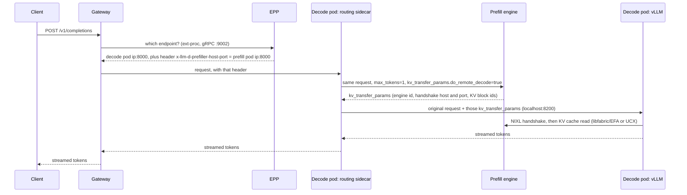

# vLLM prefill/decode disaggregation routed by llm-d

**Status: run on real hardware, not yet working end to end.** On a light-tier two-node cell with the Gateway API/GAIE CRDs installed and NGINX Gateway Fabric as the Gateway implementation (confirmed: NGINX Gateway Fabric's own `nginxGateway.gwAPIInferenceExtension.enable` value, off by default, must be on for it to recognize an `InferencePool` backend at all — without it the `HTTPRoute` resolves with `BackendNotFound` even though the `InferencePool` object itself exists), the chart's own prefill/decode Deployments, the `HTTPRoute`, the `InferencePool` and the EPP Deployment all reached a healthy state: the EPP's own pod datastore correctly tracked both real engine pods, and the decode-side routing sidecar's own allowlist correctly tracked the real `InferencePool` membership. A real request through the Gateway still fails (`500`, the Gateway's own error, not an engine error): the Gateway's data-plane container reports `EPP transport error: h2 response: stream closed because of a broken pipe` when calling the EPP's `ext_proc` gRPC endpoint, consistent with a TLS/plaintext transport mismatch between NGINX Gateway Fabric's own `gwAPIInferenceExtension.endpointPicker.disableTLS` setting and the EPP's own default TLS-serving behavior — not yet root-caused past that point. Every other statement below about runtime behavior comes from the pinned upstream sources named in [Upstream components](#upstream-components), not from an observed, successful run of this chart's own request path.

This Helm chart serves the same prefill and decode engines as [`../disagg-pd/`](../disagg-pd/) (vLLM's `NixlConnector`, the same placement, transport and KV cache tier values), but routes requests with the [llm-d](https://github.com/llm-d/llm-d) router instead of that chart's hand-written proxy: a Gateway API `HTTPRoute` sends each request to an `InferencePool`, the Gateway asks llm-d's Endpoint Picker (EPP) which pod to use, and a routing sidecar in each decode pod runs the prefill step on the prefill pod the EPP chose. It is the router the RFC ([#37](https://github.com/littlemex/distai-platform/issues/37), Decision 2) adopts for vLLM's prefill/decode slice.

The aggregated baseline to compare against is [`../agg-baseline/`](../agg-baseline/); the load generator, the scorer and the dashboard are in [`../../_shared/`](../../_shared/).

## What changes compared with the hand-written proxy

Only the routing layer differs; the engine pods, their placement and the KV transfer are rendered the same way by both charts.

| | [`../disagg-pd/`](../disagg-pd/) | This chart |
| --- | --- | --- |
| Entry point | A `ClusterIP` Service in front of a proxy Deployment | An `HTTPRoute` on a Gateway the cluster administrator provides |
| Who picks the prefill and the decode pod | The proxy, round robin per request over the ready pods of each role | The EPP, per request: the prefill profile picks the prefill pod with the least queued prompt tokens (`token-load-scorer`), the decode profile the decode pod with the fewest in-flight requests (`active-request-scorer`) |
| Who calls prefill, then decode | The proxy | The routing sidecar in the decode pod the EPP picked, using the prefill address the EPP put in the `x-llm-d-prefiller-host-port` request header |
| When is a request disaggregated | Always | Always (`always-disagg-pd-decider`), so the two charts route the same requests through the same two steps |
| How a role is told apart | Two headless Services, one per role | One `InferencePool` over both roles, and the pod label `llm-d.ai/role` (`prefill` or `decode`) read by the EPP's `prefill-filter` and `decode-filter` |
| If routing cannot be decided | The proxy returns an error | `failureMode: FailClose`: the Gateway rejects the request instead of sending it to an arbitrary pool member |
| Single point of failure | One proxy pod | One EPP pod (see [Known issues](#known-issues)) |

## How a request flows



The sidecar runs the same two-step flow as the `disagg-pd` proxy, but inside each decode pod: the decode engine is picked once, by the EPP, and the sidecar only ever talks to its own pod's vLLM and to the prefill pod named in the header. With `routingSidecar.ssrfProtection=true` (default) the sidecar refuses a prefill address that is not a pod of this release's own `InferencePool`, so the header cannot be used to make it send requests elsewhere.

## Upstream components

Every routing object is rendered by llm-d's own router chart, used as a dependency of this chart rather than rewritten; the CRDs come from their own projects' release manifests.

| Component | Version pinned here | Release date | Source |
| --- | --- | --- | --- |
| llm-d router chart `llm-d-router-gateway` (EPP Deployment, its ConfigMap, Service and namespaced RBAC, `InferencePool`, `HTTPRoute`) | `v1.0.0` (`oci://ghcr.io/llm-d/charts`, chart digest `sha256:0a16af45be7457acea1d5df2a3e2b7da7583ad65efcb30a65bbd6f2fd8f6ea4e`) | 2026-10-16 | [llm-d-router `v1.0.0`, `config/charts/llm-d-router-gateway`](https://github.com/llm-d/llm-d-router/tree/v1.0.0/config/charts/llm-d-router-gateway) |
| EPP image | `ghcr.io/llm-d/llm-d-router-endpoint-picker:v1.0.0@sha256:024188e998f516879f68532016ca24fabca00afbdcc2af9a61b17634e197df2c` | 2026-10-16 | [llm-d-router `v1.0.0`](https://github.com/llm-d/llm-d-router/releases/tag/v1.0.0) |
| Routing sidecar image | `ghcr.io/llm-d/llm-d-router-disagg-sidecar:v1.0.0@sha256:83cdf20199485329baca89b69d78f695735855ed93412aeaeec325d2374ced04` | 2026-10-16 | [llm-d-router `v1.0.0`](https://github.com/llm-d/llm-d-router/releases/tag/v1.0.0) |
| Gateway API Inference Extension CRDs (`InferencePool`, `inference.networking.k8s.io/v1`) | `v1.6.2`, `v1-manifests.yaml` | 2026-09-17 | [gateway-api-inference-extension `v1.6.2`](https://github.com/kubernetes-sigs/gateway-api-inference-extension/releases/tag/v1.6.2) |
| Gateway API CRDs (`Gateway`, `HTTPRoute`, `gateway.networking.k8s.io/v1`) | `v1.6.2`, `standard-install.yaml` | 2026-09-03 | [gateway-api `v1.6.2`](https://github.com/kubernetes-sigs/gateway-api/releases/tag/v1.6.2) |

The router chart, both images and both CRD versions are the ones the llm-d `v1.0.0` release's own guides install together ([`guides/env.sh`](https://github.com/llm-d/llm-d/blob/v1.0.0/guides/env.sh): `ROUTER_CHART_VERSION`, `ROUTER_EPP_VERSION`, `GAIE_VERSION`, `GATEWAY_API_VERSION`). The EPP configuration is that release's [prefill/decode guide](https://github.com/llm-d/llm-d/tree/v1.0.0/guides/pd-disaggregation) configuration without its `prefix-cache-affinity-filter`, whose one parameter is a prefill throughput upstream measured for one model on one GPU type and says to re-measure for anything else. The current `InferencePool` API has no `InferenceModel` any more; the per-request priority object, `InferenceObjective`, now lives in llm-d's own `llm-d.ai` API group and is not used here (`llmdRouter.router.inferenceObjectives` is empty), so no llm-d CRD is required.

llm-d's own guide deploys the engines as a LeaderWorkerSet `DisaggregatedSet`. This chart keeps two ordinary Deployments instead, so that the placement rules of [`../disagg-pd/`](../disagg-pd/) (RFC Decision 3) apply unchanged and no LeaderWorkerSet controller is needed; the RFC does not adopt `DisaggregatedSet` for its first implementation (Decision 2). llm-d's router chart also comes in a "standalone" variant that runs its own Envoy proxy in the EPP pod and needs no Gateway; this chart uses the Gateway variant because Decision 2 and the RFC's architecture put the Gateway implementation in the administrator's serving add-on wave and the route in the team's workload.

## Prerequisites

| Requirement | Who provides it | Why |
| --- | --- | --- |
| Everything [`../disagg-pd/`](../disagg-pd/#prerequisites) needs: NVIDIA GPU nodes with the NVIDIA device plugin, the EFA device plugin for the default `LIBFABRIC` backend, nodes labeled for each role | Cluster administrator | The engines are the same |
| The Gateway API `v1.6.2` CRDs and the Gateway API Inference Extension `v1.6.2` CRDs | Cluster administrator (cluster-scoped) | The chart renders an `HTTPRoute` and an `InferencePool` |
| A Gateway implementation that supports `InferencePool` backends, and a `Gateway` (default name `llm-d-inference-gateway`) with an HTTP listener that accepts routes from the release's namespace | Cluster administrator (the RFC's serving add-on wave, follow-up A) | The chart attaches a route to that Gateway but does not create one |
| Nodes that can pull from `ghcr.io` | Cluster administrator | The EPP and the routing sidecar images |
| `kubectl` and Helm 3.8 or later | You | Installing the chart; Helm 3.8 is the first release that pulls an OCI chart dependency |

Install the CRDs. Both are the pinned upstream release manifests; `--server-side` is needed because the Gateway API CRDs are larger than the annotation `kubectl apply` would otherwise store.

```bash
kubectl apply --server-side -f https://github.com/kubernetes-sigs/gateway-api/releases/download/v1.6.2/standard-install.yaml
kubectl apply --server-side -f https://github.com/kubernetes-sigs/gateway-api-inference-extension/releases/download/v1.6.2/v1-manifests.yaml
kubectl get crd httproutes.gateway.networking.k8s.io inferencepools.inference.networking.k8s.io
```

The Gateway implementation is the cluster administrator's choice. The ones the Gateway API Inference Extension `v1.6.2` lists as conformant are Istio, agentgateway and NGINX Gateway Fabric ([`site-src/implementations/gateways.md`](https://github.com/kubernetes-sigs/gateway-api-inference-extension/blob/v1.6.2/site-src/implementations/gateways.md)); llm-d's own [gateway recipes](https://github.com/llm-d/llm-d/tree/v1.0.0/guides/recipes/gateway) create a `Gateway` named `llm-d-inference-gateway` for each of them. How the Gateway's own proxy is exposed (a cluster-internal Service or a load balancer, and whether that load balancer is internet-facing) is decided by the implementation and the `Gateway` object, not by this chart; keep it cluster-internal, as the load replay runs inside the cluster anyway. **Confirmed on real hardware**: NGINX Gateway Fabric's own per-`Gateway` data-plane Service defaults to `type: LoadBalancer` (a real, internet-facing AWS load balancer was provisioned the moment the `Gateway` object was created, with no authentication in front of it) unless the administrator's own `NginxProxy` policy (`spec.kubernetes.service.type`) is set to `ClusterIP` — this is not a default this chart controls or can override, since the chart renders only the `Gateway`/`HTTPRoute`/`InferencePool`/EPP objects, not the Gateway implementation's own install. Set it explicitly before creating any `Gateway` against NGINX Gateway Fabric.

## Deploy

Clone the repository and set the values for your cluster. `MODEL_ID` is a Hugging Face model repository id that fits on `gpusPerEngine` GPUs of your nodes; `PREFILL_NODE` and `DECODE_NODE` are the names of two GPU nodes; `GATEWAY_NAME` and `GATEWAY_NAMESPACE` name the administrator's Gateway.

```bash
git clone https://github.com/littlemex/distai-platform.git
cd distai-platform
export NAMESPACE=pd-demo
export RELEASE=pd
export MODEL_ID="${MODEL_ID:?set MODEL_ID to a Hugging Face model repository id}"
export PREFILL_NODE="${PREFILL_NODE:?set PREFILL_NODE to a GPU node name}"
export DECODE_NODE="${DECODE_NODE:?set DECODE_NODE to another GPU node name}"
export GATEWAY_NAME=llm-d-inference-gateway
export GATEWAY_NAMESPACE="${GATEWAY_NAMESPACE:?set GATEWAY_NAMESPACE to the namespace of the Gateway}"
```

Label the nodes, exactly as for `disagg-pd`:

```bash
kubectl label node "$PREFILL_NODE" distai.dev/pd-role=prefill --overwrite
kubectl label node "$DECODE_NODE" distai.dev/pd-role=decode --overwrite
```

Fetch the router chart dependency (the version in `Chart.lock`), then install. For a gated model, add the Hugging Face token Secret the same way as for [`disagg-pd`](../disagg-pd/#deploy).

```bash
helm dependency build examples/inference/vllm/disagg-pd-llmd
helm install "$RELEASE" examples/inference/vllm/disagg-pd-llmd \
  --namespace "$NAMESPACE" --create-namespace \
  --set model.name="$MODEL_ID" \
  --set llmdRouter.httpRoute.inferenceGatewayName="$GATEWAY_NAME" \
  --set llmdRouter.httpRoute.inferenceGatewayNamespace="$GATEWAY_NAMESPACE"
kubectl rollout status deployment -n "$NAMESPACE" -l app.kubernetes.io/instance="$RELEASE" --timeout=40m
kubectl rollout status deployment "$RELEASE-epp" -n "$NAMESPACE" --timeout=10m
```

The installation notes print the routing chain, the number of GPUs the release requests (the `--gpu-count` the scorer needs) and the commands below.

## Verify

Check that prefill and decode landed on different nodes, and that the Gateway accepted the route and resolved the pool (`Accepted=True ResolvedRefs=True`):

```bash
kubectl get pods -n "$NAMESPACE" -l app.kubernetes.io/instance="$RELEASE" -o wide
kubectl get httproute "$RELEASE" -n "$NAMESPACE" \
  -o jsonpath='{range .status.parents[*].conditions[*]}{.type}={.status} {end}{"\n"}'
```

Send one request through the Gateway from inside the cluster:

```bash
export GATEWAY_ADDRESS="$(kubectl get gateway "$GATEWAY_NAME" -n "$GATEWAY_NAMESPACE" -o jsonpath='{.status.addresses[0].value}')"
kubectl run curl-pd --rm -i --restart=Never -n "$NAMESPACE" \
  --image=curlimages/curl:8.23.0 -- \
  curl -sS "http://$GATEWAY_ADDRESS/v1/completions" \
  -H 'Content-Type: application/json' \
  -d "{\"model\": \"$MODEL_ID\", \"prompt\": \"The capital of France is\", \"max_tokens\": 32}"
```

## Confirm the EPP split each request

A completion coming back proves only that some pod answered. Three independent records show that the EPP sent the request through a prefill pod and then a decode pod; read all three around a known number of requests (for example the single request above, or a load run of `NUM_PROMPTS` requests).

**1. The EPP's own decision counter.** Every request the EPP routes increments `llm_d_epp_disagg_decision_total` once, labeled with `decision_type="prefill-decode"` when it scheduled a prefill and a decode pod, and `decision_type="decode-only"` when it scheduled decode alone (llm-d-router `v1.0.0`, [`disagg/metrics.go`](https://github.com/llm-d/llm-d-router/blob/v1.0.0/pkg/epp/framework/plugins/scheduling/profilehandler/disagg/metrics.go)). A request whose required prefill step found no prefill pod is rejected, not counted. With `always-disagg-pd-decider`, the `prefill-decode` count must grow by the number of requests sent and the `decode-only` count must not grow. The metrics port is reachable without a token (`llmdRouter.router.monitoring.prometheus.auth.enabled=false`); read it through the API server, without a port-forward:

```bash
kubectl get --raw "/api/v1/namespaces/$NAMESPACE/services/$RELEASE-epp:http-metrics/proxy/metrics" \
  | grep '^llm_d_epp_disagg_decision_total'
```

The same counter reaches Amazon Managed Prometheus through the `llm-d-epp` job in [`../../_shared/dashboards/scrape-configs.yaml`](../../_shared/dashboards/scrape-configs.yaml).

**2. The EPP's log.** The EPP logs JSON, at verbosity 3 (`llmdRouter.router.epp.flags.v`, default here). For every request it logs `"Running scheduler profile"` with `"profile":"prefill"` and then with `"profile":"decode"`, and one `"Request handled"` line whose `"endpoint"` is the decode pod's `ip:8000` (the endpoint the Gateway forwards to) ([`requestcontrol/director.go`](https://github.com/llm-d/llm-d-router/blob/v1.0.0/pkg/epp/requestcontrol/director.go), [`scheduling/scheduler.go`](https://github.com/llm-d/llm-d-router/blob/v1.0.0/pkg/epp/scheduling/scheduler.go)). Compare the `endpoint` values with the pod IPs: every one must be a decode pod's IP, never a prefill pod's.

```bash
kubectl get pods -n "$NAMESPACE" -l app.kubernetes.io/instance="$RELEASE" \
  -o custom-columns=ROLE:.metadata.labels.llm-d\\.ai/role,IP:.status.podIP,NAME:.metadata.name
kubectl logs -n "$NAMESPACE" "deployment/$RELEASE-epp" --since=10m \
  | grep -E '"Request handled"|"Running scheduler profile"'
```

At verbosity 4 (`--set llmdRouter.router.epp.flags.v=4`) the EPP also logs `"Completed running picker plugin successfully"` with the `"result"` of each profile, which names the prefill pod it picked as well. Verbosity 4 logs every candidate and score for every request; use it for a check, not for a measured run.

**3. The decode pod's routing sidecar.** The sidecar counts every request it ran as prefill then decode in `llm_d_disagg_sidecar_disagg_requests_total{disagg_type="prefill-decode"}`, and times the two steps in `llm_d_disagg_sidecar_prefill_duration_seconds` and `llm_d_disagg_sidecar_decode_duration_seconds` ([`sidecar/metrics/metrics.go`](https://github.com/llm-d/llm-d-router/blob/v1.0.0/pkg/sidecar/metrics/metrics.go)), on `routingSidecar.metricsPort` (9100). With `--set routingSidecar.logLevel=4` it also logs `"sending prefill request"` with `"to"` set to the prefill pod's `ip:port` ([`connector_nixlv2.go`](https://github.com/llm-d/llm-d-router/blob/v1.0.0/pkg/sidecar/proxy/connector_nixlv2.go)).

```bash
export DECODE_POD="$(kubectl get pods -n "$NAMESPACE" -l app.kubernetes.io/instance="$RELEASE",llm-d.ai/role=decode -o jsonpath='{.items[0].metadata.name}')"
kubectl get --raw "/api/v1/namespaces/$NAMESPACE/pods/$DECODE_POD:9100/proxy/metrics" \
  | grep -E '^llm_d_disagg_sidecar_(disagg_requests_total|request_errors_total)'
kubectl logs -n "$NAMESPACE" "$DECODE_POD" -c routing-sidecar --since=10m | grep 'sending prefill request'
```

The engines confirm the same split from their side, exactly as for `disagg-pd`: the prefill pod's `vllm:request_success_total` grows by one per request (each prefill call generates one token), the decode pod's by one per request, and the KV cache bytes show up on the EFA counters ([`disagg-pd`, "Check which path the KV cache took"](../disagg-pd/#check-which-path-the-kv-cache-took)).

## Measure

Use the in-cluster load replay and the scorer in [`../../_shared/`](../../_shared/) with `TARGET_URL=http://$GATEWAY_ADDRESS`, then run the same trace against [`disagg-pd`](../disagg-pd/) and the [aggregated baseline](../agg-baseline/) on the same hardware. Comparing this chart with `disagg-pd` on the same engines isolates the routing layer: the extra Gateway and EPP hop, and the EPP's load-aware choice against the proxy's round robin, which only differ once a role has more than one replica. Record `llm_d_epp_disagg_decision_total` before and after every run, so that a run in which any request was not disaggregated is visible rather than averaged in. A comparison is only meaningful when the model revision, precision, hardware, total GPU count, vLLM version and the replayed trace are the same on both sides; pin `model.revision` for any measurement.

## Values

Every key from `image` through `engine`, and `metrics` and `kvCacheTier`, has the same meaning and default as in [`disagg-pd`'s values table](../disagg-pd/#values), with three differences: `engine.port` is also the `InferencePool`'s target port, served by vLLM on a prefill pod and by the routing sidecar on a decode pod; the decode pod's vLLM listens on `routingSidecar.enginePort` instead, and its `prometheus.io/port` annotation names that port. `proxy.*` and `service.*` do not exist here. The routing-specific values:

| Value | Default | Meaning |
| --- | --- | --- |
| `routingSidecar.image.repository` / `.tag` / `.digest` | `ghcr.io/llm-d/llm-d-router-disagg-sidecar` / `v1.0.0` / pinned | Routing sidecar image |
| `routingSidecar.enginePort` | `8200` | Port of the decode pod's vLLM, behind the sidecar; must differ from `engine.port` |
| `routingSidecar.kvConnector` | `nixlv2` | The sidecar's KV protocol toward vLLM's `NixlConnector` |
| `routingSidecar.ssrfProtection` | `true` | Only send prefill requests to pods of this release's `InferencePool`; creates a namespaced ServiceAccount, Role and RoleBinding for the decode pods |
| `routingSidecar.metricsPort` | `9100` | The sidecar's own `/metrics` port; `0` disables it |
| `routingSidecar.logLevel` | `info` | The sidecar's log level; `4` logs every prefill call |
| `routingSidecar.resources`, `.containerSecurityContext` | 1 CPU, 1Gi; non-root UID 65532, read-only root, all capabilities dropped | The sidecar container |
| `llmdRouter.httpRoute.inferenceGatewayName` / `.inferenceGatewayNamespace` | `llm-d-inference-gateway` / `""` (release namespace) | The Gateway the `HTTPRoute` attaches to |
| `llmdRouter.httpRoute.requestTimeout` | `300s` | Longest one request may take through the Gateway |
| `llmdRouter.router.epp.image.*` | `v1.0.0` pinned by digest, `IfNotPresent` | EPP image; the router chart's own default is the floating `main` tag |
| `llmdRouter.router.epp.flags.v` | `3` | EPP log verbosity; see [Confirm the EPP split each request](#confirm-the-epp-split-each-request) |
| `llmdRouter.router.epp.pluginsCustomConfig` | prefill/decode configuration | The EPP's scheduling configuration (`pd-config.yaml`) |
| `llmdRouter.router.inferencePool.failureMode` | `FailClose` | `FailOpen` lets the Gateway pick any pool member when the EPP does not answer |
| `llmdRouter.router.modelServers.matchLabels` | `distai.dev/llm-d-pool: vllm-disagg-pd-llmd` | The `InferencePool`'s pod selector, also put on every engine pod; give a second release in the same namespace a different value |
| `llmdRouter.router.modelServers.targetPorts` | `[{number: 8000}]` | Must be exactly `[engine.port]`; the chart fails to render otherwise |
| `llmdRouter.router.monitoring.prometheus.auth.enabled` | `false` | `true` requires a bearer token on the EPP's `/metrics` and makes the router chart create a ClusterRole and ClusterRoleBinding |

Every other key under `llmdRouter` is the router chart's own; see its [values](https://github.com/llm-d/llm-d-router/blob/v1.0.0/config/charts/routerlib/values.yaml) and [`llm-d-router-gateway` values](https://github.com/llm-d/llm-d-router/blob/v1.0.0/config/charts/llm-d-router-gateway/values.yaml).

## Known issues

- Not yet run on real hardware: the routing objects, the EPP configuration, the sidecar flags and the security contexts are rendered and statically validated only. In particular, the read-only root file system and fixed UID set here for the EPP and the sidecar are tighter than the router chart's own defaults (which set no security context) and have not been tried.
- Everything `disagg-pd` lists under [Known issues](../disagg-pd/#known-issues) about the engines (NixlConnector as a developer preview, no authentication on vLLM, the `emptyDir` model cache, `IPC_LOCK`, `transport.forceEfaSameNode` under `sameNodeMeasurement`, `Recreate` in that mode) applies here unchanged.
- One EPP pod: with `failureMode: FailClose`, the endpoint is down while the EPP restarts. More than one replica turns on the router chart's leader election (standbys stay NotReady), and the EPP's in-flight token accounting is per replica, which is why llm-d's own prefill/decode guide runs one.
- vLLM's OpenAI port on a decode pod (`routingSidecar.enginePort`) listens on all interfaces, as in llm-d's own guide, so it is reachable inside the cluster without going through the sidecar; the kubelet probes and the `vllm` scrape job use it. Restrict access with a NetworkPolicy if the cluster is shared.
- The EPP sees only GPU-resident KV blocks (vLLM's KV events); anything `kvCacheTier` puts in LMCache is invisible to its scoring. See `disagg-pd`'s "KV cache tiers" section.
- `tests/1.e2e.sh` covers `disagg-pd` and `agg-baseline` only; it does not deploy this chart.

## Clean up

```bash
helm uninstall "$RELEASE" -n "$NAMESPACE"
kubectl label node "$PREFILL_NODE" distai.dev/pd-role-
kubectl label node "$DECODE_NODE" distai.dev/pd-role-
kubectl delete namespace "$NAMESPACE"
```

The Gateway API and Gateway API Inference Extension CRDs are cluster-wide and shared with any other user of them; remove them only if nothing else uses them.
