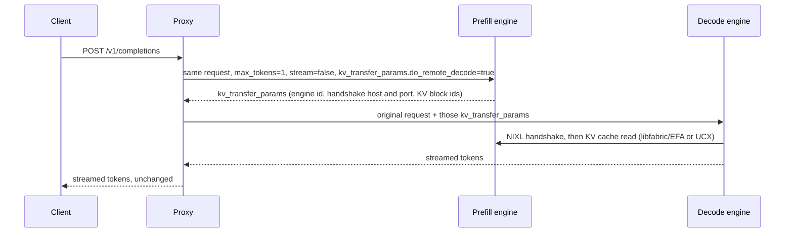

# vLLM prefill/decode disaggregation with NixlConnector

This Helm chart serves one model with prefill and decode disaggregated: prefill engines compute the KV cache of each prompt, decode engines pull that KV cache over NIXL and generate the answer, and a small proxy in front sends each request through both. The two roles run as two Deployments with their own replica count and GPUs per engine, so the prefill:decode ratio is a value, not a fixed 1:1. By default prefill and decode never share a node, and the KV cache moves over libfabric on EFA.

The chart uses vLLM's own disaggregation mechanism unchanged: the `NixlConnector` KV connector and the two-step request flow described in vLLM's [disaggregated prefilling](https://docs.vllm.ai/en/latest/features/disagg_prefill.html) and [NixlConnector usage](https://docs.vllm.ai/en/latest/features/nixl_connector_usage/) documents. vLLM marks this feature as a developer preview; its configuration may change between vLLM releases, which is why the image is pinned.

The aggregated baseline to compare against is [`../agg-baseline/`](../agg-baseline/); the load generator, the scorer and the dashboard are in [`../../_shared/`](../../_shared/).

## How a request flows



The proxy follows the flow of vLLM's own NixlConnector integration-test proxy. It finds engines by resolving the headless `-prefill` and `-decode` Services (which list ready pods only) and picks one of each round robin per request, so load is balanced per request rather than per TCP connection. If a prefill response carries no `kv_transfer_params`, the proxy returns HTTP 502 instead of letting decode quietly recompute the prompt, and the engines run with `kv_load_failure_policy: fail` for the same reason: a broken KV transfer shows up as failed requests, never as slower but successful ones.

## Placement and transport

Three mechanisms keep the roles apart, each doing a different job:

| Mechanism | What it does | Value |
| --- | --- | --- |
| Node label | Nodes are labeled for one role, for example `distai.dev/pd-role=prefill` or `distai.dev/pd-role=decode` | `placement.nodeSelectorKey` (default `distai.dev/pd-role`) |
| `nodeSelector` | Each role requests nodes with its own label value, unless `placement.sameNodeMeasurement=true` overrides both to `placement.sharedPoolValue` (default `shared`) | `prefill.nodeSelectorValue`, `decode.nodeSelectorValue`, `placement.sameNodeMeasurement`, `placement.sharedPoolValue` |
| Required pod anti-affinity (default) or affinity (same-node measurement), on `kubernetes.io/hostname`, rendered on the **decode** Deployment only | Default: decode never schedules onto a node running a prefill pod of the same release, even if the node labels are wrong. With `sameNodeMeasurement=true` and `enforceAntiAffinity=false`: decode is instead required to schedule onto the *same* node as a prefill pod | `placement.enforceAntiAffinity` (default `true`) |

With `placement.sameNodeMeasurement=false` (default), the two mechanisms above already make same-node impossible — two different pools, decode's own anti-affinity never has anything to trigger on, it is a defense-in-depth backstop. `placement.sameNodeMeasurement=true` switches both roles onto one shared pool (so the admin's `NodePool` behind `placement.sharedPoolValue` must be sized to fit both roles' combined GPU/EFA request on one instance, with `limits` capping it to exactly that one instance, so Karpenter cannot launch a second node for it). Within that shared-pool mode, `placement.enforceAntiAffinity=true` (still the default) turns it into a **fault-injection test**: prefill schedules first, decode's required anti-affinity then has nowhere to go (not a second node — the pool's own cap forbids it; not the same node — the anti-affinity rule forbids it), so decode stays `Pending` with a `FailedScheduling` event naming the anti-affinity rule — proving the backstop itself works, not merely that the default happens not to trigger it. Setting `placement.enforceAntiAffinity=false` in that same shared-pool mode is the actual **same-node measurement cell**: decode's required affinity now pulls it onto prefill's own node instead.

Transport is explicit. With `transport.backend=LIBFABRIC` (the default), both roles get `FI_PROVIDER=efa` and `FI_EFA_USE_DEVICE_RDMA=1` and request `vpc.amazonaws.com/efa` devices. Those two variables do not decide what happens when prefill and decode are on the same host: libfabric's EFA provider then uses its own shared-memory path by default, and the EFA device sees no traffic. `FI_EFA_ENABLE_SHM_TRANSFER` is always rendered explicitly, never left to the library's own default: `transport.forceEfaSameNode=true` sets it to `0`, forcing even a same-host transfer onto the EFA device (see `fi_efa(7)`); the default `false` sets it to `1`, the library's own default value, stated rather than omitted. `forceEfaSameNode=true` only renders when `placement.sameNodeMeasurement=true` (the chart fails to render otherwise, since forcing the same-host path has no effect on a cross-node run). Which path a transfer really took is read from the EFA hardware counters, not inferred from these values; see [Check which path the KV cache took](#check-which-path-the-kv-cache-took).

## Prerequisites

| Requirement | Why |
| --- | --- |
| An EKS cluster with NVIDIA GPU nodes and the NVIDIA device plugin (`nvidia.com/gpu`) | Engines request GPUs as an extended resource |
| The EFA device plugin (`vpc.amazonaws.com/efa`) on those nodes, for the default `LIBFABRIC` backend | Engines request EFA devices; FI_PROVIDER=efa needs one |
| At least one node labeled for each role | The node selectors |
| Nodes that can pull `vllm/vllm-openai` from Docker Hub and model weights from Hugging Face | The image and the weights are downloaded at start |
| `kubectl` and Helm 3.8 or later on your workstation | Installing the chart |

GPU only: neither the vLLM Neuron plugin nor NeuronX Distributed Inference ships a disaggregated prefill/decode path today, so this chart has no Neuron variant.

## Deploy

Clone the repository and set the values for your cluster. `MODEL_ID` is a Hugging Face model repository id that fits on `gpusPerEngine` GPUs of your nodes; `PREFILL_NODE` and `DECODE_NODE` are the names of two GPU nodes.

```bash
git clone https://github.com/littlemex/distai-platform.git
cd distai-platform
export NAMESPACE=pd-demo
export RELEASE=pd
export MODEL_ID="${MODEL_ID:?set MODEL_ID to a Hugging Face model repository id}"
export PREFILL_NODE="${PREFILL_NODE:?set PREFILL_NODE to a GPU node name}"
export DECODE_NODE="${DECODE_NODE:?set DECODE_NODE to another GPU node name}"
```

Label the nodes. On a cluster whose GPU nodes come from Karpenter, put the same label in the template of the NodePool that provisions each role instead, so that new nodes carry it from the start.

```bash
kubectl label node "$PREFILL_NODE" distai.dev/pd-role=prefill --overwrite
kubectl label node "$DECODE_NODE" distai.dev/pd-role=decode --overwrite
```

Install the chart. For a gated model, first create the namespace with `kubectl create namespace "$NAMESPACE"`, store your Hugging Face token in a Secret with `kubectl create secret generic hf-token -n "$NAMESPACE" --from-literal=token="$HF_TOKEN"` and add `--set model.hfTokenSecret.name=hf-token`.

```bash
helm install "$RELEASE" examples/inference/vllm/disagg-pd \
  --namespace "$NAMESPACE" --create-namespace \
  --set model.name="$MODEL_ID"
kubectl rollout status deployment -n "$NAMESPACE" -l app.kubernetes.io/instance="$RELEASE" --timeout=40m
```

The installation notes print the in-cluster endpoint and the number of GPUs the release requests, which is the `--gpu-count` the scorer needs.

## Verify

Check that prefill and decode landed on different nodes:

```bash
kubectl get pods -n "$NAMESPACE" -l app.kubernetes.io/instance="$RELEASE" -o wide
```

Send one request through the proxy from inside the cluster. The Service is `ClusterIP`, so it is not reachable from outside the cluster.

```bash
kubectl run curl-pd --rm -i --restart=Never -n "$NAMESPACE" \
  --image=curlimages/curl:8.23.0 -- \
  curl -sS "http://$RELEASE-vllm-disagg-pd:8000/v1/completions" \
  -H 'Content-Type: application/json' \
  -d "{\"model\": \"$MODEL_ID\", \"prompt\": \"The capital of France is\", \"max_tokens\": 32}"
```

The response is an ordinary OpenAI-style completion generated by a decode engine from a KV cache that a prefill engine computed.

## Check which path the KV cache took

The EFA hardware counters show whether a transfer used the EFA device. With the efa-node-exporter scrape job in place, the dashboard panel "EFA RDMA write bytes per node" plots `node_amazonefa_rdma_write_bytes_total` and `node_amazonefa_rdma_write_recv_bytes_total`. Without it, read the counters on the node itself, once before and once after sending requests:

```bash
export NODE="$PREFILL_NODE"
kubectl debug "node/$NODE" -n "$NAMESPACE" --profile=general --image=curlimages/curl:8.23.0 -i -- \
  sh -c 'cat /host/sys/class/infiniband/*/ports/*/hw_counters/rdma_write_bytes | awk "{s+=\$1} END {print s}"'
```

`kubectl debug` leaves a `node-debugger-*` pod behind; delete it when you are done:

```bash
kubectl get pods -n "$NAMESPACE" -o name | grep node-debugger | xargs kubectl delete -n "$NAMESPACE"
```

To measure the same-node path on purpose, reinstall with both roles on one node and run the two cells one after the other. The node needs **at least two EFA interfaces**, one allocation per engine pod, not just an EFA-capable instance type: Kubernetes' EFA device plugin hands out one physical interface per allocation and never shares one across two Pods, so a single-network-card instance (every `g7`/`g7e` size below `.48xlarge`, confirmed via `aws ec2 describe-instance-types`) leaves the second pod `Pending` forever with a `FailedScheduling` event naming `vpc.amazonaws.com/efa` — not a chart bug, a real resource-count conflict (found on real hardware, `g7.12xlarge`, 2026-11-20). Use an instance with at least two EFA interfaces (`g7.48xlarge` is the smallest `g7` size with two; card counts vary widely by family — `p5en.48xlarge` has 16, not 2, confirmed via `aws ec2 describe-instance-types`, 2026-11-21) and request one EFA-only interface per network card in the shared pool's `EC2NodeClass` (`capacity-pool`'s `pool.networkInterfaces`, see that chart's README for the exact two-network-card example and how to extend it for an instance with more cards).

```bash
helm upgrade "$RELEASE" examples/inference/vllm/disagg-pd -n "$NAMESPACE" \
  --set model.name="$MODEL_ID" \
  --set placement.sameNodeMeasurement=true \
  --set placement.enforceAntiAffinity=false \
  --set transport.forceEfaSameNode=true
```

**What this comparison actually shows, observed on real hardware (`g7.48xlarge`, 2026-11-20), and what it does not**: with two EFA interfaces, each role's Pod is allocated a *different* physical device (confirmed from each pod's own `rdmap*` interface name) — so `transport.forceEfaSameNode=true` and `=false` produced **identical**, nonzero EFA counter traffic (same byte count, both cases) rather than the one-flat/one-rising contrast an earlier version of this README claimed. That is a measurement, not yet a fully isolated explanation: the likely mechanism is that libfabric's same-host shared-memory bypass is keyed to both endpoints resolving to the *same* EFA device address (never true here, since Kubernetes' exclusive, per-Pod device allocation does not let two separate Pods share one physical EFA interface on any instance type), but a difference in IPC/shared-memory namespace between two separate Pods was not separately ruled out as a contributing factor either. This cell still proves two real things — co-located placement, and that a disaggregated pair on one node still moves real KV bytes over EFA hardware — but it cannot show the shm-vs-forced-EFA contrast Decision 6 of the RFC originally described. Whether both roles sharing one Pod (and so, by construction, one EFA allocation) would reproduce that contrast is plausible but untested; see the RFC ([#37](https://github.com/littlemex/distai-platform/issues/37)), Decision 6 (as amended), for the current status.

## KV cache tiers (skeleton, not built or measured on real hardware yet)

`kvCacheTier.mode` picks whether LMCache is on at all: `gpu-only` (default, no change) keeps vLLM's own GPU-resident cache only; `local` and `remote` both add `LMCacheMPConnector` (the registered connector name for LMCache's current "mp server" integration — not `LMCacheConnector`, confirmed against vLLM's own connector factory, 2026-11-21), stacked onto the same `MultiConnector` list this chart already uses for `NixlConnector` (vLLM's own confirmed stacking shape; `NixlConnector` is never replaced, since it carries the mandatory prefill-to-decode handshake this chart depends on). **`mode` does not actually select a node-local vs. an off-node backend**: `local` and `remote` render **identically**, both pointing `LMCacheMPConnector` at the same `kvCacheTier.lmcache.mpServerEndpoint` — one static value, rendered the same way into every prefill and decode Pod, which run on *different* nodes by Decision 3. This chart does not deploy, detect, or enforce any particular topology for that endpoint — it renders the exact same value into every Pod either way. Whether the address behind it actually resolves to a genuinely node-local server per node (for example a `Service` with `internalTrafficPolicy: Local` in front of a per-node mp-server DaemonSet, a topology this chart does not build) or to one single off-node server like Amazon ElastiCache is entirely that external setup's own property, invisible to this chart's own values. `local`/`remote` are kept as two words of this directory's own measurement vocabulary, to be recorded by hand alongside whichever backend the mp server was actually given for a run, not as a value this chart's rendering distinguishes.

**Prerequisite this chart does not provide**: an LMCache mp server already running and reachable at `kvCacheTier.lmcache.mpServerEndpoint`. If that server's own adapter points at Amazon ElastiCache (or anything else off-node), that deployment's own endpoint, VPC/subnet-count and TLS requirements are this prerequisite's own responsibility, not this chart's — no ElastiCache (or other backing store) Terraform ships here.

What is not yet confirmed, stated rather than assumed: whether the pinned image's own bundled LMCache version actually speaks this "mp server" shape, or a different, older shape some other integration write-ups describe (unconfirmed — see `values.yaml`'s own `kvCacheTier` comment); whether LMCache's current RESP (Redis/Valkey) adapter's TLS behavior matches what Amazon ElastiCache's distributed KV caching feature needs (unconfirmed — not the same product as ElastiCache Serverless, which a separate, earlier source found EFA-incapable); and that vLLM's own KV-event publisher (the mechanism llm-d-kv-cache-manager's indexer reads for cross-node routing) describes vLLM's own GPU-resident block pool only, with no visibility into anything `LMCacheMPConnector` holds. Since the `remote` tier is one shared endpoint every Pod can already reach directly, that gap does not block a hit on it (there is no single node to route to); it does mean the indexer/EPP's own reuse scoring under-counts what is actually reusable, and it would block routing outright for a genuinely node-local tier if one is ever built (this chart does not build one, per the paragraph above) — not solved here either way. Follow-up issue B's own real-machine run settles the LMCache-shape and TLS questions before `kvCacheTier.mode` is anything but `gpu-only` in a real measurement. SGLang's own HiCache has no confirmed Redis/ElastiCache backend as of this writing — even though AWS's own ElastiCache announcement names SGLang as a supported engine via a LMCache connector, a discrepancy this chart does not reconcile, treating SGLang's own upstream docs as the more specific source — so this tiering is vLLM-only until that changes or is otherwise confirmed.

## Measure

Use the in-cluster load replay and the scorer in [`../../_shared/`](../../_shared/) against `http://$RELEASE-vllm-disagg-pd:8000`, then run the same trace against the [aggregated baseline](../agg-baseline/) on the same hardware. A comparison is only meaningful when the model revision, precision, hardware, total GPU count, vLLM version and the replayed trace are the same on both sides; pin `model.revision` for any measurement.

## Values

| Value | Default | Meaning |
| --- | --- | --- |
| `model.name` | `""` | Hugging Face model repository id. Required; the engines exit with a message until it is set |
| `model.revision` | `""` | Model repository commit or tag; empty is the default branch |
| `model.servedModelName` | `""` | Name clients send as `model`; empty is `model.name` |
| `model.hfTokenSecret.name` / `.key` | `""` / `token` | Secret with a Hugging Face token, for gated models |
| `image.repository` / `.tag` / `.digest` | `vllm/vllm-openai` / `v0.34.0-efa` / pinned | Engine and proxy image; the `-efa` variant is built with vLLM's KV connectors and the AWS EFA userspace |
| `accelerator.resourceName` | `nvidia.com/gpu` | Extended resource the GPU device plugin advertises |
| `placement.nodeSelectorKey` | `distai.dev/pd-role` | Node label key that tells the roles apart |
| `placement.sameNodeMeasurement` | `false` | `true` targets both roles' `nodeSelector` at `placement.sharedPoolValue` instead of their own `nodeSelectorValue` |
| `placement.sharedPoolValue` | `shared` | The pool value both roles target when `sameNodeMeasurement=true` |
| `placement.enforceAntiAffinity` | `true` | `false` swaps decode's required anti-affinity (against prefill) for a required affinity (toward prefill) — only meaningful combined with `sameNodeMeasurement=true` |
| `placement.tolerations` | `[]` | Tolerations for both roles, for example for GPU node taints |
| `transport.backend` | `LIBFABRIC` | NIXL backend, `LIBFABRIC` or `UCX` |
| `transport.forceEfaSameNode` | `false` | `true` sets `FI_EFA_ENABLE_SHM_TRANSFER=0` on both roles (else explicitly `1`); requires `LIBFABRIC` and `placement.sameNodeMeasurement=true`. Observed to have no effect on real hardware under this chart's two-Pod model (see "Known issues"), likely because each role always gets its own physical EFA interface there |
| `transport.efaResourceName` | `vpc.amazonaws.com/efa` | Extended resource the EFA device plugin advertises |
| `transport.sideChannelPort` | `5600` | NIXL handshake port (`VLLM_NIXL_SIDE_CHANNEL_PORT`); the host is the pod IP |
| `transport.kvLoadFailurePolicy` | `fail` | `fail` or `recompute` when decode cannot load a transferred KV cache |
| `transport.extraConnectorConfig` | `{}` | Extra keys for `kv_connector_extra_config` |
| `prefill.replicas`, `decode.replicas` | `1`, `1` | Engines per role |
| `prefill.gpusPerEngine`, `decode.gpusPerEngine` | `1`, `1` | GPUs per engine (tensor parallel degree) |
| `prefill.efaDevices`, `decode.efaDevices` | `1`, `1` | EFA devices per engine pod; at least 1 with `LIBFABRIC` |
| `prefill.nodeSelectorValue`, `decode.nodeSelectorValue` | `prefill`, `decode` | Label value each role selects |
| `prefill.extraNodeSelector`, `decode.extraNodeSelector` | `{}` | Additional node selector terms per role |
| `prefill.extraArgs`, `decode.extraArgs` | `[]` | Extra `vllm serve` arguments per role |
| `prefill.extraEnv`, `decode.extraEnv` | `[]` | Extra environment variables per role |
| `prefill.resources`, `decode.resources` | 4 CPU, 32Gi requested | CPU and memory; GPU and EFA limits are added from the values above |
| `engine.port` | `8000` | Engine HTTP port, also serving `/metrics` |
| `engine.shmSizeLimit` | `16Gi` | Size of the memory-backed `/dev/shm` |
| `engine.cacheVolume` | `emptyDir: {}` | Volume for the model download cache |
| `engine.podSecurityContext`, `engine.containerSecurityContext` | non-root UID 2000, all capabilities dropped | Security context of the engine pods |
| `engine.startupTimeoutSeconds` | `1800` | Time allowed for download and load before a restart |
| `proxy.replicas` | `1` | Proxy pods |
| `service.type` / `.port` | `ClusterIP` / `8000` | Client-facing Service in front of the proxy |
| `metrics.enabled` | `true` | Pod label and annotations for the `vllm` scrape job |
| `kvCacheTier.mode` | `gpu-only` | `local` or `remote` stacks `LMCacheMPConnector` onto the mandatory `NixlConnector` via `MultiConnector`; see "KV cache tiers" above. Skeleton only, not built or measured on real hardware yet |
| `kvCacheTier.lmcache.mpServerEndpoint` | `""` | `host:port` of LMCache's own separate mp server; required whenever `mode` is `local` or `remote` (both render identically), fails to render otherwise |
| `kvCacheTier.lmcache.extraConfig` | `{}` | Merged into `kv_connector_extra_config` as-is; unconfirmed beyond `lmcache.mp.host`/`lmcache.mp.port` |

## Known issues

- vLLM documents NixlConnector as a developer preview. The chart is tested against the pinned image only; another vLLM version may need a different connector configuration.
- vLLM's OpenAI-compatible server has no authentication in this configuration. The Services are `ClusterIP`; any pod in the cluster that can reach them can send requests. Restrict access with a NetworkPolicy if the cluster is shared.
- With the default `emptyDir` cache, every engine pod downloads the weights at start. Point `engine.cacheVolume` at a persistent volume to avoid that.
- The engine containers run as the vLLM image's non-root user (UID 2000, GID 0) with all Linux capabilities dropped and privilege escalation disabled. EFA memory registration then relies on the node's locked-memory limit rather than a capability; if your nodes need `IPC_LOCK` for it, add the capability through `engine.containerSecurityContext`.
- One proxy pod is a single point of failure for the endpoint. Raise `proxy.replicas` for anything beyond measurement.
- `transport.forceEfaSameNode` does not show a shm-vs-forced-EFA contrast under `placement.sameNodeMeasurement=true`: both values produce identical EFA traffic once each role has its own physical EFA interface, which is the only way two separate Pods can be co-located at all (confirmed on real hardware, see "Check which path the KV cache took" above). It still correctly forces `FI_EFA_ENABLE_SHM_TRANSFER=0` when set, which is as far as this chart's own contract on the value goes.
- `placement.sameNodeMeasurement=true` sets the roles' `strategy.type` to `Recreate` (brief downtime on every `helm upgrade` in that mode) instead of the default rolling update, because the shared pool has no spare GPU/EFA capacity for a surge pod to land on while the old one is still running. This only applies in `sameNodeMeasurement` mode; the default (two separate pools) keeps `RollingUpdate`.

## Clean up

```bash
helm uninstall "$RELEASE" -n "$NAMESPACE"
kubectl label node "$PREFILL_NODE" distai.dev/pd-role-
kubectl label node "$DECODE_NODE" distai.dev/pd-role-
kubectl delete namespace "$NAMESPACE"
```
