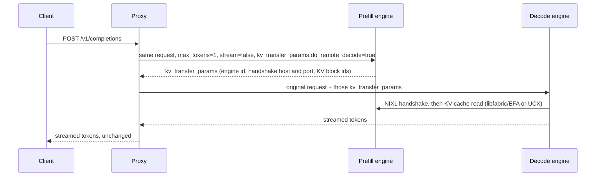

# vLLM prefill/decode disaggregation with NixlConnector

This Helm chart serves one model with prefill and decode disaggregated: prefill engines compute the KV cache of each prompt, decode engines pull that KV cache over NIXL and generate the answer, and a small proxy in front sends each request through both. The two roles run as two Deployments with their own replica count and GPUs per engine, so the prefill:decode ratio is a value, not a fixed 1:1. By default prefill and decode never share a node, and the KV cache moves over libfabric on EFA.

The chart uses vLLM's own disaggregation mechanism unchanged: the `NixlConnector` KV connector and the two-step request flow described in vLLM's [disaggregated prefilling](https://docs.vllm.ai/en/latest/features/disagg_prefill.html) and [NixlConnector usage](https://docs.vllm.ai/en/latest/features/nixl_connector_usage/) documents. vLLM marks this feature as a developer preview; its configuration may change between vLLM releases, which is why the image is pinned.

The aggregated baseline to compare against is [`../agg-baseline/`](../agg-baseline/); the load generator, the scorer and the dashboard are in [`../../_shared/`](../../_shared/).

## How a request flows



The proxy follows the flow of vLLM's own NixlConnector integration-test proxy. It finds engines by resolving the headless `-prefill` and `-decode` Services (which list ready pods only) and picks one of each round robin per request, so load is balanced per request rather than per TCP connection. If a prefill response carries no `kv_transfer_params`, the proxy returns HTTP 502 instead of letting decode quietly recompute the prompt, and the engines run with `kv_load_failure_policy: fail` for the same reason: a broken KV transfer shows up as failed requests, never as slower but successful ones.

## Placement and transport

Three mechanisms keep the roles apart, each doing a different job:

| Mechanism | What it does | Value |
| --- | --- | --- |
| Node label | Nodes are labeled for one role, for example `distai.dev/pd-role=prefill` or `distai.dev/pd-role=decode` | `placement.nodeSelectorKey` (default `distai.dev/pd-role`) |
| `nodeSelector` | Each role requests nodes with its own label value | `prefill.nodeSelectorValue`, `decode.nodeSelectorValue` |
| Required pod anti-affinity on `kubernetes.io/hostname` | No prefill pod is scheduled onto a node running a decode pod of the same release, and the other way round, even if the node labels are wrong; a pod that cannot be placed stays `Pending` | on unless `placement.allowSameNode=true` |

`placement.allowSameNode=true` removes the anti-affinity rule from both Deployments. It exists to measure the same-node transport path on purpose. To actually co-locate the roles, also give both roles the same node selector value, for example `--set decode.nodeSelectorValue=prefill`.

Transport is explicit. With `transport.backend=LIBFABRIC` (the default), both roles get `FI_PROVIDER=efa` and `FI_EFA_USE_DEVICE_RDMA=1` and request `vpc.amazonaws.com/efa` devices. Those two variables do not decide what happens when prefill and decode are on the same host: libfabric's EFA provider then uses its own shared-memory path by default, and the EFA device sees no traffic. `transport.forceEfaSameNode=true` sets `FI_EFA_ENABLE_SHM_TRANSFER=0` on both roles, which forces even a same-host transfer onto the EFA device (see `fi_efa(7)`). The default `false` leaves the variable unset, so the library default applies. Which path a transfer really took is read from the EFA hardware counters, not inferred from these values; see [Check which path the KV cache took](#check-which-path-the-kv-cache-took).

## Prerequisites

| Requirement | Why |
| --- | --- |
| An EKS cluster with NVIDIA GPU nodes and the NVIDIA device plugin (`nvidia.com/gpu`) | Engines request GPUs as an extended resource |
| The EFA device plugin (`vpc.amazonaws.com/efa`) on those nodes, for the default `LIBFABRIC` backend | Engines request EFA devices; FI_PROVIDER=efa needs one |
| At least one node labeled for each role | The node selectors |
| Nodes that can pull `vllm/vllm-openai` from Docker Hub and model weights from Hugging Face | The image and the weights are downloaded at start |
| `kubectl` and Helm 3.8 or later on your workstation | Installing the chart |

GPU only: neither the vLLM Neuron plugin nor NeuronX Distributed Inference ships a disaggregated prefill/decode path today, so this chart has no Neuron variant.

## Deploy

Clone the repository and set the values for your cluster. `MODEL_ID` is a Hugging Face model repository id that fits on `gpusPerEngine` GPUs of your nodes; `PREFILL_NODE` and `DECODE_NODE` are the names of two GPU nodes.

```bash
git clone https://github.com/littlemex/distai-platform.git
cd distai-platform
export NAMESPACE=pd-demo
export RELEASE=pd
export MODEL_ID="${MODEL_ID:?set MODEL_ID to a Hugging Face model repository id}"
export PREFILL_NODE="${PREFILL_NODE:?set PREFILL_NODE to a GPU node name}"
export DECODE_NODE="${DECODE_NODE:?set DECODE_NODE to another GPU node name}"
```

Label the nodes. On a cluster whose GPU nodes come from Karpenter, put the same label in the template of the NodePool that provisions each role instead, so that new nodes carry it from the start.

```bash
kubectl label node "$PREFILL_NODE" distai.dev/pd-role=prefill --overwrite
kubectl label node "$DECODE_NODE" distai.dev/pd-role=decode --overwrite
```

Install the chart. For a gated model, first create the namespace with `kubectl create namespace "$NAMESPACE"`, store your Hugging Face token in a Secret with `kubectl create secret generic hf-token -n "$NAMESPACE" --from-literal=token="$HF_TOKEN"` and add `--set model.hfTokenSecret.name=hf-token`.

```bash
helm install "$RELEASE" examples/inference/vllm/disagg-pd \
  --namespace "$NAMESPACE" --create-namespace \
  --set model.name="$MODEL_ID"
kubectl rollout status deployment -n "$NAMESPACE" -l app.kubernetes.io/instance="$RELEASE" --timeout=40m
```

The installation notes print the in-cluster endpoint and the number of GPUs the release requests, which is the `--gpu-count` the scorer needs.

## Verify

Check that prefill and decode landed on different nodes:

```bash
kubectl get pods -n "$NAMESPACE" -l app.kubernetes.io/instance="$RELEASE" -o wide
```

Send one request through the proxy from inside the cluster. The Service is `ClusterIP`, so it is not reachable from outside the cluster.

```bash
kubectl run curl-pd --rm -i --restart=Never -n "$NAMESPACE" \
  --image=curlimages/curl:8.23.0 -- \
  curl -sS "http://$RELEASE-vllm-disagg-pd:8000/v1/completions" \
  -H 'Content-Type: application/json' \
  -d "{\"model\": \"$MODEL_ID\", \"prompt\": \"The capital of France is\", \"max_tokens\": 32}"
```

The response is an ordinary OpenAI-style completion generated by a decode engine from a KV cache that a prefill engine computed.

## Check which path the KV cache took

The EFA hardware counters show whether a transfer used the EFA device. With the efa-node-exporter scrape job in place, the dashboard panel "EFA RDMA write bytes per node" plots `node_amazonefa_rdma_write_bytes_total` and `node_amazonefa_rdma_write_recv_bytes_total`. Without it, read the counters on the node itself, once before and once after sending requests:

```bash
export NODE="$PREFILL_NODE"
kubectl debug "node/$NODE" -n "$NAMESPACE" --profile=general --image=curlimages/curl:8.23.0 -i -- \
  sh -c 'cat /host/sys/class/infiniband/*/ports/*/hw_counters/rdma_write_bytes | awk "{s+=\$1} END {print s}"'
```

`kubectl debug` leaves a `node-debugger-*` pod behind; delete it when you are done:

```bash
kubectl get pods -n "$NAMESPACE" -o name | grep node-debugger | xargs kubectl delete -n "$NAMESPACE"
```

To measure the same-node path on purpose, reinstall with both roles on one node and run the two cells one after the other. The node needs at least two EFA devices, one per engine pod.

```bash
helm upgrade "$RELEASE" examples/inference/vllm/disagg-pd -n "$NAMESPACE" \
  --set model.name="$MODEL_ID" \
  --set placement.allowSameNode=true \
  --set decode.nodeSelectorValue=prefill \
  --set transport.forceEfaSameNode=true
```

With `transport.forceEfaSameNode=true` the counters on that node rise while requests run. Repeat with `--set transport.forceEfaSameNode=false`: the transfer now takes libfabric's shared-memory path and the counters stay flat while requests still succeed.

## Measure

Use the in-cluster load replay and the scorer in [`../../_shared/`](../../_shared/) against `http://$RELEASE-vllm-disagg-pd:8000`, then run the same trace against the [aggregated baseline](../agg-baseline/) on the same hardware. A comparison is only meaningful when the model revision, precision, hardware, total GPU count, vLLM version and the replayed trace are the same on both sides; pin `model.revision` for any measurement.

## Values

| Value | Default | Meaning |
| --- | --- | --- |
| `model.name` | `""` | Hugging Face model repository id. Required; the engines exit with a message until it is set |
| `model.revision` | `""` | Model repository commit or tag; empty is the default branch |
| `model.servedModelName` | `""` | Name clients send as `model`; empty is `model.name` |
| `model.hfTokenSecret.name` / `.key` | `""` / `token` | Secret with a Hugging Face token, for gated models |
| `image.repository` / `.tag` / `.digest` | `vllm/vllm-openai` / `v0.34.0-efa` / pinned | Engine and proxy image; the `-efa` variant is built with vLLM's KV connectors and the AWS EFA userspace |
| `accelerator.resourceName` | `nvidia.com/gpu` | Extended resource the GPU device plugin advertises |
| `placement.nodeSelectorKey` | `distai.dev/pd-role` | Node label key that tells the roles apart |
| `placement.allowSameNode` | `false` | `true` removes the prefill/decode anti-affinity rule |
| `placement.tolerations` | `[]` | Tolerations for both roles, for example for GPU node taints |
| `transport.backend` | `LIBFABRIC` | NIXL backend, `LIBFABRIC` or `UCX` |
| `transport.forceEfaSameNode` | `false` | `true` sets `FI_EFA_ENABLE_SHM_TRANSFER=0` on both roles; requires `LIBFABRIC` |
| `transport.efaResourceName` | `vpc.amazonaws.com/efa` | Extended resource the EFA device plugin advertises |
| `transport.sideChannelPort` | `5600` | NIXL handshake port (`VLLM_NIXL_SIDE_CHANNEL_PORT`); the host is the pod IP |
| `transport.kvLoadFailurePolicy` | `fail` | `fail` or `recompute` when decode cannot load a transferred KV cache |
| `transport.extraConnectorConfig` | `{}` | Extra keys for `kv_connector_extra_config` |
| `prefill.replicas`, `decode.replicas` | `1`, `1` | Engines per role |
| `prefill.gpusPerEngine`, `decode.gpusPerEngine` | `1`, `1` | GPUs per engine (tensor parallel degree) |
| `prefill.efaDevices`, `decode.efaDevices` | `1`, `1` | EFA devices per engine pod; at least 1 with `LIBFABRIC` |
| `prefill.nodeSelectorValue`, `decode.nodeSelectorValue` | `prefill`, `decode` | Label value each role selects |
| `prefill.extraNodeSelector`, `decode.extraNodeSelector` | `{}` | Additional node selector terms per role |
| `prefill.extraArgs`, `decode.extraArgs` | `[]` | Extra `vllm serve` arguments per role |
| `prefill.extraEnv`, `decode.extraEnv` | `[]` | Extra environment variables per role |
| `prefill.resources`, `decode.resources` | 4 CPU, 32Gi requested | CPU and memory; GPU and EFA limits are added from the values above |
| `engine.port` | `8000` | Engine HTTP port, also serving `/metrics` |
| `engine.shmSizeLimit` | `16Gi` | Size of the memory-backed `/dev/shm` |
| `engine.cacheVolume` | `emptyDir: {}` | Volume for the model download cache |
| `engine.podSecurityContext`, `engine.containerSecurityContext` | non-root UID 2000, all capabilities dropped | Security context of the engine pods |
| `engine.startupTimeoutSeconds` | `1800` | Time allowed for download and load before a restart |
| `proxy.replicas` | `1` | Proxy pods |
| `service.type` / `.port` | `ClusterIP` / `8000` | Client-facing Service in front of the proxy |
| `metrics.enabled` | `true` | Pod label and annotations for the `vllm` scrape job |

## Known issues

- vLLM documents NixlConnector as a developer preview. The chart is tested against the pinned image only; another vLLM version may need a different connector configuration.
- vLLM's OpenAI-compatible server has no authentication in this configuration. The Services are `ClusterIP`; any pod in the cluster that can reach them can send requests. Restrict access with a NetworkPolicy if the cluster is shared.
- With the default `emptyDir` cache, every engine pod downloads the weights at start. Point `engine.cacheVolume` at a persistent volume to avoid that.
- The engine containers run as the vLLM image's non-root user (UID 2000, GID 0) with all Linux capabilities dropped and privilege escalation disabled. EFA memory registration then relies on the node's locked-memory limit rather than a capability; if your nodes need `IPC_LOCK` for it, add the capability through `engine.containerSecurityContext`.
- One proxy pod is a single point of failure for the endpoint. Raise `proxy.replicas` for anything beyond measurement.

## Clean up

```bash
helm uninstall "$RELEASE" -n "$NAMESPACE"
kubectl label node "$PREFILL_NODE" distai.dev/pd-role-
kubectl label node "$DECODE_NODE" distai.dev/pd-role-
kubectl delete namespace "$NAMESPACE"
```
