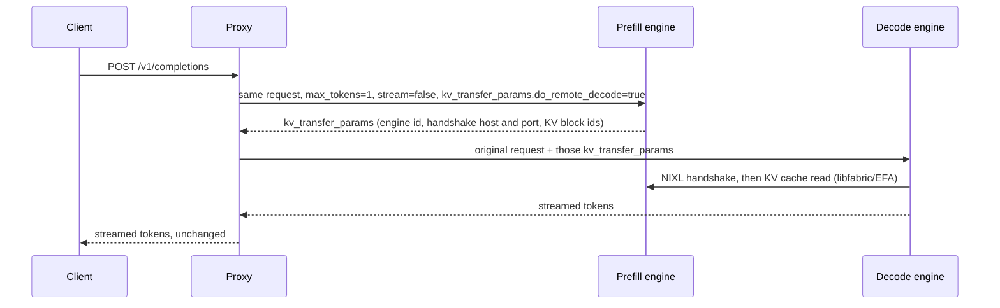

# vLLM prefill/decode disaggregation on AWS Trainium (vLLM Neuron plugin)

This Helm chart serves one model with prefill and decode disaggregated on AWS Trainium: prefill engines compute the KV cache of each prompt, decode engines pull that KV cache over NIXL and generate the answer, and a small proxy in front sends each request through both. The two roles run as two Deployments with their own replica count and NeuronCores per engine, so the prefill:decode ratio is a value, not a fixed 1:1. By default prefill and decode never share a node, and the KV cache moves over libfabric on EFA.

The engines run the [vLLM Neuron plugin](https://github.com/vllm-project/vllm-neuron) `0.29.0.1.2.0` (vLLM `0.29.0`, Neuron SDK `2.33`), whose release notes list disaggregated inference (1P1D and xPyD) as supported on Trn2 and Trn3. The plugin uses vLLM's own disaggregation mechanism: the `NixlConnector` KV connector with NIXL's `LIBFABRIC` backend over EFA and the same two-step request flow as vLLM on GPUs, described in the plugin's [disaggregated inference tutorial](https://github.com/vllm-project/vllm-neuron/blob/eb6cb360f7cff6082e22a9437d8ce0ba3891304a/docs/tutorials/tutorial-di-1p1d-xpyd.md) and [design document](https://github.com/vllm-project/vllm-neuron/blob/eb6cb360f7cff6082e22a9437d8ce0ba3891304a/docs/design/vllm/disaggregated-inference.md). The plugin is a Beta release, which is why the image is pinned.

This chart is the Neuron counterpart of the NVIDIA chart [`../../disagg-pd/`](../../disagg-pd/): the same value names wherever the concept is the same, the same proxy, the same NetworkPolicy and the same placement rules. The aggregated baseline to compare against is [`../agg-baseline/`](../agg-baseline/); the load generator, the scorer and the dashboard are in [`../../../_shared/`](../../../_shared/).

## How a request flows



The proxy is the NVIDIA chart's proxy, unchanged: it does not depend on the accelerator behind the engines, and the plugin's own tutorial proxy sends the same `kv_transfer_params`. It finds engines by resolving the headless `-prefill` and `-decode` Services and picks one of each round robin per request. If a prefill response carries no `kv_transfer_params`, the proxy returns HTTP 502 instead of letting decode quietly recompute the prompt, and the engines run with `kv_load_failure_policy: fail` for the same reason.

## What differs from the NVIDIA chart, and why

| Part | NVIDIA chart (`../../disagg-pd`) | This chart | Why |
| --- | --- | --- | --- |
| Image | `vllm/vllm-openai:v0.34.0-efa` | `public.ecr.aws/neuron/pytorch-inference-vllm-neuronx:0.29.0.1.2.0-neuronx-py314-sdk2.33.1-ubuntu26.04` | The Neuron plugin is a separate build with its own container, not a flag on the GPU image |
| Accelerator request | `nvidia.com/gpu` = `gpusPerEngine` | `aws.amazon.com/neuron` = ceil(`neuronCoresPerEngine` / `accelerator.coresPerDevice`) | The Neuron device plugin hands out whole devices (one Trainium2 device = 4 NeuronCores), while the tensor parallel degree counts NeuronCores |
| Tensor parallel value | `prefill.gpusPerEngine` | `prefill.neuronCoresPerEngine` (same for decode) | Named for the unit it counts |
| `kv_buffer_device` | not set (vLLM's default on CUDA is `cuda`) | `"cuda"`, always | vLLM defaults it to the platform's device type ([kv_transfer.py](https://github.com/vllm-project/vllm/blob/98dff2a81d747d1dba01a47f939f48c3526d4206/vllm/config/kv_transfer.py#L16-L18)), `neuron` here, which vLLM's NIXL worker rejects; the Neuron platform registers only `cuda` for NIXL ([platform.py](https://github.com/vllm-project/vllm-neuron/blob/eb6cb360f7cff6082e22a9437d8ce0ba3891304a/vllm_neuron/vllm/platform.py#L1134-L1141), [base_worker.py](https://github.com/vllm-project/vllm/blob/98dff2a81d747d1dba01a47f939f48c3526d4206/vllm/distributed/kv_transfer/kv_connector/v1/nixl/base_worker.py#L455-L463)) |
| Connector class | `NixlConnector` | `NixlConnector` | The plugin rewrites a top-level `NixlConnector` to its subclass `NeuronNixlConnector`, which registers Neuron's KV cache layout ([platform.py](https://github.com/vllm-project/vllm-neuron/blob/eb6cb360f7cff6082e22a9437d8ce0ba3891304a/vllm_neuron/vllm/platform.py#L1194-L1219)) |
| Compile cache | none | `prefill.compileCacheVolume`/`decode.compileCacheVolume` at `VLLM_CACHE_ROOT`, with `VLLM_NEURON_BACKEND=neuron_native` | A cold start traces and compiles the model; the [precompile cache guide](https://github.com/vllm-project/vllm-neuron/blob/eb6cb360f7cff6082e22a9437d8ce0ba3891304a/docs/guides/how-to-precompile-cache.md) says the cache is only on when that variable is set explicitly. Set per role (not once for both): prefill and decode run on separate nodes, so one shared field pointing both at the same PersistentVolumeClaim name would hand two Pods on two different nodes the same claim |
| MPS and memory fraction | `*.mps`, `*.gpuMemoryUtilization` | absent | NVIDIA-only; Neuron has no counterpart |
| Non-root user | the image's own `vllm` user (UID 2000) | UID 2000 with `HOME` and `USER` set by the chart | The Neuron image declares no user of its own |
| Router alternatives | also `../../disagg-pd-llmd` (llm-d) | this proxy only | No primary source shows llm-d's Endpoint Picker running against the Neuron plugin ([#80](https://github.com/littlemex/distai-platform/issues/80)) |

`NEURON_VISIBLE_DEVICES` is never set. The plugin's tutorial uses it for host-level NeuronCore numbering on a bare instance and says to leave it unset under Kubernetes and size the resource request instead; the device plugin already exposes only the allocated devices to the container.

The KV connector role defaults to `kv_both` on both roles (`transport.kvRoleMode: kv_both`), the same as the NVIDIA chart, instead of the tutorial's `kv_producer`/`kv_consumer` split. The plugin supports `kv_both`; its cost is that a decode engine keeps its prefill weights and compiles its prefill graph, which a `kv_consumer` engine would skip. Whether the plugin's NIXL path accepts `kv_both` end to end on Trainium is part of the real-hardware check ([Status](../../../README.md#status)). If it does not, set `transport.kvRoleMode: producer_consumer` to render the tutorial's own shape instead (`kv_producer` on prefill, `kv_consumer` on decode) -- a values-only change, not a template change; the connector class itself already becomes `NeuronNixlConnector` through the plugin's own rewrite either way.

## Placement and transport

Placement works exactly as in the NVIDIA chart (see [its "Placement and transport" section](../../disagg-pd/README.md#placement-and-transport)): each role selects nodes where `placement.nodeSelectorKey` equals its own `nodeSelectorValue`, and the decode Deployment carries a required pod anti-affinity against prefill's node and, whenever EFA is requested AND `placement.enforceAntiAffinity` is `true` (the default), a required pod affinity to prefill's Availability Zone. **Known gap, identical in both this chart and the NVIDIA chart it mirrors**: with `placement.enforceAntiAffinity: false`, the zone guarantee is dropped along with the anti-affinity it backstops, even if EFA is still requested -- tracked in [#92](https://github.com/littlemex/distai-platform/issues/92), not fixed here. The values-contract checker asserts the zone term renders under the default configuration (required `podAffinity`, `topologyKey: topology.kubernetes.io/zone`, matching prefill's own labels); it does not assert that the gap above exists, only that the default's own guarantee holds. On this platform's capacity pools, `placement.nodeSelectorKey=karpenter.sh/nodepool` selects one NodePool per role with no extra node label, because Karpenter sets that label on every node it launches.

Transport is NIXL `LIBFABRIC` over EFA: both roles get `FI_PROVIDER=efa`, `FI_EFA_USE_DEVICE_RDMA=1` and an explicit `FI_EFA_ENABLE_SHM_TRANSFER`, and request `vpc.amazonaws.com/efa` devices. The plugin's tutorial requires `FI_EFA_ENABLE_SHM_TRANSFER=0` for prefill and decode on one node ("without it, both servers can start successfully but requests can produce inaccurate output"); `transport.forceEfaSameNode=true` sets it, together with `placement.sameNodeMeasurement=true`. A same-node run needs an instance with at least two Neuron devices and two EFA interfaces (for example `trn2.48xlarge`), because each engine pod holds its own; a `trn2.3xlarge` has one of each.

## Prerequisites

| Requirement | Why |
| --- | --- |
| A cell of this platform, which delivers the core add-ons [`accel-neuron-device-plugin`](../../../../../gitops/addons/accel-neuron-device-plugin/addon.yaml) (`aws.amazon.com/neuron`) and [`accel-efa-device-plugin-neuron`](../../../../../gitops/addons/accel-efa-device-plugin-neuron/addon.yaml) (`vpc.amazonaws.com/efa` on Neuron nodes) | Engines request Neuron devices and EFA devices as extended resources |
| Two Trainium capacity pools, one per role, each shaped like [`gitops/cells/dp-a19-trn-r3/capacity-pool/trn.yaml`](../../../../../gitops/cells/dp-a19-trn-r3/capacity-pool/trn.yaml) and requesting one EFA interface (below) | The method label opts the nodes into the Neuron device plugin; the EFA interface sets `distai.dev/efa-attached=true`, which the Neuron EFA device plugin also selects on |
| The toleration `aws.amazon.com/neuron=true:NoSchedule` on both roles (`placement.tolerations`) | That pool shape taints its nodes so that only pods requesting the device land there |
| A Hugging Face token with access to the model, for gated models such as `meta-llama/Llama-3.2-1B-Instruct` | The weights are downloaded at start |
| Nodes that can pull from `public.ecr.aws` and Hugging Face, with a root volume large enough for the image (about 6.5 GB compressed; the pool shape above sets `100Gi`) | The image and the weights are downloaded at start |
| `kubectl` and Helm 3.8 or later on your workstation | Installing the chart |

Each pool's parameter file adds `pool.networkInterfaces` to the `trn.yaml` shape, with the one-EFA-interface layout the capacity-pool chart documents for a single-network-card instance type such as `trn2.3xlarge` (see the `networkInterfaces` comment in [`gitops/charts/capacity-pool/values.yaml`](../../../../../gitops/charts/capacity-pool/values.yaml)). For the prefill pool (`pool.name: trn-prefill`; the decode pool is the same with `pool.name: trn-decode`):

```yaml
values:
  pool:
    name: trn-prefill
    networkInterfaces:
      - networkCardIndex: 0
        deviceIndex: 0
        interfaceType: interface
      - networkCardIndex: 0
        deviceIndex: 1
        interfaceType: efa-only
```

## Deploy

The example serves `meta-llama/Llama-3.2-1B-Instruct`, a model in the plugin's tested-model table, with one NeuronCore per engine: one prefill engine and one decode engine, each on its own `trn2.3xlarge`. `--max-model-len 4096 --max-num-seqs 4` are the values of the plugin's [online serving quickstart](https://github.com/vllm-project/vllm-neuron/blob/eb6cb360f7cff6082e22a9437d8ce0ba3891304a/docs/getting-started/quickstart-online-serving.md); they keep the compiled shapes small, and both roles must use the same values.

```bash
git clone https://github.com/littlemex/distai-platform.git
cd distai-platform
export NAMESPACE=pd-neuron
export RELEASE=pdn
export MODEL_ID=meta-llama/Llama-3.2-1B-Instruct
export PREFILL_POOL=trn-prefill
export DECODE_POOL=trn-decode
export HF_TOKEN="${HF_TOKEN:?set HF_TOKEN to a Hugging Face token with access to the model}"
kubectl create namespace "$NAMESPACE"
kubectl create secret generic hf-token -n "$NAMESPACE" --from-literal=token="$HF_TOKEN"
helm install "$RELEASE" examples/inference/vllm/neuron/disagg-pd \
  --namespace "$NAMESPACE" \
  --set model.name="$MODEL_ID" \
  --set model.hfTokenSecret.name=hf-token \
  --set prefill.neuronCoresPerEngine=1 \
  --set decode.neuronCoresPerEngine=1 \
  --set placement.nodeSelectorKey=karpenter.sh/nodepool \
  --set prefill.nodeSelectorValue="$PREFILL_POOL" \
  --set decode.nodeSelectorValue="$DECODE_POOL" \
  --set-json 'placement.tolerations=[{"key":"aws.amazon.com/neuron","operator":"Equal","value":"true","effect":"NoSchedule"}]' \
  --set-json 'prefill.extraArgs=["--max-model-len","4096","--max-num-seqs","4"]' \
  --set-json 'decode.extraArgs=["--max-model-len","4096","--max-num-seqs","4"]'
kubectl rollout status deployment -n "$NAMESPACE" -l app.kubernetes.io/instance="$RELEASE" --timeout=40m
```

The installation notes print the in-cluster endpoint, the number of Neuron devices the release requests (the `--gpu-count` the scorer needs, one unit per reserved device) and the NeuronCores the engines use.

## Verify

Check that prefill and decode landed on different nodes:

```bash
kubectl get pods -n "$NAMESPACE" -l app.kubernetes.io/instance="$RELEASE" -o wide
```

The engine log names the connector the plugin chose; expect the rewrite to `NeuronNixlConnector`:

```bash
kubectl logs -n "$NAMESPACE" deployment/"$RELEASE"-vllm-neuron-disagg-pd-decode | grep -i 'NeuronNixlConnector'
```

Send one request through the proxy from inside the cluster. The Service is `ClusterIP`, so it is not reachable from outside the cluster.

```bash
kubectl run curl-pdn --rm -i --restart=Never -n "$NAMESPACE" \
  --labels=app.kubernetes.io/name=load-replay \
  --image=curlimages/curl:8.23.0 -- \
  curl -sS -f "http://$RELEASE-vllm-neuron-disagg-pd:8000/v1/completions" \
  -H 'Content-Type: application/json' \
  -d "{\"model\": \"$MODEL_ID\", \"prompt\": \"The capital of France is\", \"max_tokens\": 32}"
```

Which path the KV cache took is read from the EFA hardware counters on both nodes, the same way as for the NVIDIA chart (see [its "Check which path the KV cache took" section](../../disagg-pd/README.md#check-which-path-the-kv-cache-took)); in the plugin's read mode, decode pulls the blocks from prefill with an RDMA read.

## Measure

Run the load replay and scorer from [`../../../_shared/`](../../../_shared/) against `http://$RELEASE-vllm-neuron-disagg-pd:8000`, with `--gpu-count` set to the number of Neuron devices the installation notes print, and the same trace and SLO as the [aggregated baseline](../agg-baseline/) run on the same instance type.

## Values

| Value | Default | Meaning |
| --- | --- | --- |
| `model.name` | `""` | Hugging Face model repository id. Required; the engines exit with a message until it is set |
| `model.revision` | `""` | Model repository commit or tag; empty is the default branch |
| `model.servedModelName` | `""` | Name clients send as `model`; empty is `model.name` |
| `model.hfTokenSecret.name` / `.key` | `""` / `token` | Secret with a Hugging Face token, for gated models |
| `image.repository` / `.tag` / `.digest` | `public.ecr.aws/neuron/pytorch-inference-vllm-neuronx` / `0.29.0.1.2.0-neuronx-py314-sdk2.33.1-ubuntu26.04` / `sha256:7e44e4f6...` (pinned) | Engine and proxy image; confirmed against the registry's own v2 manifest API (a metadata-only query, not a layer pull), pinned in values.yaml |
| `accelerator.resourceName` | `aws.amazon.com/neuron` | Extended resource the Neuron device plugin advertises, one unit per device |
| `accelerator.coresPerDevice` | `4` | NeuronCores per device (Trainium2 at the default logical NeuronCore setting); devices per engine = ceil(`neuronCoresPerEngine` / this) |
| `placement.nodeSelectorKey` | `distai.dev/pd-role` | Node label key that tells the roles apart; `karpenter.sh/nodepool` selects one capacity pool per role |
| `placement.sameNodeMeasurement` | `false` | `true` targets both roles' `nodeSelector` at `placement.sharedPoolValue` instead of their own `nodeSelectorValue` |
| `placement.sharedPoolValue` | `shared` | The pool value both roles target when `sameNodeMeasurement=true` |
| `placement.enforceAntiAffinity` | `true` | `false` swaps decode's required anti-affinity (against prefill) for a required affinity (toward prefill), only meaningful with `sameNodeMeasurement=true` |
| `placement.tolerations` | `[]` | Tolerations for both roles; `aws.amazon.com/neuron=true:NoSchedule` for this platform's Neuron pools |
| `transport.backend` | `LIBFABRIC` | NIXL backend, `LIBFABRIC` or `UCX` (UCX is not documented by the plugin and not run on Neuron) |
| `transport.forceEfaSameNode` | `false` | `true` sets `FI_EFA_ENABLE_SHM_TRANSFER=0` on both roles (else explicitly `1`); requires `LIBFABRIC` and `placement.sameNodeMeasurement=true` |
| `transport.efaResourceName` | `vpc.amazonaws.com/efa` | Extended resource the EFA device plugin advertises |
| `transport.sideChannelPort` | `5600` | NIXL handshake port (`VLLM_NIXL_SIDE_CHANNEL_PORT`); the host is the pod IP |
| `transport.ucx.tcpPortRange` | `"20000-20063"` | `UCX_TCP_PORT_RANGE`, only read with `backend=UCX` |
| `transport.kvLoadFailurePolicy` | `fail` | `fail` or `recompute` when decode cannot load a transferred KV cache |
| `transport.kvRoleMode` | `kv_both` | `kv_both` (default, both roles) or `producer_consumer` (`kv_producer` on prefill, `kv_consumer` on decode -- the plugin's own tutorial shape, skips `kv_both`'s weight/compile cost on decode). Any other value fails the render |
| `transport.extraConnectorConfig` | `{}` | Extra keys for `kv_connector_extra_config` |
| `prefill.replicas`, `decode.replicas` | `1`, `1` | Engines per role |
| `prefill.neuronCoresPerEngine`, `decode.neuronCoresPerEngine` | `1`, `1` | NeuronCores per engine (tensor parallel degree) |
| `prefill.efaDevices`, `decode.efaDevices` | `1`, `1` | EFA devices per engine pod; at least 1 with `LIBFABRIC` |
| `prefill.nodeSelectorValue`, `decode.nodeSelectorValue` | `prefill`, `decode` | Label value each role selects |
| `prefill.extraNodeSelector`, `decode.extraNodeSelector` | `{}` | Additional node selector terms per role |
| `prefill.extraArgs`, `decode.extraArgs` | `[]` | Extra `vllm serve` arguments per role |
| `prefill.extraEnv`, `decode.extraEnv` | `[]` | Extra environment variables per role, for example `TORCH_CACHING_PRECOMPILE=0` |
| `prefill.resources`, `decode.resources` | 4 CPU, 32Gi requested | CPU and memory; Neuron device and EFA limits are added from the values above |
| `engine.port` | `8000` | Engine HTTP port, also serving `/metrics` |
| `engine.shmSizeLimit` | `16Gi` | Size of the memory-backed `/dev/shm` |
| `engine.cacheVolume` | `emptyDir: {}` | Volume for the model download cache (`HF_HOME`) |
| `prefill.compileCacheVolume`, `decode.compileCacheVolume` | `emptyDir: {}` each | Volume for the compile cache (`VLLM_CACHE_ROOT`), one independent value per role. `emptyDir` is already one instance per Pod with no change needed; a `persistentVolumeClaim` override must use a different claim name per role (or an access mode that supports multiple attachers) since prefill and decode run on separate nodes, and must set `emptyDir: null` explicitly (Helm deep-merges a values-file map into the chart's default map, so leaving `emptyDir: {}` in place renders a volume carrying both sources, which the API server rejects) |
| `engine.podSecurityContext`, `engine.containerSecurityContext` | non-root UID 2000, all capabilities dropped | Security context of the engine pods |
| `engine.startupTimeoutSeconds` | `1800` | Time allowed for download, compile and load before a restart |
| `proxy.replicas` | `1` | Proxy pods |
| `service.type` / `.port` | `ClusterIP` / `8000` | Client-facing Service in front of the proxy |
| `metrics.enabled` | `true` | Pod label and annotations for the `vllm` scrape job |
| `networkPolicy.enabled` | `true` | Default-deny ingress with the same exceptions as the NVIDIA chart |
| `networkPolicy.metricsScrapeFrom` | `[]` | Ingress peers allowed to scrape `engine.port` |
| `kvCacheTier.mode` | `gpu-only` | Same mode names as the NVIDIA chart; `gpu-only` means NIXL alone. `local`/`remote` render `MultiConnector` with `NeuronNixlConnector` and `LMCacheMPConnector`, unverified on Neuron |
| `kvCacheTier.lmcache.mpServerEndpoint` | `""` | `host:port` of LMCache's own mp server; required whenever `mode` is `local` or `remote` |
| `kvCacheTier.lmcache.extraConfig` | `{}` | Merged into `kv_connector_extra_config` as-is |

## Known issues

- Installed on a real cluster for the first time in the 8th real-hardware attempt on [#80](https://github.com/littlemex/distai-platform/issues/80) (across three rounds): the first 7 attempts never reached this chart at all -- 3 stopped in the verification harness's own setup before any chart was installed (fixed, not chart defects); of the other 4, which each installed `../agg-baseline/` first, 1 hit a `trn2.3xlarge` spot capacity wall, 2 crash-looped before `Ready` (the real engine-startup defect fixed by `values.yaml`'s `engine.skipEfaAffinity`), and 1 reached `Ready` but the harness's own request step aborted before this chart could be installed (a harness bug, fixed in the next round). In the 8th attempt, `../agg-baseline/` reached `Ready` again and, for the first time, returned a real completion response through it, then this chart installed cleanly -- but its three pods (`prefill`, `decode`, `proxy`) stayed `Pending` for the full wait window and the round never completed. `kubectl describe pod`/`kubectl get events`, captured before teardown, showed three different causes: the `decode` pod's node was repeatedly reported as not yet having `vpc.amazonaws.com/efa` to allocate even once Karpenter had nominated it; the `prefill` pod saw the same kind of transient `Insufficient aws.amazon.com/neuron`/`Insufficient vpc.amazonaws.com/efa` scheduling failures before its own wait window ran out; and the `proxy` pod -- which requests no Neuron device and carries no `nodeSelector`/`tolerations` by design (`values.yaml`'s `proxy.nodeSelector: {}` / `proxy.tolerations: []`) -- had no node to land on at all, because every node in that verification cluster carried either the platform's own system-node-group taint or one of the two Neuron-pool taints, and no generic, untainted node pool existed for a Neuron-free pod like the proxy to use. Whether that last point is a gap in the verification harness (which never provisions a generic node pool) or a real deployment consideration for this chart (which assumes some node, somewhere, tolerates nothing but an ordinary workload) is not yet settled; it is not fixed here. This chart's own EFA requests, required anti-affinity and zone affinity are therefore still verified by `helm template` only (the static checks in this directory), never against a live, `Ready` pod. See [#80](https://github.com/littlemex/distai-platform/issues/80) for the exact events, not repeated here.
- The image is pinned by tag and digest (confirmed against the registry's own v2 manifest API).
- The engines run as UID 2000, a user the image does not define. The chart sets `HOME` to a writable directory and `USER` so that Python and Torch do not fail on the missing account. That a non-root process can open the Neuron device files on this platform's nodes is consistent with, not independently confirmed by, a later round's real-hardware run: `../agg-baseline/`'s own pod reached `Ready` with this exact UID, meaning the readiness probe's own HTTP health check passed against the running server; this disaggregated chart's own pods reached real hardware for the first time in the 8th attempt but stayed `Pending` for the whole wait window (see the bullet above), so no container from this chart has run on real hardware yet, and no dedicated log line confirming the device open itself was captured in either chart's case. Separately, `engine.podSecurityContext` sets `fsGroup: 0` as defense-in-depth for a `PersistentVolumeClaim` override of `cacheVolume`/`compileCacheVolume`: some provisioners/access modes hand back a volume owned by a group other than 0, which this UID could not then write to without it. It is not what fixes the default `emptyDir` configuration, and it was never the aggregated chart's own real-hardware crash loop's cause (`values.yaml`'s own `engine.skipEfaAffinity` comment is): a real kubelet (confirmed with a local `kind` cluster, no Trainium needed) creates a plain `emptyDir` (no PVC override) as `root:root` mode `0777`, already writable by any UID regardless of group. An earlier round's own container-only reproduction (a bind mount on a plain Docker host, not a real kubelet) wrongly suggested `0755`, because a bind-mounted host directory inherits the host's own umask instead of the kubelet's own emptyDir creation mode.
- With the default `emptyDir` volumes, every engine pod downloads the weights and compiles the model at start. `prefill.compileCacheVolume`/`decode.compileCacheVolume` can each be pointed at their own `PersistentVolumeClaim`, since they are independent values -- but every replica of one role still shares that one role's single Pod template (a Kubernetes `Deployment` cannot give each replica its own distinct volume source), so a PVC compile cache only works at `replicas: 1` per role, or with an access mode that supports multiple attachers (for example an EFS-backed `ReadWriteMany` claim); the plugin's own guide also says multi-node precompile is not coordinated yet, which is a second, independent reason not to share one cache between concurrent replicas. `engine.cacheVolume` (the HF weights cache) is still one value shared by *both* prefill and decode -- the same multi-attach risk a `PersistentVolumeClaim` override would hit on `compileCacheVolume` before it was split applies to `cacheVolume` too, unchanged here; use a multi-attach access mode if overriding it to a PVC, or leave it as the default `emptyDir`.
- The proxy runs in the engine image so that it needs no image of its own; the node it lands on pulls the full image.
- vLLM's OpenAI-compatible server has no authentication in this configuration. The Services are `ClusterIP` and the NetworkPolicy admits only the proxy and the shared load-replay driver.
- One proxy pod is a single point of failure for the endpoint. Raise `proxy.replicas` for anything beyond measurement.
- Whether the Neuron plugin exposes every vLLM metric that `_shared/dashboards/vllm-pd.json` reads is not confirmed.

## Clean up

```bash
helm uninstall "$RELEASE" -n "$NAMESPACE"
kubectl delete namespace "$NAMESPACE"
```
