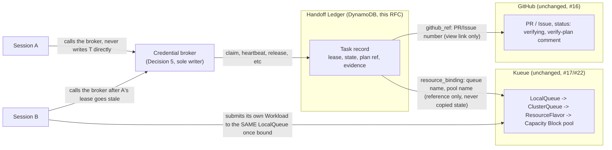
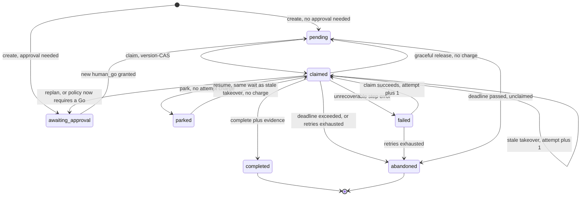
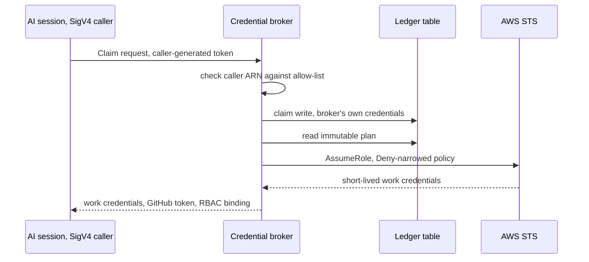

# RFC: Task handoff between AI agent sessions

Status: draft, under Fable 5.2 review. Not an Issue yet (maintainer posts to GitHub).

## Motivation

distai-platform's own verification tiers (#16) already buy scarce, time-boxed
capacity: a 24-hour Capacity Block, a `light` spot/on-demand accelerator, a `queued`
batch the maintainer approves once for several pull requests at a time. Today, the
thing that *uses* that capacity across its lifetime is a human, or at most one AI
session that stays alive for the whole window. That assumption is already false in
practice: a Claude Code session (Mac, EC2 relay box, a sub-agent, a headless
`claude -p` job, an in-cluster agent pod) runs for a bounded context/time budget, can
be background-detached, can be killed, and routinely hands off to a fresh session with
no shared process memory. When a 24-hour Capacity Block outlives the session that
requested it, or a verification run spans more wall-clock time than one session's
lifetime, something has to let a *different* AI session discover the in-flight task,
the capacity it is bound to, and the evidence already produced, and continue safely -
without re-running finished work, without two sessions fighting over the same block,
and without a crashed session silently stranding a $50-$1,000/day reservation.

The maintainer's own framing (2026-11-19) names the three hard parts directly:
hand off a task *and* the resource it holds; detect a stalled hand-off when the
accelerating signal (a Claude Code hook) does not fire, which it is not guaranteed to;
and do all of this with permissions narrower than today's `AdministratorAccess`
runner role, per task, not per machine. Kueue is one candidate the maintainer named
but did not commit to ("maybe with Kueue, I don't know") - this RFC takes that
question seriously and answers it precisely, rather than reaching for Kueue because
it is already in the stack.

This is explicitly a cross-cutting mechanism, not a distai-platform feature: it must
work for a session on the maintainer's Mac, a session on the EC2 relay/runner box, and
(once device/capacity work from #17/#19/#22 lands) an in-cluster agent pod, with or
without Kubernetes present at all. Per this platform's own standing principle ("no
repository-only abstraction" - distai-platform `AGENTS.md` / this skill's section 0.4),
a mechanism this generic is designed to be buildable as an independent, small OSS
project, with distai-platform as its first and most demanding consumer (Decision 12
makes this explicit, including the alternative of keeping it in-repo and why that
loses).

## Terminology

| Term | Meaning in this RFC |
| --- | --- |
| Session | One running AI agent process: a Claude Code CLI session (interactive, background, or headless `claude -p`), a sub-agent, or an in-cluster agent pod. Identified to the Ledger only by whatever lease token it currently holds (Decision 4), never by a self-asserted name. |
| Task | One unit of work with a lifetime longer than a single tool call: "run verification lane 1 under the current Capacity Block", "wait for the maintainer's Go on PR #41", "finish the migration PR #21 started". Identified by `task_id`. |
| Plan | The immutable, content-addressed record (`plan_ref`) of everything a human Go approves for one task: `kind`, permission profile, resource binding, budgets (Decision 2, Decision 6). The step *list*'s own run-time progress stays on the mutable task item (Decision 8) - a plan fixes scope and budget, not a live work log. |
| Ledger | The durable, authoritative store of task records and plans (Decision 2). Not Kueue, not GitHub - a separate small store, linked to both by ID. |
| Lease | A time-boxed, exclusively-held claim on a task, recorded in the Ledger as a random per-claim token (Decision 4). |
| Resource binding | A reference from a task's plan to a Kueue `LocalQueue`/`ClusterQueue`/capacity pool the task's work is (or will be) scheduled through - never a copy of Kueue's own state. |
| Broker | The small, maintainer-owned service (Decision 5) that is the only thing allowed to mint scoped AWS/GitHub/Kubernetes credentials for a task, from a maintainer-authored permission profile - never from an AI-authored policy. |
| Go | The maintainer's explicit, unforgeable, MFA-gated approval of one specific plan hash (Decision 6), required before an AI may claim a task whose `kind` a maintainer-owned policy marks as needing one. Reuses #16's own vocabulary and binding rules (plan hash, head SHA) rather than inventing a second approval grammar. |

## Use cases this design is checked against

Numbered 1-10 as given by the maintainer, plus five added during design (11-15),
each with the section of this RFC that is its primary answer.

| # | Use case | Primary answer |
| --- | --- | --- |
| 1 | Session A finishes lane 1 under a 24h Capacity Block, hands the block and lane 2 to session B, evidence included - the concrete, scheduled first consumer is a `p5en x2` block: lane 1 EKS verification (Kueue-bound), lane 2 an engram GIN experiment on bare EC2 in the same reservation (no Kubernetes) | Decision 1 (Kueue vs. Ledger split, "first real consumer"), Decision 8 (evidence) |
| 2 | A crashes or its hook never fires; B must detect the stall via heartbeat/lease expiry and take over without double execution | Decision 4 |
| 3 | Two agents race for the same task | Decision 4 (conditional writes) |
| 4 | A task needs a human Go; the AI cannot self-approve | Decision 6 |
| 5 | A task declares what it may touch; the claimant gets only that; secrets never pass through the task record | Decision 5 |
| 6 | Partial work and resumability: checkpoints, idempotent steps, what "done" means, evidence links | Decision 8 |
| 7 | Cost and time boxes: a task that keeps retrying; a block ending | Decision 9 |
| 8 | Audit: who did what when | Decision 10 |
| 9 | The maintainer's one place to see and steer all tasks | Decision 11 |
| 10 | Cross-environment: Mac, EC2, in-cluster pods | Decision 2 (store reachable the same way from anywhere with AWS credentials) |
| 11 | A session is deliberately paused (background/detached) for hours, not crashed - must not be treated as stalled | Decision 4 (lease duration vs. heartbeat interval), Decision 7 (hooks as accelerant) |
| 12 | A task's scope changes mid-flight (the plan is edited after a claim) - mirrors #16's own "a push invalidates the go-ahead" rule | Decision 6 |
| 13 | A sub-agent spawned *by* a claimed task needs its own, narrower permissions than its parent task | Decision 5 (permission narrowing is compositional) |
| 14 | The Ledger itself must not become a second place secrets or approvals can be forged by a compromised AI session | Decision 5, Decision 6 |
| 15 | A task is abandoned (no session ever claims it, or every retry is exhausted) and must stop consuming capacity, not retry forever | Decision 9 |

## Proposed Change

(Decisions 1-12 follow in this document; each states options considered, the
decision, and why - matching this platform's own RFC style, e.g. `issues2/17-full.md`,
`issues2/22-tenancy.md`.)

### Facts checked (2026-11-19)

| Topic | Fact | Source |
| --- | --- | --- |
| Kueue `Workload` | The unit of admission; spec carries `podSets`, `queueName`, `priority`, `maximumExecutionTimeSeconds`; status carries `schedulingStats.evictions`, `reclaimablePods`, `nominatedClusterNames`. Admission is `QuotaReservation=True` AND every `AdmissionCheck` `Ready`. `labelKeysToCopy` copies arbitrary labels from the owning Job/Pod onto the Workload for identification/debugging only - a passive mirror, not a field Kueue itself interprets. No Kueue doc defines task ownership, heartbeat, lease or takeover between two non-Kubernetes actors | [Kueue Workload](https://kueue.sigs.k8s.io/docs/concepts/workload/), [Kueue AdmissionCheck](https://kueue.sigs.k8s.io/docs/concepts/admission_check/), checked 2026-11-19 |
| Kueue `MultiKueue` | Manager/worker model coordinating **where a resource request runs** across clusters (dispatch modes AllAtOnce/Incremental/External); it syncs a Workload's status back and deletes losing copies. This is cluster placement for one resource request, not task business state or ownership between two external actors | [Kueue MultiKueue](https://kueue.sigs.k8s.io/docs/concepts/multikueue/), checked 2026-11-19 |
| `coordination.k8s.io/v1` `Lease` | Fields `holderIdentity`, `leaseDurationSeconds`, `renewTime`, `leaseTransitions`. Kubernetes' own docs sanction it as a general-purpose coordination primitive beyond built-in uses ("custom workloads can define their own use of Leases"), but reaching it always means talking to a kube-apiserver (kubeconfig + RBAC) - there is no standalone client usable with no Kubernetes control plane, unlike a plain database row | [Kubernetes Leases](https://kubernetes.io/docs/concepts/architecture/leases/), checked 2026-11-19 |
| `client-go` `leaderelection` | Config: `LeaseDuration` (default 15s), `RenewDeadline` (10s), `RetryPeriod` (2s). States explicitly: **"This implementation does not guarantee that only one client is acting as a leader (a.k.a. fencing)."** No fencing token is exposed beyond a bare transition counter | [client-go leaderelection](https://pkg.go.dev/k8s.io/client-go/tools/leaderelection), checked 2026-11-19 |
| Prior art search | No blog post, RFC, KEP or paper found tying Kueue, or any Kubernetes queue/scheduler, to AI-agent-to-AI-agent task handoff specifically (search terms and engines recorded in the research log). This is an open design question, not a documented pattern | negative result, searched 2026-11-19 |
| Argo Workflows | Steps are scheduled onto Kubernetes Pods, with no claim/ownership concept at the step level; `retryPolicy` (default `OnFailure`) reacts to the main container failing, `OnError` to a controller/init/wait failure; `activeDeadlineSeconds` bounds a workflow or template's total time; external resumption is `argo resume` (CLI) or the Argo Server REST API's `PUT .../resume`, both assuming the *same* workflow object, not a different claimant taking over step ownership | [Argo Workflows retries](https://argo-workflows.readthedocs.io/en/latest/retries/), [timeouts](https://argo-workflows.readthedocs.io/en/latest/walk-through/timeouts/), [suspending](https://argo-workflows.readthedocs.io/en/latest/walk-through/suspending/), checked 2026-11-19 |
| Temporal Activity model | Activities heartbeat; four timeout types (Schedule-To-Start, Start-To-Close, Schedule-To-Close, Heartbeat); "the Temporal Server cannot directly detect that a Worker has lost communication," so heartbeat silence is the only death signal; on timeout, Retry Policy lets a *different* worker re-poll the same Task Queue - handoff is a first-class, built-in guarantee. Workflows can live for days; only the Activity's own heartbeat interval need be short | [Temporal Activities](https://docs.temporal.io/activities), [Detecting Activity Failures](https://docs.temporal.io/encyclopedia/detecting-activity-failures), checked 2026-11-19 |
| AWS Step Functions Task Tokens | `.waitForTaskToken` + `HeartbeatSeconds`; no `SendTaskHeartbeat`/`SendTaskSuccess`/`SendTaskFailure` within the heartbeat window raises `States.Timeout`. The documented, canonical use of this exact pattern is a human-approval gate | [Step Functions callback pattern](https://docs.aws.amazon.com/step-functions/latest/dg/connect-to-resource.html), checked 2026-11-19 |
| SQS FIFO visibility timeout | An implicit, time-based lease, not a true exclusive lock: "the queue doesn't guarantee that the consumer will never receive the message again" even inside the visibility window; a crashed consumer that already produced a side effect before being re-delivered the same message re-runs that side effect unless the application itself is idempotent | [SQS visibility timeout](https://docs.aws.amazon.com/AWSSimpleQueueService/latest/SQSDeveloperGuide/sqs-visibility-timeout.html), checked 2026-11-19 |
| DynamoDB conditional-write leases | AWS's own reference implementation (`amazon-dynamodb-lock-client`) stores only a *relative* lease duration, never an absolute clock reading, specifically so two machines with unsynchronized clocks do not fight over a lease; ownership changes are atomic conditional writes keyed on a record version, with a background thread sending heartbeats that bump the version - heartbeat silence plus lease-duration expiry is the death signal, and the conditional write is what prevents two claimants from both succeeding | [amazon-dynamodb-lock-client](https://github.com/awslabs/amazon-dynamodb-lock-client), [DynamoDB TTL](https://docs.aws.amazon.com/amazondynamodb/latest/developerguide/time-to-live-ttl-before-you-start.html), checked 2026-11-19 |

### Verdict this RFC is built on

Kueue's `Workload` is built for **"resources for tasks," not "tasks for AIs."** It has
no concept of task ownership, heartbeat, or takeover between two external actors; its
only hook for arbitrary metadata (`labelKeysToCopy`) is a passive, uninterpreted
mirror. A Kubernetes `Lease` is a real, sanctioned general-purpose primitive, but it
requires a Kubernetes control plane to reach at all - wrong fit for a mechanism that
must work identically from a Mac with no cluster in reach. DynamoDB's conditional-write
lease pattern is the one primitive above that is reachable identically from a Mac, an
EC2 box or a pod (it is just an HTTP call to a regional AWS API, with IAM as the only
access boundary) and gives atomic claim-or-fail as a native guarantee - closest in
shape to Temporal's own model (heartbeat-detected death, built-in reassignment) without
needing a standing orchestration cluster. This is why Decision 1 and Decision 2 land
where they do.

### Decision 1: split resource handoff (Kueue) from task handoff (a new Ledger), linked by ID

| Option | What it is | Why | Decision |
| --- | --- | --- | --- |
| (a) Put task/session state into Kueue `Workload` annotations | One system to operate | Per the Facts above, Kueue interprets none of it; it would be inert cargo an AI session reads by convention only, with no atomicity, no lease, no admission tie-in - all the real coordination work would happen outside Kueue anyway, so this buys nothing and tempts a future reader into assuming Kueue enforces something it does not | Rejected |
| (b) A custom Kubernetes CRD + controller as the Ledger | Native to the cluster, `kubectl get` works | Needs a Kubernetes control plane to exist before any task can be coordinated, which breaks use case 10 (Mac session, no cluster) outright; also a repository-only abstraction this platform's own principle (section 0.4) rejects unless it is cut out as independent, generic OSS - and a CRD could be that, but still fails use case 10 | Rejected |
| (c) GitHub Issues/PR comments/labels as the Ledger (mirroring #16's `verify-plan` comment) | No new store; humans already read it | GitHub's write API has no atomic conditional-write primitive for a label or a comment edit - two sessions racing to add the same label can both succeed, and nothing fails closed (this is exactly why #16 keeps the *decision* in a structured comment but still needs the orchestrator, a single-threaded actor, to apply labels; #16 never lets two independent AI processes write the same field concurrently). Unsuitable as the substrate for use case 3 (race) | Rejected as the substrate; kept as a *view* (Decision 11) |
| (d) A separate, small durable store (DynamoDB) as the Ledger, holding task records that *reference* a Kueue `LocalQueue`/pool by name when resource-bound, and reference a GitHub PR/Issue by number when relevant | Matches the Facts: reachable identically from Mac/EC2/pod; native atomic conditional writes (Decision 4); Kueue keeps doing exactly what #17 already designed it to do (admit a resource request) with zero new Kueue surface | **Adopt** |



Use case 1 (hand off the Capacity Block) is therefore two independent things that only
need to *agree by ID*, never a new Kueue mechanism: (i) the Ledger's task-ownership
lease moves from A to B (Decision 4); (ii) B submits lane 2's Workload to the same
`LocalQueue` that stays configured against the pool for as long as the pool itself
exists (#17) - Kueue was never holding "session A's seat," it was admitting
Workloads against a pool that keeps existing after any one Workload completes. B
reads A's `evidence` list (Decision 8) before continuing, closing "evidence handed
over too." **Round 2 of this RFC's own adversarial review (N6) found a real gap
here, accepted as still open rather than claimed as closed**: see Decision 4's own
"what this protocol does NOT give" and Decision 1's revised Kueue-binding note
below for what is and is not actually solved for the live-cluster side of this use
case.

**Round 1's F9 is accepted: "linked by name only" leaves the cluster-side effect of
an abandoned, taken-over, or timed-out Ledger task completely unaddressed.** Round
2's own fix was itself found incomplete by a second review pass (N6): naming a
Workload `task_id-attempt_count` means a takeover's new attempt gets a *different*
name from the stale holder's own Workload, so a reclaim creates a second Workload
instead of adopting the first - A's orphaned Workload keeps running, exactly the
double-execution sequence this whole mechanism exists to prevent. Fixed by dropping
`attempt_count` from the name entirely: the deterministic name is
**`task_id-step_id`** (stable across every attempt at the same step), applied to
whichever object the submitter actually names - most plausibly the Kubernetes
`Job` (or `JobSet`) Kueue's own integration watches, since Kueue typically
generates the `Workload` object itself from that owner rather than accepting a
submitter-chosen `Workload` name directly; **this RFC does not assert which object
and field precisely carry the name and the time limit with full confidence, and
says so rather than guessing** - confirming it against Kueue's actual, current
behavior is explicitly part of the first live-cell experiment below, not decided
here. Whichever object it turns out to be, `maximumExecutionTimeSeconds` (or
whatever the equivalent Job-level field is confirmed to be) is set from the plan's
own `timebox_minutes` at submission time, as a second, independent backstop that
holds even if the Ledger's reaper never runs - but this bounds *duration*, not
*concurrency*, and is set by the submitting client, not verified server-side; an
admission-time check (a `ValidatingAdmissionPolicy`, in this platform's own
established style - #22) that the submitted value matches what the plan says is
named here as the closing piece, not yet designed. A Capacity-Block-bound lane
(use case 1) is given
its own dedicated `ClusterQueue` with no lending to other cohort members for the
block's duration (#17's own `-rsv` convention), which stops an *unrelated team's*
workload from borrowing the gap between lane 1 and lane 2 - **round 2 additionally
claimed this stops Karpenter from consolidating the idle nodes in that gap, which
round 2's own review correctly flagged as wrong and this RFC withdraws**: a
dedicated `ClusterQueue` affects Kueue's admission accounting, not Karpenter's own
consolidation decision, which acts on node-level idleness regardless of which
`ClusterQueue` reserved the quota. The actual mitigation, named honestly as a time
cost rather than a solved problem, is that lane 2's Workload may need to wait for a
fresh node launch if consolidation already reclaimed the gap - correctness is
unaffected (Kueue still admits correctly against the dedicated queue), only latency
is. On abandon or a confirmed takeover, the reaper additionally deactivates
(`active: false`) or deletes the stale holder's own Workload by this same
deterministic `task_id-step_id` name - this needs the reaper (or the broker,
Decision 5) to hold a small, namespace-scoped Kueue/Kubernetes RBAC grant to do so,
named here as an explicit capability this RFC requires, not assumed for free; it
remains best-effort, backed by `maximumExecutionTimeSeconds` as the mechanism that
holds even when this step is skipped. Kueue's own `AdmissionCheck` mechanism -
its sanctioned extension point for an external gate - was not evaluated as an
alternative fencing point for this use case; named here as an open question for the
first real consumer PR, not decided in this round.

#### The first real consumer: a 24-hour p5en x2 Capacity Block, EKS then bare EC2

Use case 1's "lane 1, lane 2" framing is not hypothetical: the maintainer's next
scheduled Capacity Block is a 24-hour `p5en x2` reservation running two lanes in
sequence - **lane 1** is this platform's own EKS verification (the e2e tests under
`infra/foundation/tests/`, Kueue-admitted against the block's own `-rsv` pool,
exactly the Kueue-bound shape Decision 1's `resource_binding` already covers);
**lane 2**, once lane 1 finishes, is an unrelated engram GIN experiment running
**directly on the reservation's bare EC2 instances, with no Kubernetes involved
at all**. This is the scenario that forced `resource_binding` (Decision 2) into
the open, lane-shaped form above rather than a Kueue-specific one: lane 2's own
task carries `capacity_block_id`/`lane` and an EC2 instance or launch-template
reference, never a `cluster_queue`, and the Ledger's own claim/heartbeat/release
mechanics are identical either way - the design's own claim of working "with or
without Kubernetes present" (Motivation) is tested by this exact pair of lanes,
not only asserted. The handoff this RFC exists for happens twice in this one
block: lane 1's own session(s) to lane 2's, and independently, whichever AI
sessions pick up either lane across the Mac, the EC2 runner, and (for lane 1)
in-cluster, over the block's full 24 hours.

**Nothing about this block may depend on this mechanism existing or working.**
If the Ledger and broker are implemented and verified in time, this block is
their first real use - a genuine accelerant for exactly the coordination problem
that motivated this RFC. If they are not ready, the block runs anyway, coordinated
the way every Capacity Block has been coordinated before now (the maintainer's
own direct observation and handoff, with no automated lease). This RFC's own
design already supports that posture without a special case: every mechanism
here degrades to "nobody is currently claiming this" when unused, never to a
state that blocks progress - the Ledger is additive instrumentation for this
block, not a dependency of it.

### Decision 2: the task record's store and schema

DynamoDB, on-demand billing (no provisioned capacity to size or forget), one table,
partition key `task_id`. Chosen over Temporal/Step Functions/Argo Workflows (compared
in full in "Alternatives Considered") because this RFC needs exactly one primitive -
atomic conditional writes reachable with a bare AWS API call - and nothing else; adding
a standing orchestration engine to coordinate a handful of concurrent tasks is the kind
of accidental complexity #17 already warned against for capacity, applied here to
tasks.

```json
// task item
{
  "task_id": "cb-2026w47-lane2",
  "plan_ref": "plan:sha256:9f1c...a3",
  "version": 7,
  "attempt_count": 1,
  "state": "claimed",
  "created_at": "2026-11-19T02:00:00Z",
  "created_by": "broker",
  "claimed_at": "2026-11-19T02:05:11Z",
  "deadline_at": "2026-11-19T05:05:11Z",
  "lease_holder_hash": "sha256:e1c4...",
  "heartbeat_at": "2026-11-19T02:40:02Z",
  "human_go": {"granted_by": "littlemex", "granted_at": "...", "plan_hash": "sha256:9f1c...a3", "expires_at": "2026-11-20T02:00:00Z"},
  "steps": [{"id": "apply", "status": "done", "idempotency_key": "tf-apply-3b81748"}],
  "evidence": [{"type": "test-results", "url": "s3://.../run7-sha256-ab12.log", "by": "principal:arn...", "at": "..."}],
  "ttl": null
}
// plan item (immutable; this IS what human_go's plan_hash names)
{
  "plan_ref": "plan:sha256:9f1c...a3",
  "kind": "verify-run",
  "profile": "verify-run-light",
  "resource_binding": {"capacity_block_id": "cr-0851e21c76ca07bd5", "lane": 1,
                        "cluster_queue": "trn2-rsv", "workload_name": "cb-2026w47-lane1-apply"},
                        // cluster_queue/workload_name apply ONLY to a Kueue-bound lane (like this
                        // example's lane 1). A lane that instead runs directly on the Capacity
                        // Block's own EC2 instances, no Kubernetes at all (lane 2 in "The first
                        // real consumer" above) carries only capacity_block_id/lane and, instead,
                        // an instance_ids or launch_template reference - resource_binding is
                        // deliberately a
                        // small, open shape keyed by what the lane actually runs on, never
                        // assumed to be Kueue-shaped
  "lease_seconds": 600,
  "timebox_minutes": 180,
  "max_cost_usd": 60,
  "max_retries": 2
}
```

Round 1 found the first schema let an AI write the very fields a maintainer-only
gate needed to be the maintainer's alone, and a caller-supplied absolute
`lease_expiry` contradicted this RFC's own cited lock-client pattern. Round 2 moved
approval-relevant content into an immutable `plan` item, which round 2's own
follow-up review (N4) found insufficient on its own: `kind` was still chosen by
whoever created the task, on the *mutable* item, so an AI could still pick a `kind`
nothing requires approval for, and nothing recomputed or re-verified the plan's own
hash at claim time. Round 2's own `lease_seconds` was also a *caller-supplied
parameter* to `claim()` rather than a stored value (N1) - letting any caller simply
pass a short value and treat an actively-held lease as stale, which is the exact
shape of bug this RFC's own prototype caught in its first run (Verification,
`verification.md`). This round fixes all three by moving the Ledger to a strictly
**broker-only write model** (Decision 5): `kind` and `profile` now live on the
immutable `plan` item, chosen from a maintainer-owned `kind -> {allowed profiles,
default lease_seconds, requires_approval}` policy table the broker consults *at
plan-creation time*, not supplied freely by whoever asks for a task - an AI can
request a `kind`, but cannot request one that does not exist in that table, and
cannot attach a `profile` the table does not list for that `kind`. `lease_seconds`
lives on the plan (maintainer- or policy-set, never a per-call parameter a caller
chooses), and the broker - now the only thing that ever performs the
wait-then-recheck sequence - reads it from there, so no caller can shorten or skip
the wait by passing a different value (closing N1 structurally, not by convention).
`lease_holder_hash` replaces a plaintext lease token in the record (N2). Round
3 additionally makes this a **client-generated token** (Decision 4): the caller
itself picks a random `client_token` and presents it to `claim()`, rather than the
broker inventing one and returning it - this is what lets a caller whose own
response was lost (a dropped connection after the write already committed) retry
with the *same* token and have the broker recognize "this is my own earlier
success," not a new, ambiguous failure (closing round 2's own "orphan claim"
finding, N-numbered R2 in its third-round review). The broker only ever stores
and compares `sha256(client_token)`, never the plaintext, and every later
`heartbeat()`/`release()`/etc. call presents the same token again - the Ledger
itself, readable by every
authorized session for `list`/`show`, never holds anything a reader could replay
as another session's own proof of ownership. `evidence[].by` records the broker's
own verified caller identity (the IAM principal that invoked it), never the lease
token, for the same reason. `claimed_at` is set once (via `if_not_exists`) at a
task's *first* claim and is never removed by `release()` or `park()` (round 2's
`release()` pseudocode incorrectly removed it, which would have let a graceful
release-and-reclaim quietly reset it every time - fixed in Decision 4's
pseudocode below). **`deadline_at` is set earlier still - at `create()` time for
a no-approval `kind` (the clock starts immediately, with nothing to wait on), or
at the first successful `grant_go()`/`replan()` for an approval-required one
(the clock starts only once a human actually approves it, never while it waits
on them)** - a sixth review pass found an earlier draft of this paragraph still
described `deadline_at` as claim-time-derived, directly contradicting Decision
4's own pseudocode; by the time any task reaches `pending` or `claimed`,
`deadline_at` is therefore always already set, closing the "no clock for a
never-claimed task" gap without the `created_at`-based fallback an even earlier
draft tried, which would have made a task approved long after its own creation
instantly overdue the moment it was finally granted. `ttl` is written only by the broker's own terminal-state actions (`complete`, `abandon`), never mid-flight, once
a task reaches a terminal state.

Field choices otherwise reuse #16's own vocabulary where #16 already named the
concept (plan-hash-bound approval, `timebox_minutes`, `max_cost_usd`) rather than
inventing synonyms. A separate, append-only `task_events` table (or the same
table's DynamoDB Stream fanned into one) is the audit trail (Decision 10); the task
record itself keeps no unbounded history.

### Facts checked, hooks and agent protocols (2026-11-19)

| Topic | Fact | Source |
| --- | --- | --- |
| Claude Code hooks, `SessionEnd` | `reason` enum is `clear`/`resume`/`logout`/`prompt_input_exit`/`other`/`bypass_permissions_disabled` only - no crash/killed value exists; the word "crash", "kill", "SIGKILL" and "guarantee" appear nowhere on the hooks reference page | [Claude Code hooks reference](https://code.claude.com/docs/en/hooks), checked 2026-11-19 |
| Async hooks | "Claude Code delivers an async hook's results only while the session runs"; in headless mode (`claude -p`) any async hook still running at teardown is killed and finalized as `cancelled` | [Claude Code hooks reference](https://code.claude.com/docs/en/hooks), checked 2026-11-19 |
| `SessionEnd` timeout | 1.5s shared budget by default across all `SessionEnd` hooks, raisable per-hook to 60s; no retry on hook execution itself | [Claude Code hooks reference](https://code.claude.com/docs/en/hooks), checked 2026-11-19 |
| A2A protocol | Defines a `Task` object and `TaskState` enum (submitted/working/input-required/completed/failed/canceled/rejected/auth-required); `tasks/get`/`tasks/resubscribe` assume the *original* client reconnecting - no spec for a different agent instance taking over a crashed task | [A2A specification](https://a2a-protocol.org/latest/specification/), checked 2026-11-19 |
| MCP core | Explicitly stateless; the optional Tasks extension defines a durable `taskId` a client can poll after a disconnect, but only for continuing server-side execution, not for a different *client* agent claiming ownership | [MCP spec](https://modelcontextprotocol.io/specification/2026-07-28/basic.md), [MCP Tasks extension](https://modelcontextprotocol.io/extensions/tasks/overview.md), checked 2026-11-19 |
| LangGraph | The one framework surveyed with a documented, DB-backed checkpointer keyed by `thread_id`, explicitly resumable from a *different process* - closest prior art to this RFC's Ledger, though scoped to one framework's own workflow state, not a cross-framework, cross-machine primitive | [LangGraph durable execution](https://docs.langchain.com/oss/python/langgraph/durable-execution), checked 2026-11-19 |
| CrewAI, AutoGen/AG2, OpenAI Agents SDK handoffs | Each surveyed and found to keep handoff/task state in-process or in-run only, with no documented cross-process crash recovery | primary docs for each, checked 2026-11-19 |

**Verdict this RFC is built on**: no hook, no agent protocol (A2A, MCP) and no
multi-agent framework surveyed guarantees crash/kill detection or safe takeover by a
different process. The one documented exception (LangGraph's checkpointer) is
framework-internal, not something a Claude Code session, a GitHub Action and an
in-cluster pod can all participate in. Hooks are therefore designed into this RFC as
an *accelerant only* (Decision 7), never the record of truth.

### Decision 3: task state machine

Round 1 found the original machine had no `claimed -> awaiting_approval` edge (so a
plan edited mid-flight had no mechanical consequence, only a convention), no `parked`
state (so use case 11's "deliberately paused" session looked identical to a crashed
one, which round 1 correctly called out as the opposite of the requirement, not a
feature), and a `pending -> claimed` transition gated on `state IN ('pending')`, which
makes an already-`claimed`-but-abandoned task unreclaimable forever - the literal
definition of use case 2's stuck-task failure. All three are fixed here.



Edge labels above are kept short for the diagram; the exact mechanics behind each
one are in the pseudocode and prose that follow. Two are worth restating in prose
precisely because the diagram cannot: `parked -> claimed` (`resume()`) uses the
*same* version-CAS and the *same* wait as any other stale-to-claimed takeover - a
parked task and a silently stalled one are indistinguishable to the Ledger by
design (round 2's N10: intentional, not a bug), and only the `park()` write's own
audit trail tells a human reader the two apart after the fact. `claimed ->
abandoned` fires when a takeover *attempt* finds `attempt_count` already at
`max_retries` - a dead holder whose budget is exhausted is surfaced as `abandoned`
explicitly, rather than left `claimed` forever with nobody able to reclaim it.

Round 2's follow-up review (N7) found the original counting rule wrong: incrementing
`attempt_count` on *every* `claim()`, including an ordinary graceful
release-then-reclaim or a `park()`/`resume()` cycle, charges a multi-session task
for behaving exactly as this RFC's own motivation describes (several healthy
sessions finishing one long task in sequence) - with a small `max_retries`, a
perfectly healthy three-session handoff could exhaust the budget and strand the
task as `abandoned` for no failure at all. **`attempt_count` now increments in
exactly two places: a takeover of a *stale* `claimed` task (version unchanged
across a full wait - something actually failed to renew), and a `failed ->
pending` retry.** A graceful `release()` followed by a fresh `claim()`, and a
`park()` followed by a `resume()`, never touch it - there is no failure to count.
There is no separate stored "stale" state: whether a `claimed` task is reclaimable
is computed by any reader from `version` alone, never from a stored timestamp
compared against the reader's own clock.

### Decision 4: lease, heartbeat, and takeover protocol (use cases 2, 3, 11)

Round 1's most serious finding (F1/F2/F3) is accepted in full: an absolute,
caller-supplied `lease_expiry` compared against the caller's own clock is exactly the
cross-machine clock-skew hazard this RFC's own cited lock-client reference
implementation exists to avoid (Facts checked: "stores only a *relative* lease
duration... so two machines with unsynchronized clocks do not fight over a lease"),
and the original schema stored an absolute one anyway - a direct contradiction inside
the RFC's own text, not a subtle gap. The fix adopts that reference implementation's
actual algorithm instead of a sketch of it: a monotonic `version` counter, and a
takeover that is never based on reading a stored clock value, only on **observing no
change for a locally-measured interval**, which needs no two machines to agree on
what time it is, only that each machine can measure its own elapsed time.

All of the following run **only inside the broker** (Decision 5) - never as a
direct DynamoDB call from an AI session, closing round 2's own "two incompatible
write models" finding (N3) - and round 2's own follow-up review found this
statement was not actually honored by the rest of the document (N3's own
re-review): a diagram still showed sessions writing the Ledger directly, and
`grant_go`/the reaper/`ttl` were described as if they wrote outside the broker.
**Restated without exception: every one of `create`, `claim`, `heartbeat`,
`park`/`resume`, `release`, `complete`, `fail`, `abandon`, `force_release`,
`grant_go`, `replan`, `create_child`, `RenewWorkCredentials`, `sweep` and
`AppendEvidence` is a broker action, each reachable by its own authenticated API
call, and nothing else ever writes to this table.**
One invariant holds across every single one of them, stated once here rather than
repeated per action: **every write to a task item increments `version` by exactly
1** - round 2's follow-up review (R4/R9) found that without this stated explicitly,
a transition that forgot to bump `version` (its own example: `complete()`) would
let a waiting claimant's "is the version still what I observed" check wrongly read
"unchanged" even though the task's state had actually moved - this is the one
property every write below must hold, and it is what makes the two-call wait
protocol below actually detect *any* change, not only a renewed heartbeat.

Round 2's own follow-up review (R1) also found a literal implementation defect:
`sleep(lease_seconds + margin)` inside a single broker invocation is unworkable -
a Lambda behind API Gateway times out around 30 seconds regardless of
`lease_seconds`, and holding a Function URL connection open for the full wait is
fragile and, if the connection drops, can leave the write committed with nobody
receiving the token. **The wait is restructured into two separate, short calls,
with the broker's own clock - never the caller's - deciding how much time has
really passed between them:**

Round 3's own pseudocode disagreed with round 3's own prose in five places, found
by a fourth review pass that actually traced each branch rather than reading the
surrounding comments: a parked holder's own `claim()` returned `ALREADY_OWNED`
before any state check, which left it stuck `parked` forever once every later
`heartbeat()`/`complete()`/`release()` then rejected it for not being `claimed`
(P1); the wait's own scratch fields were rewritten by *every* new observer,
resetting the clock each time and making a dead task potentially unreclaimable
forever (P2); a missing or expired Go rejected a claim with no way back, since
nothing moved the task into `awaiting_approval` for a fresh grant to attach to
(P3); `AppendEvidence` and `park` had no deadline check at all, so a holder past
its own deadline could keep the lease alive indefinitely just by calling
`AppendEvidence` instead of `heartbeat()` (P4); and Decision 9's own prose still
said an overdue healthy holder's task moves to `pending` while this pseudocode
said it never would (D1, the same finding as round 2's R5). A fifth review pass
then found that the fix adopted for `create()`'s own retry case - a `Put`
condition of `attribute_not_exists(task_id) OR plan_ref matches` - was not a
no-op on the matching branch: `Put` always replaces the whole item, so a retry
against a task that had since been claimed, worked, or completed would silently
reset its `version`, `attempt_count`, `lease_holder_hash`, `deadline_at` and
`evidence` back to a brand-new task's values - a live holder's own task made
instantly claimable, a completed task reopened, and its evidence erased, all at
once. Fixed below by never using the matching condition to decide what gets
*written* - only to decide whether to report success without writing anything:

```
create(kind, requested_profile, resource_binding, client_task_id):
  policy = KIND_POLICY[kind]                              # maintainer-owned, NOT caller-supplied
  if policy is None or requested_profile not in policy.allowed_profiles: reject
  if not (resource_binding.cluster_queue exists or resource_binding.capacity_block_id exists):
      reject   # a seventh review pass found an unrecognized shape (neither field
                 # present - for example an instance_ids-only binding with nothing else)
                 # passed both checks below unchecked; every resource_binding must name
                 # AT LEAST one of the two shapes this policy actually knows how to vet
  if resource_binding.cluster_queue exists and resource_binding.cluster_queue not in policy.allowed_queues:
      reject   # Kueue-bound lanes only - checked when that field is even present
  if resource_binding.capacity_block_id exists and resource_binding.capacity_block_id not in policy.allowed_capacity_blocks:
      reject   # the bare-EC2-lane equivalent (First real consumer, above): a
                 # no-approval kind cannot name a reserved block either, by
                 # whichever shape its own resource_binding actually takes -
                 # a sixth review pass found the ORIGINAL version of this check
                 # only knew the Kueue shape, so a bare-EC2 lane either failed
                 # this check outright or passed with no policy check on which
                 # block/instances a kind may use at all (N1)
  plan = {kind, profile: requested_profile, resource_binding,
          lease_seconds: policy.lease_seconds, timebox_minutes: policy.timebox_minutes,
          max_cost_usd: policy.max_cost_usd, max_retries: policy.max_retries}
  plan_ref = "plan:sha256:" + sha256(canonical_json(plan))
  Put plan_ref, plan, ConditionExpression: attribute_not_exists(plan_ref) OR content matches
  try:
      Put {task_id: client_task_id, plan_ref, version: 0, attempt_count: 0,
           state: 'awaiting_approval' if policy.requires_approval else 'pending',
           created_at: :now_iso,
           deadline_at: (:now_iso_plus_timebox if not policy.requires_approval else absent)}
                                                              # B3: the clock starts HERE for a
                                                              # no-approval kind (nothing to wait
                                                              # on) - left unset for an
                                                              # approval-required one, so
                                                              # grant_go()/replan() can start it
                                                              # only once a human actually approves
      ConditionExpression: attribute_not_exists(task_id)   # the ONLY condition on this write -
                                                              # never widened to "or matches,"
                                                              # which would let a matching retry
                                                              # overwrite a task that has since
                                                              # moved on
  except ConditionalCheckFailedException:
      existing = GetItem task_id
      if existing.plan_ref == plan_ref: return SUCCESS(existing)   # a true retry of the exact
                                                                       # same request: report
                                                                       # success, write NOTHING
      else: reject   # a DIFFERENT caller's content collided with this task_id - the
                        # callers' own naming discipline to fix, never silently resolved
                        # by overwriting whichever task was there first
```

A fifth review pass found `deadline_at` was set only at first claim, so an
unclaimed task (or one that never leaves `awaiting_approval`) had no deadline at
all - `pending -> abandoned` could never fire (B3), and the fallback this RFC
first reached for ("`created_at + timebox_minutes` for a never-claimed task")
would have made a task approved long after its own creation instantly overdue the
moment it was finally granted, which is worse than not computing one at all. The
real fix is to set `deadline_at` at the moment a task becomes *workable*, not at
the moment it happens to be first claimed: `create()` above now sets
`deadline_at = :now_iso_plus_timebox` directly whenever `policy.requires_approval`
is false (no approval step to wait through, so the clock starts immediately); for
an approval-required `kind`, `deadline_at` is left unset until `grant_go()`/
`replan()`'s own approval-granting write sets it at THAT moment instead - so a
task's clock only ever starts once it is actually workable, never while it is
waiting on a human. By the time any task reaches `pending` or `claimed`,
`deadline_at` is therefore always already set, and `claim()`'s own deadline check
below needs no fallback computation at all:

```
claim(task_id, client_token):
  item = GetItem task_id; plan = GetItem item.plan_ref
  if item.state in ('completed', 'abandoned', 'awaiting_approval'): reject
                                                              # checked BEFORE ownership, so a
                                                              # parked or awaiting_approval task
                                                              # never short-circuits through
                                                              # ALREADY_OWNED (closes P1)
  if broker_now() > item.deadline_at:
      abandon(task_id, reason='deadline exceeded')           # the broker's OWN clock against a
      reject                                                  # value fixed at create() or grant
                                                                 # time (never at claim time) -
                                                                 # never a shortcut to 'pending', a
                                                                 # hard stop straight to the
                                                                 # terminal state Decision 3 names
                                                                 # for this case (closes D1/R5)
  if plan.parent_task_id exists:                              # a CHILD task's own extra check,
      parent = GetItem plan.parent_task_id                      # placed HERE - after the deadline
      if parent.state != 'claimed' or parent's own Go (if required) invalid: reject   # check,
                                                                 # before computing `owned` below
                                                                 # (closes P7/S2)
  owned = (item.state == 'claimed' and sha256(client_token) == item.lease_holder_hash)
  if not owned and item.state in ('claimed', 'parked'):
      if item.wait_started_version != item.version:
          # the FIRST observer of this exact version starts the clock; every
          # later observer of the SAME version sees its own write fail this
          # condition and just reads what the first one already wrote - no
          # observer resets a clock someone else already started (closes P2)
          UpdateItem task_id SET wait_started_at = :broker_now, wait_started_version = :item.version
            ConditionExpression: version = :item.version
              AND (attribute_not_exists(wait_started_version) OR wait_started_version <> :item.version)
          return WAIT(retry_after = plan.lease_seconds)      # this scratch write does not bump
                                                                # version - the one stated, narrow
                                                                # exception to "every write bumps
                                                                # version"
      if broker_now() - item.wait_started_at < plan.lease_seconds:
          return WAIT(retry_after = remaining)
      # a version change between wait_started_version and now means someone
      # renewed in the meantime; this claim falls through to the ordinary checks
      # below with `owned`/`charge` recomputed fresh against the NEW item
  charge = (not owned) and item.state in ('claimed', 'failed')   # parked never charges (D2);
                                                                     # 'parked' is deliberately
                                                                     # excluded here, unlike the
                                                                     # wait check above, which DOES
                                                                     # include it
  recomputed_hash = "plan:sha256:" + sha256(canonical_json(read item.plan_ref's own content))
  if recomputed_hash != item.plan_ref: reject
  current_policy = KIND_POLICY[item.plan.kind]
  if current_policy is None: reject                          # the kind was removed from policy
                                                                 # entirely since this task's own
                                                                 # plan was created - fail closed,
                                                                 # never fall through undefined (S3)
  if current_policy.requires_approval and
      (no human_go OR human_go.plan_hash != item.plan_ref OR human_go expired):
      UpdateItem task_id SET #s = 'awaiting_approval', version = version + 1
        ConditionExpression: version = :item.version          # moves the task somewhere a NEW
      reject                                                    # grant can attach to, rather than
                                                                   # rejecting into a dead end with
                                                                   # no way back (closes P3)
  if charge and item.attempt_count >= plan.max_retries:
      abandon(task_id, reason='retries exhausted', expected_version=item.version)   # version-
      reject                                                     # conditioned, so a holder that
                                                                     # heartbeats or releases
                                                                     # between this read and the
                                                                     # abandon() write is never
                                                                     # abandoned out from under
                                                                     # itself (closes B5); the
                                                                     # deadline-exceeded call above
                                                                     # needs no such condition,
                                                                     # since broker_now() > a fixed,
                                                                     # already-committed deadline_at
                                                                     # is true regardless of any
                                                                     # later version change
  if owned: return ALREADY_OWNED(item)   # returns the SAME work credentials a fresh
                                            # successful claim would - never a bare "ok"
  UpdateItem task_id
    SET lease_holder_hash = :sha256(client_token), #s = 'claimed',
        claimed_at = if_not_exists(claimed_at, :now_iso),
        attempt_count = attempt_count + (:one if charge else :zero),
        version = version + 1
    ConditionExpression: version = :item.version
    ReturnValuesOnConditionCheckFailure: ALL_OLD

heartbeat(task_id, client_token):
  item = GetItem task_id
  if sha256(client_token) != item.lease_holder_hash or item.state != 'claimed': reject
  if broker_now() > item.deadline_at: reject(DEADLINE_EXCEEDED)   # self-fencing signal; the
                                                                     # task itself is handled by
                                                                     # claim()'s own deadline check
                                                                     # above, not by a state change
                                                                     # made here
  UpdateItem task_id SET heartbeat_at = :now_iso, version = version + 1
    ConditionExpression: lease_holder_hash = :sha256(client_token) AND #s = 'claimed'

park(task_id, client_token, evidence_entry):
  item = GetItem task_id
  if sha256(client_token) != item.lease_holder_hash or item.state != 'claimed': reject
  if broker_now() > item.deadline_at: reject(DEADLINE_EXCEEDED)   # closes P4: parking does not
                                                                     # extend a task past its own
                                                                     # deadline either
  UpdateItem task_id
    SET #s = 'parked', version = version + 1,
        evidence = list_append(if_not_exists(evidence, :empty_list), :evidence_entry)
    ConditionExpression: lease_holder_hash = :sha256(client_token) AND #s = 'claimed'
  -> claimed_at/deadline_at/attempt_count untouched. resume() is claim() against a
     parked task - same wait-gated path as any other contested reclaim (N10:
     intentional), and never charges an attempt (the `charge` rule above).

release(task_id, client_token, evidence_entry):
  UpdateItem task_id
    SET #s = 'pending', version = version + 1,
        evidence = list_append(if_not_exists(evidence, :empty_list), :evidence_entry)
    REMOVE lease_holder_hash
    ConditionExpression: lease_holder_hash = :sha256(client_token) AND #s = 'claimed'
  -> claimed_at/deadline_at are deliberately NOT removed. evidence[].by is the
     broker's own verified caller identity, never the lease token.

complete(task_id, client_token, evidence_entry):
  UpdateItem task_id
    SET #s = 'completed', version = version + 1, ttl = :now_plus_retention,
        evidence = list_append(if_not_exists(evidence, :empty_list), :evidence_entry)
    REMOVE lease_holder_hash
    ConditionExpression: lease_holder_hash = :sha256(client_token) AND #s = 'claimed'

fail(task_id, client_token, evidence_entry):
  UpdateItem task_id
    SET #s = 'failed', version = version + 1,
        evidence = list_append(if_not_exists(evidence, :empty_list), :evidence_entry)
    REMOVE lease_holder_hash
    ConditionExpression: lease_holder_hash = :sha256(client_token) AND #s = 'claimed'
  -> attempt_count is NOT incremented here; it increments only when a LATER
     claim() retries from this 'failed' state (the `charge` rule above).

AppendEvidence(task_id, client_token, evidence_entry):
  item = GetItem task_id
  if sha256(client_token) != item.lease_holder_hash or item.state not in ('claimed', 'parked'): reject
  if item.state == 'claimed' and broker_now() > item.deadline_at: reject(DEADLINE_EXCEEDED)
                                                                     # closes P4: this action cannot
                                                                     # be used to keep an
                                                                     # over-deadline lease alive
                                                                     # merely by calling it instead
                                                                     # of heartbeat()
  UpdateItem task_id
    SET version = version + 1,
        evidence = list_append(if_not_exists(evidence, :empty_list), :evidence_entry)
    ConditionExpression: lease_holder_hash = :sha256(client_token)
      AND #s IN ('claimed', 'parked')   # the SAME state check as the GetItem above,
                                            # restated inside the write's own condition
                                            # so there is no gap between the two reads
                                            # a concurrent state change could land in
  -> callable mid-step, any number of times, independent of release()/complete()/
     fail() - the one action that makes this an actually-append-only channel
     (Decision 8), since no other action ever accepts a raw evidence SET.

sweep():
  # A fifth review pass found the previous design of this action - "reap() calls
  # claim() with its own token" - was not actually ownerless: claim() always
  # transitions a stale task to 'claimed' under WHOEVER'S token it is given, so
  # the reaper itself became the holder of everything it swept, never
  # heartbeated, and was then found stale by its OWN next scan - charging an
  # attempt every cycle until every mandatory-reaper task abandoned itself
  # within a few lease windows, regardless of whether the original holder was
  # ever actually dead (B2). sweep() is a SEPARATE action that never calls
  # claim() and never writes lease_holder_hash at all:
  for each task where state not in ('completed', 'abandoned'):
      if item.state == 'awaiting_approval':
          if item.deadline_at exists and broker_now() > item.deadline_at:
              abandon(task_id, reason='deadline exceeded', expected_version=item.version)
                                                              # a seventh review pass found an
                                                              # earlier draft only ever notified
                                                              # here, never abandoned - a task
                                                              # that kept a deadline across a
                                                              # replan into awaiting_approval
                                                              # (Decision 6 item 6) could sit past
                                                              # its own deadline forever, since a
                                                              # fresh re-grant would then just
                                                              # abandon it immediately on its first
                                                              # claim instead
          else:
              notify "task_id is awaiting a Go"
          continue
      if broker_now() > item.deadline_at:
          abandon(task_id, reason='deadline exceeded'); continue
      if item.state in ('claimed', 'parked'):
          run the SAME wait-clock logic claim() uses (start it if unstarted, check
          if elapsed) - but on elapsing, do NOT claim it:
            if item.state == 'claimed' and item.attempt_count >= plan.max_retries:
                abandon(task_id, reason='retries exhausted', expected_version=item.version)
                                                              # a sixth review pass found this
                                                              # applied to 'parked' too, which
                                                              # claim()'s own resume() path never
                                                              # charges or abandons - restricted
                                                              # here to 'claimed' only, matching
                                                              # claim()'s own `charge` rule exactly
                                                              # (closes B2)
            else:
                notify maintainer/channel "task_id is reclaimable" - WRITE NOTHING
      if item.state == 'failed': notify "task_id is reclaimable" - WRITE NOTHING   # a
                                    # never-retried failure is otherwise never abandoned
  -> sweep() shares claim()'s own deadline/attempt-cap logic (so the two can
     never drift onto different rules), but the ONLY state change it ever makes
     is to call abandon() for an objectively over-budget task - it never takes
     ownership of anything, so an actually-alive holder is never deposed by the
     scan that was only supposed to be watching for a dead one. Reclaiming a
     notified task is still an ordinary `claim()` call, made by whichever
     session (the original holder resuming, or a different one) actually wants
     to do the work - exactly the same wait-gated path as any other reclaim.

replan(task_id, requester_proof, new_kind, new_requested_profile, new_resource_binding):
  # requester_proof is EITHER the task's own current client_token (its current
  # holder requesting its own task's plan be replaced) OR the maintainer's
  # MFA-gated identity (the same endpoint grant_go uses) - no third session, by
  # either path (closes P5 and the "who may change a plan" question)
  item = GetItem task_id; old_plan = GetItem item.plan_ref   # a sixth review pass found the
                                                                # maintainer path never did this
                                                                # read at all, yet conditioned its
                                                                # own write on :item.version - now
                                                                # read unconditionally, on BOTH paths
  if item.state in ('completed', 'abandoned'): reject          # a terminal task is never replanned
  if old_plan.parent_task_id exists: reject                    # a child is never replanned - it is
                                                                   # recreated via create_child
                                                                   # again, so the parent link is
                                                                   # never at risk of being silently
                                                                   # dropped (closes P7/S2 for good)
  if requester_proof is a client_token:
      if sha256(requester_proof) != item.lease_holder_hash or item.state != 'claimed': reject
  # else: verified by the MFA-gated endpoint itself, before this code runs
  policy = KIND_POLICY[new_kind]                          # exactly create()'s own checks apply;
  if policy is None or new_requested_profile not in policy.allowed_profiles: reject  # a replan
  if not (new_resource_binding.cluster_queue exists or new_resource_binding.capacity_block_id exists):
      reject   # same required-shape check as create() (a seventh review pass's own fix)
  if new_resource_binding.cluster_queue exists and new_resource_binding.cluster_queue not in policy.allowed_queues:
      reject                                                                        # can change
  if new_resource_binding.capacity_block_id exists and new_resource_binding.capacity_block_id not in policy.allowed_capacity_blocks:
      reject   # same shape-aware check as create() (N1)                            # kind, and is
  new_plan = {kind: new_kind, profile: new_requested_profile,                        # never exempt
              resource_binding: new_resource_binding, ...policy-derived fields}      # from the
  new_plan_ref = "plan:sha256:" + sha256(canonical_json(new_plan))                    # same
  Put new_plan_ref, new_plan, ConditionExpression: attribute_not_exists OR content matches  # checks
  new_state = ('awaiting_approval' if policy.requires_approval
               else 'parked' if (requester_proof is maintainer AND item.state in ('claimed', 'parked'))
               else 'pending')
               # a sixth review pass found the ORIGINAL version always wrote 'pending' or
               # 'awaiting_approval' - for a maintainer replan of a LIVE claimed/parked task to a
               # no-approval kind, that made the task instantly claimable with no wait, exactly
               # the shortcut force_release() refuses to take. A seventh review pass then found
               # that keeping the ORIGINAL state ('claimed') for this path charged an attempt on
               # the very next claim() (the `charge` rule treats any non-owned 'claimed' takeover
               # as spending budget), even though nothing actually failed - fixed by writing
               # 'parked' instead: the SAME two-call wait applies (parked is a contested state
               # exactly like claimed), but `charge` deliberately excludes 'parked', so this path
               # now costs the deposed holder nothing it did not already lose by being deposed.
               # force_release() is deliberately NOT changed the same way - round 7's own review
               # found that charge defensible there, since force_release is reserved for a holder
               # already believed dead, not a maintainer-initiated replan of possibly-live work.
               # The holder's-own-token path never reaches this branch (it is only 'claimed' to
               # begin with, so new_state is always 'pending'/'awaiting_approval' for it)
  if new_state == 'awaiting_approval':
      UpdateItem task_id SET plan_ref = :new_plan_ref, #s = :new_state, version = version + 1
        REMOVE human_go, lease_holder_hash
        ConditionExpression: version = :item.version
        # deadline_at is deliberately NOT touched here - a seventh review pass found an
        # earlier draft's write unconditional, which would have started the clock on a
        # replan INTO awaiting_approval too, burning the timebox while waiting on a human
        # Go exactly like the gap Decision 2 closed for create(); grant_go() alone starts
        # it for this case, as it already does for a freshly created approval-required task
  else:
      UpdateItem task_id
        SET plan_ref = :new_plan_ref, #s = :new_state, version = version + 1,
            deadline_at = if_not_exists(deadline_at, :now_iso_plus(policy.timebox_minutes))
        REMOVE human_go, lease_holder_hash                       # human_go always clears - it
                                                                # approved the OLD plan, not this
                                                                # one. lease_holder_hash ALSO always
                                                                # clears, on BOTH paths: the
                                                                # holder-token path's own new_state
                                                                # is never 'claimed'/'parked' to
                                                                # begin with, and the maintainer
                                                                # keep-state path clears the hash
                                                                # WHILE moving a live 'claimed'/
                                                                # 'parked' task to 'parked' (never
                                                                # 'pending') on the maintainer
                                                                # keep-state path - the SAME
                                                                # not-instantly-claimable trick
                                                                # force_release() uses, now also
                                                                # free of an attempt charge
        ConditionExpression: version = :item.version

abandon(task_id, reason, expected_version=None):
  # TWO call shapes, named explicitly rather than left as "the maintainer" with no
  # route stated (closes S1): (a) INTERNAL - claim()'s and sweep()'s own code
  # calling this same logic as a plain subroutine within the broker's own
  # trusted process, for the two OBJECTIVE, policy-computed reasons ('deadline
  # exceeded', 'retries exhausted') - no external access path, no separate
  # authorization check, exactly like any other line of claim()'s own logic;
  # (b) EXTERNAL - the maintainer's own direct request, through the SAME
  # MFA-gated endpoint grant_go/replan use, for any OTHER, discretionary reason.
  # No ordinary AI base principal's allow-listed access can call this directly
  # under either shape.
  UpdateItem task_id
    SET #s = 'abandoned', version = version + 1, ttl = :now_plus_retention, abandon_reason = :reason
    REMOVE lease_holder_hash
    ConditionExpression: #s <> 'completed' AND #s <> 'abandoned'
      AND (expected_version is None OR version = :expected_version)
      # version-conditioned whenever the caller read a specific version to decide
      # THIS call was warranted (claim()'s own retries-exhausted path always
      # passes one) - a holder that heartbeats or releases between that read and
      # this write then fails this condition instead of being abandoned out from
      # under itself (closes B5). The deadline-exceeded path passes none: a fixed,
      # already-committed deadline_at being in the past is true regardless of any
      # later version change, so no version guard is needed there.

force_release(task_id, reason):
  # MAINTAINER-ONLY, through the same MFA-gated endpoint as grant_go/replan -
  # picking exactly one caller set, not "the same as abandon()" (closes S1):
  # sweep() never calls this, since sweep() never takes ownership to begin with
  # (Decision 4's own reaper fix, below) and so has nothing of its own to force-release.
  UpdateItem task_id SET version = version + 1, force_released_reason = :reason
    REMOVE lease_holder_hash
    ConditionExpression: #s = 'claimed' OR #s = 'parked'
  -> state is NOT changed; the next claim() still runs the full wait above.
```

**Use case 2 (crash, hook never fires)**: session A dies without releasing.
`version` stops changing. Any later claimant's claim request makes the broker
observe the same `version` across a full, broker-enforced wait and proceeds - this
holds regardless of what A's or B's wall clock reads, and regardless of what
`lease_seconds` any *caller* would have liked to use, since only the plan's own
value is ever read (closing F2 and N1 together). **Use case 3 (race)**: two claim
requests that both observed the same `v0` both attempt the conditional write;
DynamoDB serializes writes to one item, so exactly one `UpdateItem` commits - the
other's `ReturnValuesOnConditionCheckFailure: ALL_OLD` tells it unambiguously
whether it lost to someone else or whether its *own* retried request already won
(F4), rather than guessing from a generic exception. Verified on real DynamoDB in
this RFC's own prototype: `verification.md` records the exact run IDs, the
assertions made, and - notably - a real bug this test caught and the fix that made
it pass (a caller-controllable wait-skip parameter, the same class of bug N1
describes at the design level, found and closed in the code before this round was
written).

**What this protocol does NOT give, stated as plainly as round 1 demanded (F3):**
the conditional write makes *Ledger ownership* exclusive and atomic; it does not, by
itself, stop a deposed holder's **already-in-flight side effect** (a running
`terraform apply`, a submitted Kueue Job, STS credentials that remain valid for up to
an hour and are not individually revocable). The honest guarantee this RFC claims is:
**at most one current Ledger owner at any instant, at-least-once execution of a
task's steps, and idempotent steps** - not exactly-once execution. Closing that gap
needs two more things: (a) every side-effecting step is addressed by a name
**deterministic in `(task_id, step_id)`, never including `attempt_count`** (Decision
1's own fix after round 2's N6 found the earlier `task_id-attempt_count` naming
defeats adoption outright - a different attempt number produces a different name,
so a takeover's retry creates a second object instead of adopting the first,
leaving the deposed holder's orphan running exactly as F3's sequence 2 describes);
and (b) a holder **self-fences with a synchronous round trip, never a local clock
check**: round 2's design asked a holder to compare its own last heartbeat against a
*locally measured* elapsed time, which round 2's own follow-up review (N9) found
fails on exactly the case it exists for - common monotonic clocks do not advance
while an OS is suspended, so a Mac that slept for two hours wakes believing its last
heartbeat was seconds old and sails through its own check. The fix drops local time
entirely: **before every side-effecting step, in every mode (interactive via
`PreToolUse`, headless, or inside the supervisor), the holder must complete a fresh,
synchronous `heartbeat()` call and only proceed if it succeeds** - this is a request
to the Ledger itself, not a calculation, so a holder that has actually lost the
lease learns it from the one authority that would know, not from its own clock.
This is still not a technical kill switch - a holder that skips this call entirely
is not physically stopped, named plainly as a residual risk below - but it is now a
real, checkable network call rather than a local calculation that can be silently
wrong.

**Use case 11 (a session deliberately paused for hours) is a named transition, not a
redefinition of "stalled."** Round 1 is right that declaring a resumed session's
takeover "a feature" directly contradicts the use case; the fix is `park()`: a holder
that is about to go quiet on purpose (a detached background session, a long
human-approval wait) calls `park()` (its own version-conditioned write, same shape as
`release()`, but to `state: parked` instead of `pending`), checkpointing `evidence` in
the same call. A parked task is claimable by `resume()` (= `claim()`, same CAS), by
the same session or a different one, exactly like any other reclaim - the difference
from use case 2 is only that `park()` was a deliberate, successful write, logged with
`by`/`at`, versus a silence nobody chose. This needs a process *other than a hook* to
call it (hooks fire on events, not on a timer, per Decision 7's own Facts), which is
why Decision 7 below moves the whole lease out of Claude Code's own hook surface and
into a small supervisor process.

**The reaper has no standing infrastructure by default, but is mandatory, not
optional, for a capacity-bound task.** Round 1's point stands: "runs only when a
session happens to start" can leave a paid Capacity Block idle and undetected for
hours. This RFC therefore splits the reaper's own obligation by what a task is bound
to: for a plain `verify-run` task with no `resource_binding`, the guaranteed backstop
is still "every session, on start, runs `handoff sweep` once" (zero standing compute,
sessions start constantly); for any task whose `resource_binding` names a Capacity
Block or other paid, time-boxed reservation, a small EventBridge Scheduler -> Lambda
calling the same `sweep()` on a short interval (five minutes) is **required, not
optional**, scoped to exactly `sweep()`'s own read/notify/abandon actions on the Ledger, and
named explicitly as new, small, standing infrastructure (Residual risks) rather than
a free accelerant - the cost of a five-minute Lambda invocation is negligible next to
an idle Capacity Block.

The reaper and the maintainer both need two more broker actions, named explicitly
because round 2's own follow-up review (R3) found this RFC had, until now, only
described them informally as if they wrote the Ledger directly - they are broker
actions like every other one, with no exception. Their pseudocode is given once,
in `claim()`'s own listing above (`abandon`, `force_release`) and `sweep()` below,
rather than repeated here: `abandon()` is called by `claim()`'s own logic once a
deadline has passed or retries are exhausted, and separately by the maintainer
directly for any
other reason; `force_release()` is a maintainer-only break-glass action for a
holder known to be dead right now, which deliberately does **not** change state
and does **not** skip the wait - clearing `lease_holder_hash` only makes the task
look like any other contested, unrenewed lease to the very next `claim()`, which
still runs the full two-call wait before anyone, including the maintainer's own
next claim, can take over (an earlier draft jumped this task straight to
`pending`, instantly claimable with no wait at all - exactly the double-execution
shape this mechanism exists to prevent, for the one case, a human's own mistaken
certainty, this RFC can least afford to special-case away).

This is also the named break-glass path for a broker outage (Decision 5's own
residual risk): `force_release`/`abandon` are the maintainer's own, separately
authenticated route to the broker, not gated behind the same availability as an
ordinary `claim()`/`heartbeat()` - if the ordinary path is down, the maintainer can
still reach these two actions directly, without needing to route through
whichever queue a crashed AI session's own retries are stuck in.

### Decision 5: permission model - a credential broker, not a cooperative session policy (use cases 5, 13, 14)

Round 1's F6/F7 found the first version of this Decision was **advisory, not
enforced**: a task's `permissions.session_policy` was passed by the claimant in its
*own* `AssumeRole` call - nothing stops that same claimant from simply not passing it
(getting the role's full, un-narrowed permissions) or skipping the Ledger entirely
and using its own ambient credentials (today, `AdministratorAccess` on the runner).
Worse, because `permissions` lived on the task record, any session that could create
or edit a task - which an AI session routinely can - could write a broader role ARN
or policy into a record an *honest* session later claims and acts on: a textbook
confused deputy. And F7 found a specific factual error this design leaned on: role
*chaining* does not intersect a prior session policy automatically - `AssumeRole`'s
resulting permissions are the target role's own policy intersected only with
whatever session policy is passed in *that same call*; a sub-agent that chains to a
second role with no session policy of its own gets that role's full permissions, not
something narrower than its parent. Both findings point the same way: scoping cannot
be something the claimant applies to itself.

| Option | What it is | Why | Decision |
| --- | --- | --- | --- |
| (a) Task-carried `session_policy`, applied by the claimant itself (round 1's design) | No new component | Cooperative only; does not survive a non-cooperating or compromised claimant, a confused deputy via an AI-authored task record, or role chaining (F6, F7) | Rejected |
| (b) A broker that mints scoped work credentials, but still lets an AI-facing IAM role write the Ledger directly (round 2's design: `AssumeRole` + session policy for work credentials, plus a separate task-scoped role with `UpdateItem` and an attribute-level `Deny` for `human_go`) | Fixes F6/F7's credential-scoping complaint | Round 2's own follow-up review (N3) found this leaves **two incompatible write models** in the same RFC: Decision 5 says AI principals may only invoke the broker and read the Ledger, while Decision 6/8 and the prototype's own experiment still give an AI-facing role `UpdateItem`. Under the second path, every field the broker-only path was supposed to protect (`state`, `attempt_count`, `deadline_at`, `evidence`, even a plan's own content before it is sealed) is AI-writable again, reopening F4/F8/F10 through the back door | Rejected |
| (c) **Broker-only writes, with no exception**: the Ledger table's resource policy and every AI-facing IAM role deny `PutItem`/`UpdateItem`/`DeleteItem`/`BatchWriteItem`/`TransactWriteItems`/PartiQL writes outright - an AI session's only two reachable actions are (i) invoke the broker's API, authenticated by SigV4 so the broker genuinely knows the caller's own IAM ARN, not a self-reported string, and (ii) `GetItem`/`Query` (read-only) for `list`/`show`. The broker's own execution role is the *only* principal with Ledger write access, and its own permissions boundary is scoped narrowly to `sts:AssumeRole` on the enumerated per-kind work-credential roles, the Ledger table's own actions, and the specific secrets the broker itself needs - never "the union of every profile," which round 2's own follow-up review correctly pointed out would let the broker's own identity act directly with everything it is only supposed to *vend* | One write model, with one place every transition's pseudocode lives (Decision 4); evidence becomes trivially append-only, because the broker exposes an `AppendEvidence` action and no raw `SET`, closing the overwrite residual by construction rather than by discipline; a correctly-scoped permissions boundary gives a second, independent ceiling even if the broker's own logic is wrong, without itself becoming a second path to the same wide access | **Adopt** |



Each step's exact meaning is in the prose around this diagram, not crammed into
the diagram itself: `S` authenticates to `B` with SigV4, so `B` reads `S`'s own
IAM ARN from the request context rather than trusting a self-reported string; `S`
itself generates the lease token and sends it *to* `B` (Decision 4's round-3 fix -
the broker never invents or returns one, which is what lets a lost response be
safely retried with the same token); every write to `L` uses the broker's own
execution role's credentials, never
`S`'s; the `AssumeRole` call is itself role chaining and so is capped at the
one-hour ceiling AWS places on chained sessions, named explicitly rather than
assumed away (Decision 5's `RenewWorkCredentials` action, below, is the answer to
that cap, not a gap left open); the Ledger itself stores only the token's hash,
never the plaintext `S` already holds (Decision 2).

**This is new, small, standing infrastructure, named plainly rather than hidden
behind "zero standing compute."** Decision 4 already requires one for a
capacity-bound task's reaper; this RFC accepts a second small Lambda for the same
reason round 1 gives: a purely cooperative control does not meet the maintainer's own
stated goal of shrinking per-task blast radius below today's `AdministratorAccess`.
Round 2's follow-up review (N5) found this RFC had not actually said how an AI
session's *base* credentials get narrowed, nor who may change the broker's own
code, role, or policy table - both closed here, not left implied:

- **Authorization, not just authentication.** "Any caller that can reach the broker
  may claim any task" is rejected outright: the broker is fronted by a Function URL
  or API Gateway endpoint with IAM (SigV4) auth specifically *because* that
  mechanism surfaces the calling principal's own ARN to the function (a bare
  `lambda:Invoke` resource policy does not carry caller identity this reliably,
  round 2's own correction accepted); the broker checks that ARN against a small,
  maintainer-maintained allow-list of registered AI base principals (the Mac's own
  role, the runner's role, an in-cluster pod's role, each enumerated) before doing
  anything else.
- **The broker's own blast radius is capped, not just trusted - and the boundary
  bounds the right thing.** Its execution role carries an IAM **permissions
  boundary**, a second policy that bounds the *effective* maximum of everything
  the role's own identity-based policies could ever grant, regardless of a future
  code or policy change. Round 2's own follow-up review correctly found an earlier
  draft of this bullet set that boundary to "the union of every profile's own
  permissions," which is wrong: a boundary on the broker's *own* role bounds what
  the broker itself can do directly, not what the roles it *assumes* can do - and
  granting it the union of every profile directly would let the broker bypass
  `AssumeRole` entirely and act with any profile's full permissions on its own
  identity, the opposite of the intent. The boundary is instead scoped to exactly
  what the broker's own identity ever needs to do *itself*: `sts:AssumeRole` on
  the enumerated per-kind work-credential roles (never a wildcard), the Ledger
  table's own read/write actions, and the specific SSM parameters or secrets the
  broker's own logic reads (for example the GitHub App's own credential) - nothing
  a profile grants is ever in the broker's *own* boundary, only in the boundary of
  the role it assumes on a caller's behalf.
- **Changing the broker is not an AI action.** Its Lambda code, execution role,
  permissions boundary, the `KIND_POLICY` table (Decision 4's `create()`), and the
  profile catalog all go through the same Issue -> PR -> human-reviewed-merge path
  as any other change to this project - no task, however it is scoped, ever grants
  `lambda:UpdateFunctionCode`, `iam:*` on the broker's own role, or write access to
  the policy/profile source.
- **Base-credential migration is a named, separate step, not implied by this RFC
  alone.** Today's EC2 runner and the Mac both hold broad standing credentials
  (`AdministratorAccess` on the runner, the maintainer's own on the Mac); this RFC
  does not silently claim those are already narrowed - the acceptance criterion is
  that *new* AI-initiated work reachable through this Ledger goes through the
  broker's own narrow base grant, and migrating the runner's and Mac's own standing
  role to that same narrow grant (broker-invoke plus Ledger-read, nothing else) is
  named here as a required follow-up change to those roles' own definitions, not
  something this design document can retroactively assert about infrastructure it
  does not itself touch.
- **Availability is a real, accepted dependency, not hidden.** If the broker is
  down, no claim, heartbeat, or release can land, and every held lease eventually
  lapses (safely - no double execution results from this, by Decision 4's own
  guarantee - but every in-flight task stalls). Mitigated by keeping the broker's
  own logic small and stateless (it forwards conditioned DynamoDB calls and
  `AssumeRole` requests; it holds no state of its own between invocations) so its
  own failure modes are Lambda's and DynamoDB's well-documented ones, not a new,
  bespoke failure surface; named as a residual risk below, not solved.

If a future maintainer decision rejects adding this component entirely, this RFC's
own acceptance criteria require that use cases 5, 13 and 14 be explicitly relabeled
"cooperative, not enforced" rather than claimed as met - round 1's own fallback,
still adopted verbatim as the honest alternative to building nothing.

**Use case 13 (a sub-agent needs narrower permissions than its parent task)**: a
sub-agent is its own child task record, created only through
`create_child(parent_task_id, parent_client_token, kind, requested_profile,
resource_binding)`:

```
create_child(parent_task_id, parent_client_token, kind, requested_profile, resource_binding):
  parent = GetItem parent_task_id
  if sha256(parent_client_token) != parent.lease_holder_hash or parent.state != 'claimed':
      reject   # only the ACTUAL current holder of the PARENT's own lease may spawn
                 # a child from it
  parent_plan = GetItem parent.plan_ref
  if requested_profile is not parent_plan.profile narrowed by Deny-only statements:
      reject   # strictly narrower than the parent's own, never a sideways or wider request
  # proceeds as create() above, but the child's plan ALSO stores parent_task_id -
  # this is load-bearing (claim()'s own parent re-check reads it, Decision 4),
  # not informational. replan() refuses to replan a task whose plan carries a
  # parent_task_id at all, rather than risk silently dropping it (S2) - a child
  # that needs a new plan is recreated via create_child again, never replanned.
```

Where exactly the parent re-check lives: inside `claim()` itself (Decision 4),
immediately after the deadline check and before `owned` is computed - so a stale
child claim is rejected before it could ever be mistaken for the child's own
prior success. `RenewWorkCredentials` performs the same parent re-check, for the
same reason - a renewal is a re-check, not a rubber stamp (above), and a child's
own renewal must re-verify its parent exactly as its own claim did, not only once
at creation. The broker mints the child's credentials as the *parent's
already-vended profile* plus additional `Deny` statements the child's own plan
names - an explicit, server-side narrowing, never a second client-side
`AssumeRole` chain (F7's fix, adopted verbatim). In-process sub-agents that share
a parent's own process environment and credentials (no new process boundary) get
no narrowing at all by any mechanism - named here as a residual limit, not
solved: STS-based scoping only applies where a sub-agent is its own process with
its own call to the broker.

**Credential renewal (closing round 2's own follow-up finding, R8)**: a chained
`AssumeRole` session is capped at one hour regardless of a task's own, often
longer, `timebox_minutes`. `RenewWorkCredentials(task_id, client_token)` re-runs
the *same* checks `claim()` itself performs - the lease is still held by this
token, the task is still `claimed`, the plan's hash still matches, and (if
`requires_approval`) `human_go` is still present and not expired - before minting
a fresh set of credentials, up to the task's own `deadline_at`. This bounds
*renewal*, not already-issued credentials: a set minted by a successful `claim()`
or a prior renewal remains valid for its own, separate one-hour ceiling even if
the lease or the Go is lost a moment later - revoking an already-issued STS
session is not something this RFC's own mechanism can do (Decision 4's own "what
this protocol does NOT give"). What renewal *does* guarantee is that a session
can never extend its own access past that one-hour window without the lease and
the Go both still being genuinely valid at the moment it asks - renewal is a
re-check, not a rubber stamp, even though it cannot reach back and shorten a
credential already handed out.

**Use case 14 (the Ledger itself must not become a forgeable side channel)**: the
Ledger still never stores a credential or secret value - only ARNs, parameter names,
and the immutable `plan_ref`. What changed from round 1: the Ledger is also no longer
where enforcement happens at all for AWS/GitHub/Kubernetes scope; it happens at the
broker, which only ever reads a maintainer-authored profile, never a task-supplied
policy document, closing the "AI-authored `permissions` consumed by an honest
claimant" path F6 found. Secrets still never pass through the Ledger at all: a
profile's own IAM policy, not a per-task field, determines which SSM parameters a
vended credential can reach, so there is no `secrets_refs`-shaped field on any
task or plan item for an AI to author or point somewhere it should not - a session
fetches a secret's value itself, through the broker's vended credentials, matching
this platform's own existing rule for the GitHub token (`distai-platform` section
3).

### Decision 6: the human Go, bound to an immutable plan, not a mutable field (use cases 4, 12)

Round 1's F8 found six independent ways the first version of this gate was forgeable
or bypassable: the plan-hash comparison was a tautology against another AI-writable
field on the same mutable item; `requires_human_go` was itself AI-writable at
creation; nothing re-hashed `permissions`/budgets/steps after a Go was granted, so
editing them afterward was silent; a review/grant race let an AI swap the plan
between the maintainer's review and the grant; the "maintainer's own principal" is,
on a Mac, the same ambient credentials an AI session runs under, so "only the
maintainer can write this" was not actually true; and whole-item operations
(`PutItem`, `DeleteItem`, an AI-writable `ttl`) bypass an attribute-level IAM
condition entirely. Each is closed, not patched around:

1. **The plan is immutable and content-addressed** (Decision 2): everything a Go
   approves - `kind`, permission profile, resource binding, budgets - is
   written once by the broker's own `create()` action and never updated again.
   Round 2's follow-up review (N4) found this alone insufficient - a hash can be
   content-addressed and still be a tautology if nothing ever recomputes it - so
   this round adds the two pieces that make the hash mean something: `claim()`
   itself (Decision 4's pseudocode) **recomputes `sha256(canonical_json(plan))`
   from the plan's own stored content on every single claim** and compares it to
   the task's `plan_ref`, rather than trusting any stored comparison; and the Go
   condition now lives **inside `claim()`'s own logic** (`reject if state ==
   'awaiting_approval'`), not only implied by a state a prior write happened to
   leave behind.
2. **Whether a `kind` requires a Go, and which profiles it may even request, is a
   maintainer-owned policy table the broker consults when a task is *created*, not
   an AI-writable field anywhere** - the same shape #16 already uses ("tiers,
   computed deterministically from a policy file read from `main`"). Round 2's
   follow-up review (N4) is right that round 2's own version still let an AI pick
   any `kind` and opt itself out of approval; fixed by moving `kind` selection
   itself behind the broker's `KIND_POLICY` lookup (Decision 4's `create()`): a
   request naming an unknown `kind`, or a `profile` the policy does not allow for
   that `kind`, is rejected outright, so there is no `kind` an AI can invent its way
   into that was never reviewed.
3. **The grant is conditional on the specific plan hash the maintainer reviewed,
   and now expires**: `grant_go(task_id, plan_hash)` is a conditional write
   (`ConditionExpression: plan_ref = :plan_hash`) that also sets
   `human_go.expires_at`, and `claim()` treats an expired grant exactly like a
   missing one - closing both the review/grant race (a plan swapped between review
   and grant makes the grant fail loudly) and an indefinitely-reusable old approval.
4. **The grant requires an MFA-present STS session, enforced at a separate
   invoke endpoint, not inside the broker's own application logic.** Round 2's
   own follow-up review (R3) correctly found that if `grant_go` were just another
   action on the same endpoint as `claim()`/`heartbeat()`, nothing in this RFC said
   where the MFA condition would actually be checked - application code cannot
   reliably introspect whether the *caller's own* STS session was MFA-present
   unless the IAM authorization layer itself already gated the call on it. Fixed
   by giving `grant_go` and `replan`'s maintainer path (no AI-facing action) their
   **own** Function URL / API
   Gateway route, whose resource policy requires
   `Condition: {"Bool": {"aws:MultiFactorAuthPresent": "true"}}` on the
   `execute-api:Invoke` (or Function URL equivalent) action itself - the check
   happens before the broker's own code ever runs, not after:
   ```
   grant_go(task_id, plan_hash, expires_in_seconds):
     # reachable only via the MFA-gated endpoint above
     item = GetItem task_id; plan = GetItem item.plan_ref
     UpdateItem task_id
       SET human_go = {granted_by: :caller_principal, granted_at: :now_iso,
                        plan_hash: :plan_hash, expires_at: :now_iso_plus(expires_in_seconds)},
           #s = 'pending', version = version + 1,
           deadline_at = if_not_exists(deadline_at, :now_iso_plus(plan.timebox_minutes))
                                                              # B3: starts the clock HERE for an
                                                              # approval-required kind, the first
                                                              # time it is ever granted -
                                                              # `if_not_exists` is the stated
                                                              # re-grant rule: a task re-granted
                                                              # after a later replan or a lapsed
                                                              # Go keeps its ORIGINAL deadline,
                                                              # never a fresh one, consistent with
                                                              # deadline_at being a fixed point for
                                                              # the task's whole life everywhere
                                                              # else in this design
       ConditionExpression: plan_ref = :plan_hash AND #s = 'awaiting_approval'
   ```
   This remains a real technical barrier against an AI's *own* base credentials,
   and - round 2's follow-up review raises a specific, unverified factual question
   this RFC does not resolve and should not assert past: **whether
   `aws:MultiFactorAuthPresent` is populated at all for IAM Identity Center
   (AWS SSO) federated sessions** is unconfirmed here; if the maintainer's own
   access is IAM Identity Center-based and that condition key is not populated for
   such sessions, this gate fails *closed* (nobody, including the maintainer, can
   grant a Go) rather than open - a safe failure mode, but one that must be
   verified against current AWS documentation before this is implemented, not
   assumed either way. Separately, **an AI running inside a shell session the
   maintainer already MFA-elevated can reuse that elevation**, named as a residual
   risk below, not claimed as solved.
5. **Every write to the Ledger, including task and plan creation, goes through the
   broker alone** (Decision 5's round-3 fix, N3): there is no AI-facing IAM role
   with any Ledger write action at all any more, so there is no `PutItem`,
   `DeleteItem`, batch, transactional, or PartiQL path for an AI to bypass
   `create()`'s own policy check by writing a task item directly - the
   delete-and-recreate-with-no-Go bypass round 1 found has no surface left to live
   on, because the AI session never has a DynamoDB write credential to begin with,
   scoped or otherwise. `ttl` is written only by the broker's own `complete()`/
   `abandon()` actions, after a task reaches a
   terminal state, for the same reason.
6. **Plan edits after a Go are a mechanical state transition, not a convention**
   (Decision 3): because the plan is immutable, there is no longer a "plan edit" on
   the live task at all - a new plan requires a new `plan_ref`, via `replan()`
   (Decision 4's own pseudocode, not repeated here). `replan()` forces
   `state: awaiting_approval` whenever the NEW plan's own `kind` requires one;
   for a no-approval kind requested by the task's own current holder, the new
   state is simply `pending` (the holder's own, voluntary re-plan of its own
   task); for a no-approval kind requested by the *maintainer* against a task
   that is currently `claimed`/`parked`, the new state is `parked` and the
   lease hash is cleared - the same non-shortcut rule `force_release()`
   already follows (never an instantly-claimable `pending`, found missing
   from an earlier draft, B4), without charging the deposed holder's own
   attempt budget for a replan it did not cause (`parked` is excluded from
   the `charge` rule, a seventh review pass's own fix) - so the current
   holder's very next synchronous `heartbeat()` call
   (Decision 4's self-fencing fix) fails immediately either way, mechanically -
   closing use case 12 without relying on the holder choosing to check anything.
   **Who may request a new plan for an existing task is now a stated rule, not
   an open question**: `replan()` is permitted only for (a) the task's own
   *current* lease holder, presenting its own still-valid `client_token` -
   exactly the same proof `create_child` requires of a parent - or (b) the
   maintainer, through the same MFA-gated path `grant_go` uses; a task whose
   plan carries a `parent_task_id` (a child) is never replanned at all, by
   either path, closing the risk of silently dropping that link - a child that
   needs a new plan is recreated via `create_child` again. No third session, AI
   or otherwise, can request a replan for a task it does not itself hold and is
   not the maintainer -
   closing the gap `create_child`'s own fix (R11) closed for children, applied
   here to plan changes on an existing task.

Verified directly against real AWS infrastructure in this RFC's own prototype
(`verification.md`, not assumed from documentation): a conditional grant bound to a
stale plan hash is rejected before it can ever take effect, a claim succeeds only
once a grant matching the *current* plan hash exists, and a subsequent plan change
invalidates it again - all three via real DynamoDB conditional writes. The MFA
condition itself was not exercised with real hardware MFA in this round (named
above and in Residual risks).

### Decision 7: hooks are an accelerant, never the only signal - and never the lease's own home

Per the Facts checked above, no Claude Code hook event is documented to fire
reliably across a crash, SIGKILL, or machine sleep, and `SessionEnd`'s own `reason`
enum has no value for any of those. Round 1's F5 found a sharper, specific bug in
round 1's own wiring, not just a reliability caveat: **`Stop` fires when Claude Code
finishes one response turn, not when the session ends.** Wiring `Stop` to
`release()` hands the task back after every single turn while the session (and any
background shell it started) is still very much running - the exact double-execution
shape this RFC exists to prevent, self-inflicted by the hook wiring itself. This is
fixed by moving the lease out of any single hook's hands entirely:

| Mechanism | Wired to | What it buys | What still holds when it does not fire |
| --- | --- | --- | --- |
| A small **supervisor process** (`handoff run -- claude ...`), wrapping the whole session from outside, not a Claude Code hook at all | Claims at start, heartbeats on its own timer (independent of turns), kills the child and releases on lease loss, releases on the child's own exit | Works identically for an interactive session, a headless `claude -p` job (which, per the Facts above, kills its own async hooks at teardown - the supervisor is an external process, not subject to that), and a sub-agent; graceful exit is near-instant | The lease simply expires on schedule (Decision 4); no correctness depends on the supervisor itself staying up, only on the Ledger |
| `PreToolUse`, wired in **every** mode - interactive, headless, and inside the supervisor, not interactive-only as round 2 had it | Performs the synchronous `heartbeat()` round trip Decision 4's self-fencing fix now requires before any side-effecting step; blocks the tool call if it fails | Makes self-fencing a real, checkable round trip rather than a local clock comparison round 2's own follow-up review (N9) found unsafe across a sleeping machine | Nothing requires it to be present for correctness; a holder that skips it is not physically stopped (a named residual risk), but Decision 4's own lease-expiry mechanism still eventually lets someone else take over regardless |
| `SessionStart` | calls `handoff sweep` once | Faster notification of a reclaimable task the moment any new session starts | The same scan still runs the next time any session starts, or via the mandatory scheduled reaper for capacity-bound tasks (Decision 4) |
| `Notification` | runs maintainer-written code that queries the Ledger and forwards anything stalled to the maintainer's own channel | Faster human awareness, when that code exists | This fires on Claude Code's *own* notification events, not automatically on a Ledger state change (round 2's follow-up review, N5's factual correction list, caught this RFC implying otherwise - corrected here: nothing is pushed unless something is written to make this hook query the Ledger itself) - the mandatory scheduled reaper (Decision 4) is the actual push path for capacity-bound tasks; this hook is, at best, a second, best-effort nudge |

`Stop` itself is deliberately given no wiring to the lease at all - it is the wrong
event for this job, not merely an unreliable one.

### Decision 8: partial work, idempotent steps, and what "done" means (use case 6)

A task record's `steps` list is the resumability unit, each with its own
`idempotency_key`: before executing a step, a claimant checks whether that key's
effect already exists (for example, "does PR #41 already carry commit `3b81748`"
before re-running an apply) rather than trusting the step's own `status` field alone,
because a crash can leave a step's side effect done but its `status` still
`in_progress`. Round 1's F3/F11 sharpen this: check-then-act is itself not atomic
across two overlapping owners (the check and the act are two separate calls), so
steps are additionally required, wherever the underlying system allows it, to be
**natively idempotent** rather than merely idempotency-checked - a deterministic
resource name (Decision 4), a client request token, or a lock the underlying system
itself owns (for example Terraform's own state lock - named explicitly as a residual
risk below, since a lock held by a crashed holder blocks a legitimate takeover until
a manual `force-unlock`, a stuck path specific to this platform's own tooling, not
solved by the Ledger).

Evidence is appended through its own dedicated broker action,
**`AppendEvidence(task_id, client_token, entry)`**, called immediately after each
step produces something - never only bundled into `release()`/`complete()` (round
1's F11: release-only attachment drops everything a crashed or timed-out holder
produced; round 2's follow-up review found that even round 2's own every-step
wording still left a *deposed* holder's very last piece of evidence
unreachable, since by the time it would call `release()` its token is already
invalid - calling `AppendEvidence` right after producing something, not deferred to
any later call, is what actually closes this, though a holder that crashes *between*
producing evidence and calling `AppendEvidence` still loses that one entry,
named honestly as a residual risk rather than claimed solved). Internally this is
`list_append(if_not_exists(evidence, :empty_list), ...)`, executed only by the
broker's own credentials (Decision 5's broker-only write model), so there is no AI
principal with a raw `UpdateItem` that could instead issue a destructive `SET
evidence = ...` and silently overwrite the whole list - the overwrite residual
round 1 and round 2 both named is closed **by construction**, not by an IAM
attribute-name restriction that could never distinguish an append from an overwrite
in the first place. Each entry's `url` is a content-addressed path (an S3 key
carrying the object's own digest), so an unrelated later write cannot corrupt a
*specific* already-published piece of evidence anyone already captured a link to.
The task item's own `evidence` attribute is deliberately a **bounded recent
window** (the broker trims it to the most recent N entries, N chosen to stay well
inside DynamoDB's 400 KB item limit even for a long-running task with many steps);
the complete, unbounded history is the Decision 10 audit trail, which has no
per-item size limit because it is one row per event in a separate table, not a
growing list inside one item. "Done" is never implicit from a released lease: a task is
`completed` only when every step the plan's own acceptance criteria name has
`status: done` *and* a matching entry exists in `evidence` - mirroring this
platform's own standing rule that validate/plan/mock output is never accepted as
verification (`distai-platform` skill section 5, "real machine verification"),
applied here to what the Ledger itself is willing to call `completed`. Completion is
still ultimately self-certified by whichever session calls `complete()` - named
plainly as a residual risk (below), the same way a human's own sign-off on finished
work is ultimately self-certified too, closed by review (Decision 11), not by the
Ledger.

### Decision 9: cost and time boxes (use cases 7, 15)

Round 1's F10 found the first version uncomputable and unbounded: there was no
`claimed_at`, so "claim time plus timebox" had nothing to measure from; the timebox
reset on every claim; only an explicit `failed` or a timebox release incremented
the retry counter, so a plain crash-reclaim-crash-reclaim loop retried forever; and
every counter was AI-writable. Round 2's own fix was itself found incomplete by a
second review pass (N7, N8): `release()` removed `claimed_at`/`deadline_at`,
resetting the fixed point on every graceful handoff; a never-claimed `pending` task
had no deadline at all to be `abandoned` against; and two edges were missing
(`claimed -> abandoned` for a dead holder whose attempts are already exhausted, and
`failed -> abandoned` once `attempt_count >= max_retries`). All are fixed now:
`claimed_at` is set once, with `if_not_exists`, at first claim, and is never
removed by `release()` or `park()` (Decision 4's corrected pseudocode).
**`deadline_at` is set earlier, and separately: at `create()` for a no-approval
`kind`, or at the first `grant_go()`/`replan()` for an approval-required one
(Decision 2, Decision 4)** - a sixth review pass found this exact paragraph, in
an earlier draft, still described `deadline_at` as `claimed_at + timebox_minutes`
"fixed at first claim," directly contradicting Decision 4's own pseudocode, which
never computes it that way; restated to match the code. Either way, once set, it
is never recomputed or removed by anything - a genuine fixed point for the whole
task's life, not reset by a healthy handoff, and always already set by the time
a task reaches `pending` or `claimed`, so `pending -> abandoned` on deadline is
always computable. `attempt_count` increments **only** on a takeover from a
stale `claimed` state - never `parked`, which `sweep()` (below) and `claim()`
both deliberately exclude - or on a `failed -> claimed` retry (Decision 3's N7
fix) - never on an ordinary graceful `release()`-then-`claim()` or
`park()`-then-`resume()`, so ordinary multi-session handoffs no longer spend the
same budget a crash loop does. Both counters are written only by the broker, as
every Ledger write now is (Decision 5), never by an AI's own call.

A fourth review pass found this exact paragraph, in an earlier draft, still said
an overdue healthy holder's task moves "back to `pending`" - directly
contradicting `claim()`'s own pseudocode (Decision 4), which never does that.
Restated to match the code, not the other way around: `deadline_at` is enforced
**inside `claim()` itself**, using only the broker's own clock against the value
set at create/grant time above - *any* later `claim()` call against an
over-deadline task (whether from the original holder trying to renew, or a
different session) finds the deadline already passed and calls `abandon()`
directly, with no intermediate `pending` state and no wait required (the
deadline is an absolute, broker-computed cutoff, not an inference from version
changes, so no wait is needed to conclude it has passed). The mandatory,
capacity-bound reaper is `sweep()` (Decision 4), not a second place this logic
lives, and - a sixth review pass found an even later draft still said it was
"only a scheduled caller of `claim()`," which is precisely the defect `sweep()`
itself exists to avoid (an earlier design where the reaper's own `claim()` calls
made it the new holder of everything it scanned, charging an attempt on every
cycle until a crashed task abandoned itself regardless of whether the original
holder was ever really dead) - `sweep()` shares `claim()`'s own deadline and
attempt-cap *logic*, so the two rules can never drift apart, but `sweep()` never
calls `claim()` and never takes ownership of anything itself. A healthy
heartbeat does not prevent this: once `deadline_at` passes, the holder's own
next `heartbeat()` also starts failing (Decision 4), so a merely slow-but-alive
holder self-fences at
the same moment a reclaim attempt would find it abandoned anyway - closing use
case 15: a task nobody can usefully finish stops consuming capacity rather than
retrying forever, without ever passing through an instantly-claimable `pending`
state a live holder might still be working against. **`max_cost_usd` and the
Capacity-Block-end cap are explicitly not enforced in any pseudocode in this
round** - stated plainly rather than implied by a mechanism that does not
actually check them: `plan.max_cost_usd` is carried on the plan as a value for
whoever sets `KIND_POLICY`'s own `timebox_minutes` to reason about (a
shorter-than-the-block timebox is today's only real lever on cost, chosen by a
human when writing the policy, not computed from a live cost estimate at claim
time), and `deadline_at`'s value for a Capacity-Block-bound `kind` is likewise
expected to be set, by that same policy's own `timebox_minutes`, to end before
the block does, with a margin - not computed from the block's own end time by
any code this RFC specifies. Once that margin IS crossed (because the policy was
set correctly), `claim()`'s own deadline check (Decision 4) calls `abandon()` on
the next attempt just as it would for any other overdue task, and the holder's
own `heartbeat()`/`AppendEvidence` calls start failing at the same moment, giving
it a window to call `release()` with a final evidence entry on its own before the
hardware actually disappears - but this entire chain depends on the policy
author having set `timebox_minutes` correctly for the block, not on any
automatic check that it was. Both gaps are named as v1 scope, not solved: a
future round could have `claim()` read the Capacity Block's own end time (an EC2
API call) and compare it directly, instead of trusting a human-set
`timebox_minutes` to already account for it. A prepaid
Capacity Block's own "cost" of an idle task is wasted *time*, not continued *spend*
- unlike `light` capacity, where releasing early genuinely saves money - and this RFC
does not conflate the two.

### Decision 10: audit (use case 8)

Every write already carries `by` (the writing session's or broker's own IAM
identity, not a self-asserted string - Decision 4's F4 fix) and `at`. Round 1's own
correction is accepted without softening: **CloudTrail does not record DynamoDB
item-level API calls by default** - these are data events, must be explicitly
enabled, are not surfaced by `LookupEvents`, and (per round 1's own recollection,
unverified here, named as a gap to confirm before implementation) may redact
non-key values. This RFC's audit design is therefore: a DynamoDB Stream on the
Ledger table fans every item change into an append-only `task_events` table or an
EventBridge Pipe (not "straight to CloudWatch Logs" as round 1's text claimed
without the intermediate Lambda/Pipe a Stream actually needs) - this is the primary,
load-bearing audit trail, not a secondary one. **DynamoDB Streams retain change
data for only 24 hours**; the consumer (the Lambda or Pipe reading the stream) must
actually be running and keeping up, or events older than that window are lost
permanently with no replay - this is a real operational dependency, named here
rather than left implicit, and is part of why Decision 5 asks for the broker's own
footprint (which this consumer sits beside) to be kept small and monitored, not why
it is treated as already solved. CloudTrail's management-event coverage of every
`AssumeRole` call through the broker (Decision 5) is a genuinely independent,
second record of which principal exercised which permission, kept as a cross-check
specifically for that one layer, not claimed as a general-purpose DynamoDB audit
log it is not. Because the broker is now the Ledger's only writer (Decision 5),
every data-plane write this audit trail records is attributable to one execution
role's own CloudTrail entries plus the Stream's own content - there is no second,
AI-facing write path whose audit coverage this section would otherwise need to
reason about separately.

### Decision 11: the maintainer's one place to see and steer every task (use case 9)

Round 1 found the first version was viewing, not steering (no `cancel`, `deny`,
`force-release`, `reassign` or `abandon`), pull-only (nothing pushes a stalled or
awaiting-approval task to the maintainer's attention), and overstated reachability
for `grant-go` specifically - once Decision 6 requires an MFA-present session,
`grant-go` is **not** "usable identically from the Mac, EC2, or a pod" the way
read-only commands are, and this RFC should not have claimed otherwise. The CLI is
corrected on both counts: `handoff list`/`handoff show <id>` call the broker's
own read actions with the same AI-base-or-maintainer identity anyone already has;
`handoff force-release <id>` and `handoff abandon <id>` call the broker's own
`force_release`/`abandon` actions, **both maintainer-only**, through the same
MFA-gated endpoint `grant_go`/`replan` use (Decision 4 - a sixth review pass
found an earlier draft of this sentence instead said "the reaper's own service
principal or the maintainer," which does not match Decision 4: `sweep()`, the
actual reaper, calls `abandon()` only internally, as a plain subroutine, never
through this external, restricted CLI action at all, so there is no external
caller for these two actions except the maintainer) - **not** a general
"admin-write" grant on the Ledger table, since no principal of any kind ever
writes that table directly any more (Decision 5); `handoff grant-go <id>
--plan-hash <h>` (Decision 6) additionally requires an MFA-present STS session
and so is realistically a Mac-and-phone-in-hand operation, stated as such.
The mandatory, capacity-bound reaper (Decision 4) is also the push side of this
decision: it is the one component already polling on a timer, so it is also where a
stalled, awaiting-approval, or soon-to-abandon capacity-bound task's notification to
the maintainer's own channel is emitted, closing the pull-only gap for exactly the
tasks expensive enough to need it; plain `verify-run` tasks remain pull-only, read
via `handoff list`/`dashboard` on demand, which this RFC accepts as a
severity-matched cost, not an oversight.

A static HTML dashboard (`handoff dashboard`, rendered on demand, not a hosted
service) gives the same at-a-glance view this platform's own `explainers` convention
already uses elsewhere, built from a direct read of the table and the Decision 10
audit trail, never a second copy of task state, and - per round 1's own point about
rendering untrusted, AI-written `steps`/`evidence` text - escapes every field it
renders rather than trusting task content to be well-formed HTML. GitHub stays the
place a *human* reads a PR's own plan and status (#16 is not replaced, and this RFC
does not design a second writer for that view); the Ledger is where an *AI* reads
and writes task-coordination state, and the dashboard is the maintainer's single
cross-cutting view spanning both, by following each task record's
`resource_binding`/`github_ref` links outward.

### Decision 12: where this lives - a separate, small OSS project, not inside distai-platform

| Option | What it is | Why | Decision |
| --- | --- | --- | --- |
| (a) Build it inside `distai-platform`, e.g. `tools/handoff/` | No new repository to maintain | Violates this platform's own standing principle (section 0.4, "no repository-only abstraction... if a generic mechanism is needed, cut it out as independent OSS") as directly as a scheduling mechanism could: nothing about claim/heartbeat/takeover/permission-scoping is EKS-, Kueue-, or Trainium-specific - it is useful to any AI-session fleet with no Kubernetes cluster at all (use case 10 requires exactly this: a Mac session with no cluster in reach must still participate) | Rejected |
| (b) A separate, small OSS project (for example `littlemex/agent-handoff`), with `distai-platform` as its first, most demanding consumer via a thin adapter that fills `resource_binding` from Kueue/`#17`'s pool names | Passes this project's own stated test for a shared mechanism ("could an awsome-distributed-ai user, or anyone running AI agent sessions with no EKS at all, take just this piece and use it alone" - yes); matches the precedent already set for `sharedfs` (#18) and the explicit non-adoption of `karpenter-tenant-pools`'s self-service CRD in favor of pulling the *pattern*, not the code, into the platform (#22 Decision 7) | **Adopt** |
| (c) Adopt an existing generic project wholesale (Temporal, a Lease-based library) instead of building a new small one | Less new code | Per the Facts checked, none of the surveyed options is reachable identically from a Mac with no cluster and no standing server with the single primitive this RFC actually needs (atomic conditional writes); adopting one means running and operating infrastructure (a Temporal cluster, a kube-apiserver) this mechanism does not otherwise need, for a scope (a handful of concurrent AI tasks) that does not justify it | Rejected, revisit if task volume grows past what a single DynamoDB table comfortably serves |

distai-platform's own integration is therefore small and explicit: one adapter module
translating a Kueue `LocalQueue`/`ClusterQueue`/pool name into a task record's
`resource_binding`, and a `handoff sweep` call wired into this skill's own
"first thing a session does" convention (section 1) - nothing about Kueue, Karpenter
or Argo CD changes.

## Verification run against this design

Round 2's own follow-up review correctly flagged that earlier drafts of this RFC
cited "(Verification, scenario `race`)" and similar in-text pointers to a section
that did not exist, while the "Experiments needed" section below was written in the
future tense even after a prototype had actually run - a real inconsistency, not a
style issue, since it let a reader believe something was demonstrated without a
place to check. This section is that place; the full run log, exact assertions,
and the one real bug the prototype itself caught and fixed are in this project's
own `verification.md`, not summarized twice here. In short: a minimal
implementation of `create()`/`claim()`/`heartbeat()`/`release()`/`grant_go()`
(the version-CAS and broker-trust-boundary shapes current as of round 2, not every
round-3 refinement below) ran against real AWS DynamoDB/IAM/STS on the
`distai-platform` EC2 runner, never a laptop; every AWS resource it created was
confirmed deleted afterward by a direct, separate `describe`/`get` call, not by
trusting the cleanup script's own exit code. Round 2's own review (`review-r2.md`)
assessed this evidence as sufficient for exactly four claims (single-winner CAS,
wait-gated takeover with a deposed holder's heartbeat rejected, conditional
grant/plan-change invalidation, and the trust-policy boundary preventing a direct
`AssumeRole`) and explicitly not sufficient for several others (the broker's own
wait-enforcement as a real service, self-fencing, MFA, kind-policy enforcement, and
anything involving Kueue) - that list is accurate and is not re-claimed as closed
by this round's design changes alone; Decision 4 and Decision 5's round-3 changes
described above are new design, re-verification of which is listed explicitly in
"Experiments needed" rather than asserted as already done.

## Residual risks, stated plainly rather than silently left out

This list grew across six rounds of adversarial review; it is not pruned back to
only round 1's findings, because each later round's own follow-up review checked
this exact list against its own findings and named items this RFC had previously
understated or omitted - those are folded in below, not left for a reader to
notice only in `review-r2.md` through `review-r6.md`:

- **Bare-EC2 lanes (the `p5en x2` block's own lane 2) have none of Kueue's
  own protection against double execution.** For a Kueue-bound lane,
  step-deterministic naming lets a takeover adopt rather than duplicate a
  Workload; nothing equivalent is specified for a lane with no Kubernetes at
  all - a dead session's experiment can keep running on the instance while a
  takeover starts a second copy. The honest answer is the same shape (a
  deterministic lock or unit name keyed by `task_id-step_id`, enforced by
  whatever the instance itself runs - a systemd unit name, a PID file, a lock
  file), but it is not designed in this round, only named as a requirement the
  first real consumer's own runbook must satisfy before lane 2 is handed off
  through this mechanism for real.
- **Nothing arbitrates exclusive use of the Capacity Block's own instances
  the way Kueue arbitrates a `ClusterQueue`'s quota.** Two tasks with different
  `task_id`s can both name the same `capacity_block_id` and the same
  instances; this RFC's own `resource_binding` check (Decision 2/4) validates
  that a `kind`'s policy *allows* a given block, never that nothing else is
  already using it. Accepted as a limit for this round, not solved - the
  bare-EC2 case has no equivalent of Kueue's own admission accounting at all.
- **A no-approval lane's deadline clock starts at `create()`, not at the moment
  it is actually workable in practice.** If lane 2's task is created at block
  start but lane 1 occupies the reservation for hours first, lane 2's own
  timebox burns down before anyone could claim it. The intended operational
  answer is to create lane 2's own task only once lane 1 actually completes (or
  to make lane 2's `kind` approval-required, so its clock starts at `grant_go()`
  instead) - a runbook discipline this RFC names but does not enforce in code.
- **A supervisor process cannot distinguish "the lease is genuinely lost" from
  "the broker is temporarily unreachable."** If it treats every failed
  `heartbeat()` call identically (killing the child session either way), a short
  broker outage charges every in-flight task an attempt it did not actually fail
  at - with a small `max_retries`, a handful of outages in sequence could abandon
  work that was never actually unsafe to continue. A supervisor that instead
  retries a failed `heartbeat()` call some bounded number of times before treating
  it as a real lease loss is the more correct behavior, named here as the
  intended design rather than built out in full pseudocode in this round.
- **`client_token` has no stated minimum entropy**, and its hash is readable by
  every session with Ledger read access (Decision 5). A token generated with a
  weak random source could in principle be guessed and hashed by another
  session, which would then present a value matching `lease_holder_hash` and be
  treated as the legitimate holder. The mitigation is conventional, not a new
  mechanism this RFC adds: `client_token` must be generated with a
  cryptographically secure random source and enough bits (128, matching round
  1's own original sizing) that guessing it is infeasible - named here as a
  requirement on the implementation, not assumed automatically true of "a random
  token" in general.
- **The credential broker is the single most privileged principal in this design,
  and a single point of failure, named explicitly as such rather than filed only
  under "standing infrastructure."** It can assume every per-kind role, is the
  Ledger's only writer, and mints every work credential, GitHub token and RBAC
  binding this mechanism hands out. Decision 5's permissions boundary and
  authorization allow-list bound its *maximum* reach and *who* may call it; neither
  makes a compromise of its own code or role impossible, only contains it. If the
  broker is down, no claim/heartbeat/release can land and every held lease
  eventually lapses - safely, by Decision 4's own guarantee, but every in-flight
  task stalls until it is back.
- **Base-credential migration (the Mac's and the runner's own standing roles,
  narrowed to broker-invoke-plus-Ledger-read) is named by this RFC as a required
  follow-up change, not something this document can claim is already true about
  infrastructure it does not itself touch.** Until that migration happens, an AI
  session on either machine still has a path to AWS that does not go through this
  Ledger at all, the same as today.
- **Ledger ownership is exclusive; an already-in-flight side effect is not stopped
  by losing it** (F3). Self-fencing (Decision 4, now a synchronous `heartbeat()`
  round trip rather than a local clock check) and step-deterministic resource names
  reduce the blast radius but do not physically kill a deposed holder's running
  process; a holder that skips its own fencing call entirely is not technically
  prevented from finishing what it started. The claimed guarantee is "one current
  Ledger owner, at-least-once execution, idempotent steps" - deliberately not
  "exactly-once execution."
- **An in-process sub-agent (no new OS process, no separate call to the broker)
  gets no permission narrowing by any mechanism in this RFC** (use case 13's
  residual limit) - STS-based scoping only reaches a sub-agent that is its own
  process.
- **An AI running inside the maintainer's own already-MFA-elevated shell session
  could reuse that elevation to call `grant_go` itself**, for up to the elevated
  session's own remaining lifetime after every legitimate grant - the technical
  barrier is real against an AI acting with its *own* base credentials, not against
  an AI that inherits a human's already-open, privileged session. Closing this
  fully needs the Go to live in a separate account or identity the AI's own shell
  never has standing access to at all, named here as the next hardening step, not
  built in this round. Separately, whether `aws:MultiFactorAuthPresent` is even
  populated for IAM Identity Center sessions is unconfirmed (Decision 6) and must
  be checked against current AWS documentation before implementation.
- **A deposed holder's very last piece of evidence, produced after its most recent
  successful `AppendEvidence` call but before it notices the lease is gone, is still
  lost** (Decision 8) - calling `AppendEvidence` immediately after each step closes
  most of round 1's "release-only" gap, not all of it.
- **A Terraform state lock held by a crashed holder blocks a legitimate Ledger
  takeover until a manual `force-unlock`** - a stuck path specific to this
  platform's own tooling, not solved by the Ledger's own lease logic, which only
  coordinates Ledger ownership, not every downstream system's own locking.
- **A laptop that sleeps is a double-execution hazard, not merely a liveness
  nuisance** - stated plainly rather than softened: common monotonic clocks do not
  advance while an OS is fully suspended, so a naive local-time self-fencing check
  would pass on a machine that just woke from a two-hour sleep believing its last
  heartbeat was seconds old. This is exactly why Decision 4's self-fencing fix
  replaced the local clock check with a synchronous `heartbeat()` round trip - the
  round trip itself fails correctly in this case (the Ledger, not the laptop's own
  clock, decides), but a holder that does not make that round trip before acting is
  still not physically stopped from acting on stale state it believes is current.
- **Evidence and step text are free-form and readable by whatever session reads
  them next** - a crafted `steps`/`evidence` entry is effectively an instruction to
  the next session that reads it, and evidence (command output, Terraform output)
  is an unguarded channel a secret could leak through if a step is not careful
  about what it writes there. Not solved by this round; named as a channel future
  work should treat the same way prompt injection from any other untrusted text is
  treated.
- **Two Workloads can still co-run on one block if the reaper's own cleanup step is
  skipped** - `maximumExecutionTimeSeconds` (Decision 1) is the backstop that holds
  even then, but it bounds duration, not the window between a takeover and the
  stale Workload's own time limit expiring, during which both may genuinely run at
  once.
- **Use case 1 is unverified on a live cell, and not only for the Kueue half.**
  `verification.md` verified round 2's own version of claim/heartbeat/release and
  the broker trust-policy boundary on real AWS; round 3's own changes to those same
  mechanisms (the two-call wait, the client-generated token, the deadline folded
  into `heartbeat()`, the `KIND_POLICY` lookup, `create_child`, `grant_go`'s
  separate endpoint) are new design, re-verification of which is listed in
  "Experiments needed" below, not re-claimed as already covered by that same run.
  The Kueue-binding half specifically (`maximumExecutionTimeSeconds` or the
  equivalent Job-level field, a dedicated `ClusterQueue`, Workload/Job adoption by
  name) remains design only, deferred to the first real consumer PR because it
  needs a live EKS cell this round's verification deliberately did not spin up.
- **DynamoDB's own availability is a new dependency** for task coordination that
  did not exist when a human watched one session end-to-end. Accepted: DynamoDB's
  documented durability/availability is already trusted elsewhere in this
  ecosystem's own cited patterns, and the alternative - no coordination at all - is
  the status quo this RFC is fixing.
- **A session that heartbeats but is actually stuck** (not crashed, not making
  progress) looks healthy to Decision 4's lease and is only caught by Decision 9's
  deadline, which may be a slower signal than a human watching would be. Accepted
  as a bounded cost, not solved.
- **A session can still read every field of a task it has no business acting on**
  via the read-only `GetItem`/`Query` grant (Decision 5) - this RFC does not put
  secret values in the record at all specifically because read-side scoping is
  weaker than the write-side model it now enforces, not despite it.
- **Completion is ultimately self-certified** by whichever session calls
  `complete()` (Decision 8) - closed by review, not by the Ledger itself, the same
  way it would be for a human's own sign-off.

## Alternatives Considered

- **Kueue `Workload` annotations as the task/session coordination layer**: rejected
  in Decision 1 - per the Facts checked, Kueue interprets none of this; it would be
  inert cargo with no atomicity and no admission tie-in.
- **A custom Kubernetes CRD + controller as the Ledger**: rejected in Decision 1 -
  requires a cluster to exist before any task can be coordinated, breaking the
  Mac-only case (use case 10), and is a repository-only abstraction unless cut out as
  independent OSS, which still would not fix the Mac-only problem.
- **GitHub Issues/PR comments/labels as the sole coordination substrate**: rejected
  in Decision 1 - no atomic conditional-write primitive on the write side, so two
  racing sessions can both "succeed" at adding the same label; kept as a view/bridge
  only (Decision 11), exactly as #16 already treats its own `verify-plan` comment as
  the record of a decision made elsewhere, applied by a single-threaded orchestrator.
- **`coordination.k8s.io` `Lease` + `client-go leaderelection`**: rejected as the
  storage substrate - requires a Kubernetes control plane to reach at all (Facts
  checked). Round 1 correctly rejected this RFC's own earlier claim that a
  DynamoDB conditional write "does not need to disclaim" fencing the way
  `client-go`'s own docs do: DynamoDB's conditional write makes *Ledger-row*
  ownership exclusive and atomic, exactly as `client-go` does for its own Lease
  object, and neither one fences a deposed holder's *already-running side effect*
  (Decision 4's own "what this protocol does NOT give"). The two mechanisms are
  equivalent on that specific point; DynamoDB is still chosen for reachability from
  a Mac with no cluster, not for a fencing guarantee `coordination.k8s.io` lacks and
  DynamoDB does not.
- **Argo Workflows**: rejected as the orchestration engine - no claim/ownership
  concept at the step level (Facts checked); a worker pod dying is handled as a
  Kubernetes-level pod failure with a retry policy, not a task handoff, and it
  requires a cluster the way the CRD option does.
- **Temporal**: the closest fit in guarantees (heartbeat-detected death,
  server-managed reassignment, long-lived Workflows), but adopting it means operating
  a Temporal cluster (or paying for Temporal Cloud) for a task volume - a handful of
  concurrent AI sessions - this RFC's own DynamoDB-conditional-write mechanism already
  serves with one small table and no server to run. Revisit if task volume or
  workflow complexity grows past what hand-rolled claim/heartbeat/takeover comfortably
  covers.
- **AWS Step Functions Task Tokens**: a very close match for the human-approval-gate
  shape specifically (Decision 6), but Step Functions state machines are themselves
  a per-execution object with no native multi-task Ledger view across many concurrent
  tasks the way one DynamoDB table gives for free; the task-token pattern is *named*
  in Decision 6 as the shape this RFC's `human_go` gate borrows from, without adopting
  the whole service.
- **SQS FIFO with visibility timeout and DLQ**: rejected as the primary mechanism -
  visibility timeout is an at-least-once, time-based guess, not an exclusive lock
  (Facts checked: "the queue doesn't guarantee the consumer will never receive the
  message again"), and a crashed consumer that already produced a side effect before
  redelivery re-runs that side effect unless idempotency is handled entirely by the
  application - which this RFC's own `idempotency_key` (Decision 8) already has to
  do regardless, making the extra queue layer redundant rather than load-bearing.
- **A2A (Agent2Agent) protocol, MCP Tasks extension, CrewAI/AutoGen/LangGraph/OpenAI
  Agents SDK handoffs**: surveyed for prior art (Facts checked); none defines
  crash-safe takeover by a *different* agent instance except LangGraph's own
  checkpointer, which is framework-internal and would not let a Claude Code session,
  a GitHub Action and a cluster-resident pod all participate the way a plain
  DynamoDB-backed Ledger does. Not adopted. An earlier draft of this RFC claimed its
  own state names were "deliberately echoed" from A2A's `TaskState` enum
  (submitted/working/input-required/completed/failed); round 2's follow-up review
  correctly pointed out this RFC's actual state names
  (pending/claimed/parked/awaiting_approval/completed/failed/abandoned) do not in
  fact match that enum, and the claim is withdrawn here rather than repeated a
  third time - the two vocabularies are simply different, and mapping one onto the
  other for a future A2A-speaking agent would need an explicit translation table,
  not an implied one.
- **One shared, unscoped IAM role for every AI task** (today's posture): rejected in
  Decision 5 as not meeting the maintainer's explicit ask to shrink per-task blast
  radius from today's `AdministratorAccess`.
- **One IAM role created per task**: rejected in Decision 5 - `iam:CreateRole` on
  every claim is itself a broad standing permission, and a crashed task would orphan
  a role, reopening the drift problem #20/#21's teardown guard exists to prevent.
- **A task-carried session policy, applied by the claimant itself in its own
  `AssumeRole` call** (this RFC's own round-1 design): rejected in Decision 5, once
  round 1's adversarial review showed it is cooperative only, not enforced, and that
  the task record itself becomes a confused-deputy channel when an AI can author or
  edit the `permissions` an honest claimant later reads.
- **Client-side role chaining for sub-agent permission narrowing** (this RFC's own
  round-1 design): rejected in Decision 5 once round 1 identified a factual error
  it rested on - a second `AssumeRole` call's resulting permissions are the target
  role's own policy intersected only with whatever session policy is passed in that
  *same* call, not with any session policy used to obtain the credentials doing the
  chaining; a sub-agent that chains with no session policy of its own gets the full
  target role, not something narrower. Replaced by broker-minted, explicit `Deny`
  statements layered server-side.
- **A broker that mints work credentials while an AI-facing IAM role still keeps
  direct `UpdateItem` on the Ledger, gated only by an attribute-level `Deny`** (this
  RFC's own round-2 design): rejected in Decision 5 once round 2's own follow-up
  review (N3) found this leaves two incompatible write models in one RFC - every
  field the broker-only path was meant to protect is reachable again through the
  second path, reopening F4, F8 and F10. Replaced by denying every AI-facing
  principal all Ledger write actions outright, with the broker's own execution role
  as the sole writer.

## Impact & Scope

- Affected areas: a new, separate OSS project (Decision 12) holding the Ledger, its
  CLI, and the claim/heartbeat/takeover library; a small adapter inside
  `distai-platform` wiring Kueue pool/queue names into `resource_binding` and wiring
  `handoff sweep` into session start; no change to Kueue, Karpenter, Argo CD, or any
  existing `NodePool`/`ClusterQueue` object; composes with, and reuses the vocabulary
  of, #16's verification-plan mechanism without modifying it.
- Breaking changes: none to this mechanism's *own* first adoption, since no
  existing task is tracked by anything today - but Decision 5's base-credential
  migration (narrowing the EC2 runner's and the Mac's own standing roles to
  broker-invoke-plus-Ledger-read) **is** a breaking change to those two roles'
  existing, broader definitions, and is named here as one rather than smoothed
  over by the first sentence: anything on either machine that relies on their
  current standing AWS access outside this mechanism needs to keep working through
  a different, explicitly-granted path once that migration lands, not through the
  role being narrowed out from under it unannounced.
- Migration needed: no existing task is tracked by anything today, so there is no
  *task* migration; adoption is opt-in per task kind, starting with the
  Capacity-Block-lane handoff (use case 1) as the first consumer. The
  base-credential migration above is a separate, required change to
  infrastructure this document does not itself own (the runner's and Mac's own
  role definitions), tracked as its own follow-up, not assumed complete by this
  RFC's own merge.

## Experiments needed (cheapest first)

Experiments 1-4 were run in round 2's prototype against round 2's own (now
superseded in places) implementation and are recorded in `verification.md`; they
are kept below, reworded against round 3's actual mechanism, as what the *next*
prototype iteration must re-confirm still holds once the broker-only write model,
the stored `lease_seconds`, the hashed token, and the `kind`-policy/hash
recomputation are actually implemented in code, not only in this document's own
pseudocode.

1. `cpu-only`, one tiny DynamoDB table: 8 concurrent claim requests race on the same
   `pending` task through a stand-in broker function; show exactly one succeeds,
   with the others' own response distinguishing "lost the race" from "my own retry
   already won" via `ReturnValuesOnConditionCheckFailure` (use case 3, F4). Already
   demonstrated once (`verification.md`); re-run once the broker-only model and
   hashed token are implemented, since neither existed in the version that passed.
2. `cpu-only`: a claim takes `lease_seconds` from the **plan**, not a caller
   parameter; show that a caller cannot shorten or skip the broker's own wait by
   passing a different value (N1 - this is the specific gap the prototype's first,
   failing run exposed in round 2's caller-parameter design, and must be re-proven
   closed under the new, plan-sourced design, not assumed closed because the old
   bug's symptom is gone). Show a crashed claimant's task is reclaimed only after
   the plan's own full `lease_seconds` has elapsed locally, and that a graceful
   `release()`-then-reclaim does **not** increment `attempt_count` while a
   stale-claimed takeover does (N7).
3. `cpu-only`: an approval-gated task; show `claim()` itself rejects an
   `awaiting_approval` task (the Go condition living inside `claim()`, not implied
   by a prior write); show the broker recomputes the plan's content hash on each
   claim rather than trusting a stored comparison, by mutating the plan's own
   underlying content out-of-band and confirming the next claim rejects it (N4);
   show a grant with an `expires_at` in the past is treated as no grant at all.
4. `cpu-only` plus a stand-in broker role whose trust policy names only itself (not
   an "AI base" principal directly): show a direct `AssumeRole` by the AI base
   principal on any per-kind work-credential role is denied (N5's authorization
   point - no path to a work credential exists that does not go through the
   broker's own identity); show the Ledger table's resource policy denies
   `PutItem`/`UpdateItem` from every principal except the broker's own execution
   role (N3 - the single-write-model claim, which the round-2 prototype's "full
   task role can write an ordinary field" scenario would now have to FAIL, not
   pass, since that path no longer exists).
5. `light` (optional, not required for this RFC's own acceptance, but the one
   experiment the actual `p5en x2` block above would exercise for real if this
   mechanism is ready in time): (a) the Kueue-bound half - bind a task's plan
   `resource_binding` to a real `LocalQueue` on the test cell (`distai-eks`,
   `ap-northeast-1`), set `maximumExecutionTimeSeconds` on the submitted Workload
   from the plan's own `timebox_minutes`, and show session B's new Workload -
   named deterministically by `task_id`/`step_id`, **never** `attempt_count`
   (N6's fix) - is admitted through the same queue and adopts rather than
   duplicates A's own Workload object; (b) the bare-EC2 half - a plan whose
   `resource_binding` carries only `capacity_block_id`/`lane` and an instance
   reference, no `cluster_queue` at all, and show the same `claim`/`heartbeat`/
   `release` mechanics work identically with no Kubernetes present - deferred to
   the first real consumer PR, since it needs a live cell and/or a real Capacity
   Block this round's verification deliberately does not spin up.

## Acceptance criteria

- a race between 8 concurrent claim requests, each with its own distinct
  client-generated token, resolves to exactly one winner, evidenced by the
  losers' own exceptions, not by inspecting final state alone, and this still
  holds once the broker, not a bare client call, is the thing performing the
  write; separately, a single caller that retries its own claim request with the
  *same* client token after its first response was lost receives an idempotent
  `ALREADY_OWNED` result, not a fresh ambiguous failure - evidenced by deliberately
  dropping the first response and confirming the retry recognizes its own earlier
  success rather than racing against it;
- the wait that gates a takeover is read from the plan, not a parameter any caller
  supplies, and a claim attempt that tries to supply a shorter wait anyway has no
  path to do so - evidenced by code inspection of the broker's own implementation,
  not only by a passing test that happens not to try;
- `attempt_count` advances on a stale-claimed takeover and on a `failed -> claimed`
  retry, and does **not** advance on a graceful release-then-reclaim or a
  park-then-resume (which stays `parked -> claimed`, never charged), evidenced by
  the counter's own value across all three kinds of sequence in the same run;
- a task requiring human approval cannot be claimed while in `awaiting_approval`,
  regardless of any `human_go` record's mere existence; a grant is rejected if the
  plan hash it names does not match the plan's own recomputed hash, or if its own
  `expires_at` has passed;
- no principal other than the broker's own execution role can write to the Ledger
  table at all, evidenced by a direct, denied write attempt from the AI base
  principal, not only by the absence of a code path that happens not to try;
- (deferred to the first real consumer PR, together with experiment 5, which is
  itself optional only in the sense of not gating *this* RFC's own merge, not in
  the sense that this property is unimportant): a Kueue-submitted object's name is
  the same across every attempt at one step, evidenced by submitting it twice
  (once as the original holder, once as a simulated takeover) and observing
  adoption, not a second object;
- every AWS resource created for verification is deleted, confirmed by a post-hoc
  `describe`/`get` call returning not-found, not by trusting the cleanup script's
  own exit code;
- this RFC's own residual-risks list is checked against the next round of
  adversarial review and contains no item the reviewer considers silently omitted
  rather than honestly accepted.
